# Mermaid Diagram Examples

Real-world examples from the BrainStrike project showing correct and incorrect Mermaid syntax.

## Example 1: Fixing Authentication Flow

### Before (BROKEN) ❌

```mermaid
flowchart LR
  User --> WebApp (React)
  WebApp (React) --> API (Lambda)
  API (Lambda) --> DB [(PostgreSQL)]
  DB --> Cache (Redis)  // Session cache
```

**Problems**:
1. Parentheses in unquoted labels (4 instances)
2. Comment in flowchart using `//` (should use `%%`)

### After (FIXED) ✅

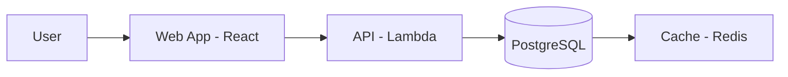

**Fixes applied**:
1. Quoted all labels with parentheses
2. Replaced `()` with `-` where parentheses weren't essential
3. Used proper cylinder syntax for database: `[("...")]`
4. Changed `//` comment to `%%` (Mermaid comment syntax)

---

## Example 2: ER Diagram for Database Schema

### Before (BROKEN) ❌

```mermaid
erDiagram
  USER ||--o{ DOCUMENT : owns
  DOCUMENT ||--o{ CHUNK : contains
  
  USER {
    uuid id PK
    string email
    timestamp created_at  // User registration time
  }
  
  DOCUMENT {
    uuid id PK
    uuid user_id FK  // Foreign key to USER
    text content
    vector embedding  // pgvector type (1536 dims)
  }
```

**Problems**:
1. Comments (`//`) in ER diagram field definitions (3 instances)

### After (FIXED) ✅

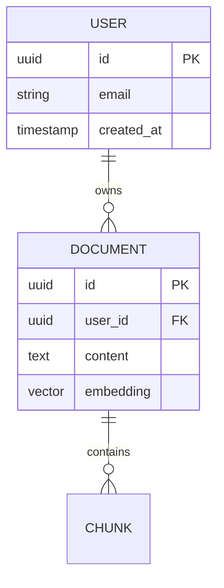

**Additional documentation in markdown**:
```markdown
### Database Schema Notes

- `USER.created_at`: User registration timestamp
- `DOCUMENT.user_id`: Foreign key reference to USER table
- `DOCUMENT.embedding`: pgvector type with 1536 dimensions
```

**Fix applied**:
- Removed all `//` comments from ER diagram
- Added comments in surrounding markdown instead

---

## Example 3: Sequence Diagram with Multiple Actors

### Before (BROKEN) ❌

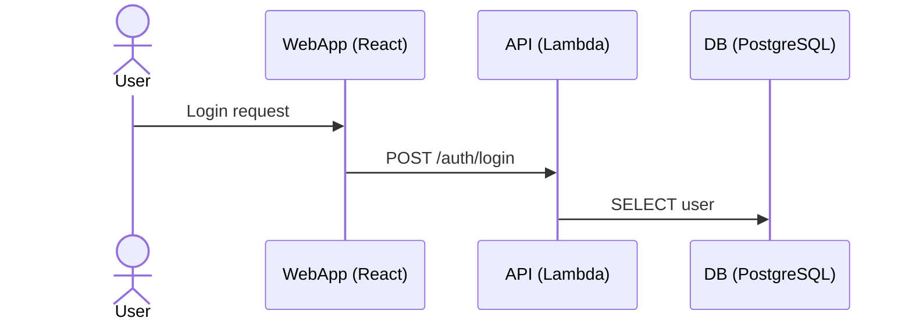

**Problems**:
1. Parentheses in participant names (3 instances)

### After (FIXED) ✅

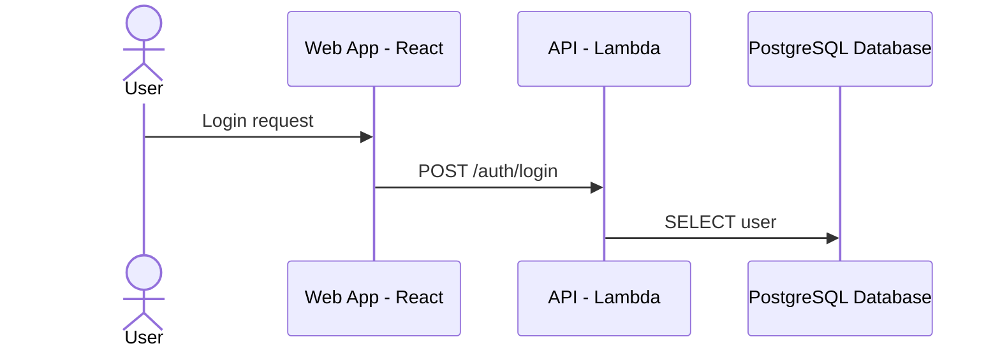

**Fixes applied**:
1. Used `as` aliases for participant names with special characters
2. Simplified participant IDs (WebApp, API, DB)
3. Clear, readable labels without parentheses in base names

---

## Example 4: Complex Architecture Diagram

### Before (BROKEN) ❌

```mermaid
flowchart TB
  subgraph Frontend
    Web[Web (Vite/React)]
    Desktop[Desktop (Electron)]
  end
  
  subgraph Backend
    API[API Gateway: Lambda]
    Worker[Background Worker (Node.js)]
  end
  
  subgraph Data
    DB[(Database (PostgreSQL))]
    Cache[(Redis Cache)]
    S3[S3 Storage (Files)]
  end
  
  Web --> API
  Desktop --> API
  API --> DB
  API --> Cache
  Worker --> DB
  Worker --> S3
```

**Problems**:
1. Multiple unquoted labels with parentheses (6 instances)
2. Colon in unquoted label (1 instance)

### After (FIXED) ✅

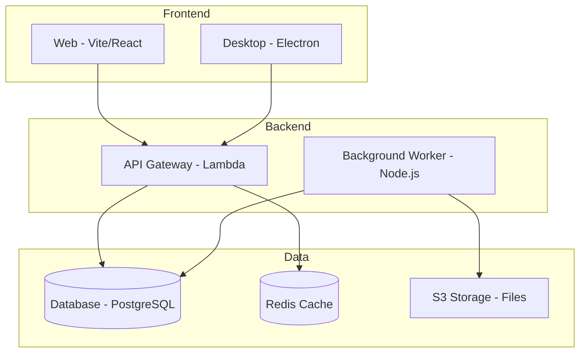

**Fixes applied**:
1. Quoted all labels with special characters
2. Replaced parentheses with dashes where appropriate
3. Used cylinder syntax `[("...")]` for databases
4. Consistent label formatting throughout

---

## Example 5: State Diagram with Transitions

### Before (BROKEN) ❌

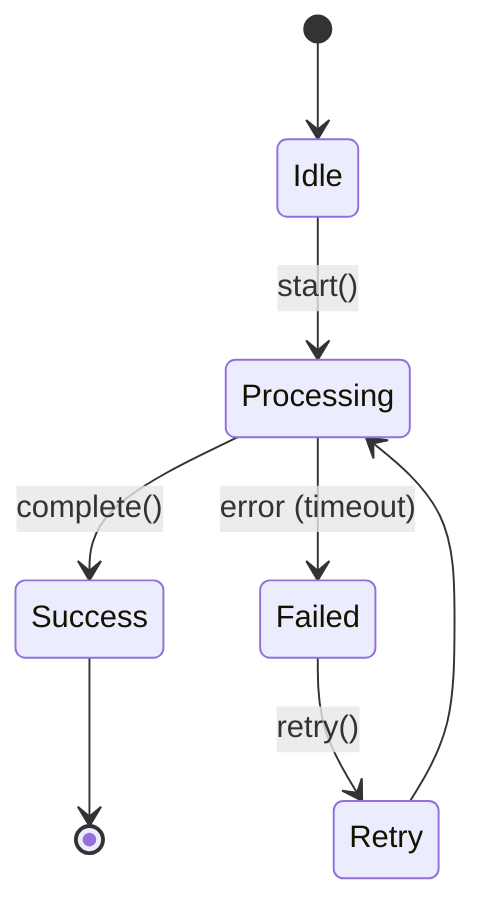

**Problems**:
1. Parentheses in transition label (1 instance)

### After (FIXED) ✅

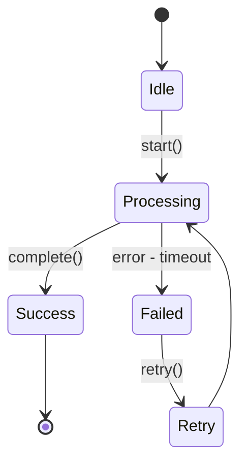

**Fix applied**:
- Replaced `error (timeout)` with `error - timeout`
- Could also use quoted label: `"error (timeout)"` if parentheses are essential

---

## Example 6: Multi-line Labels

### Before (BROKEN) ❌

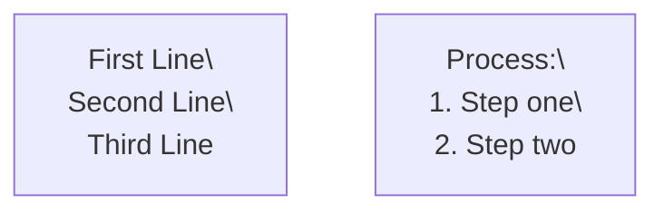

**Problems**:
1. Unquoted multi-line labels with `\\n` (2 instances)
2. Colon in unquoted label

### After (FIXED) ✅

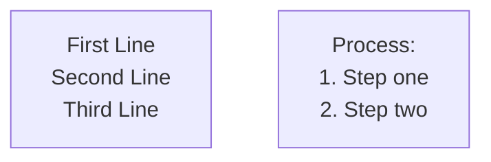

**Fixes applied**:
1. Quoted all labels
2. Used `<br/>` instead of `\\n` (more reliable)
3. Properly escaped special characters

---

## Example 7: Database Architecture with Relationships

### Before (BROKEN) ❌

```mermaid
flowchart LR
  subgraph Apps
    Web[Web App (React/Vite)]
    Desktop[Desktop App (Electron)]
  end
  
  subgraph Storage
    PG[(PostgreSQL: Users/Docs)]
    Vec[(PGVector: Embeddings)]
    Redis[(Redis: Sessions/Cache)]
  end
  
  Web --> PG
  Web --> Vec
  Web --> Redis
  Desktop --> PG
  Desktop --> Vec
```

**Problems**:
1. Multiple parentheses in labels (5 instances)
2. Colons in labels (3 instances)
3. Slashes in labels (2 instances)

### After (FIXED) ✅

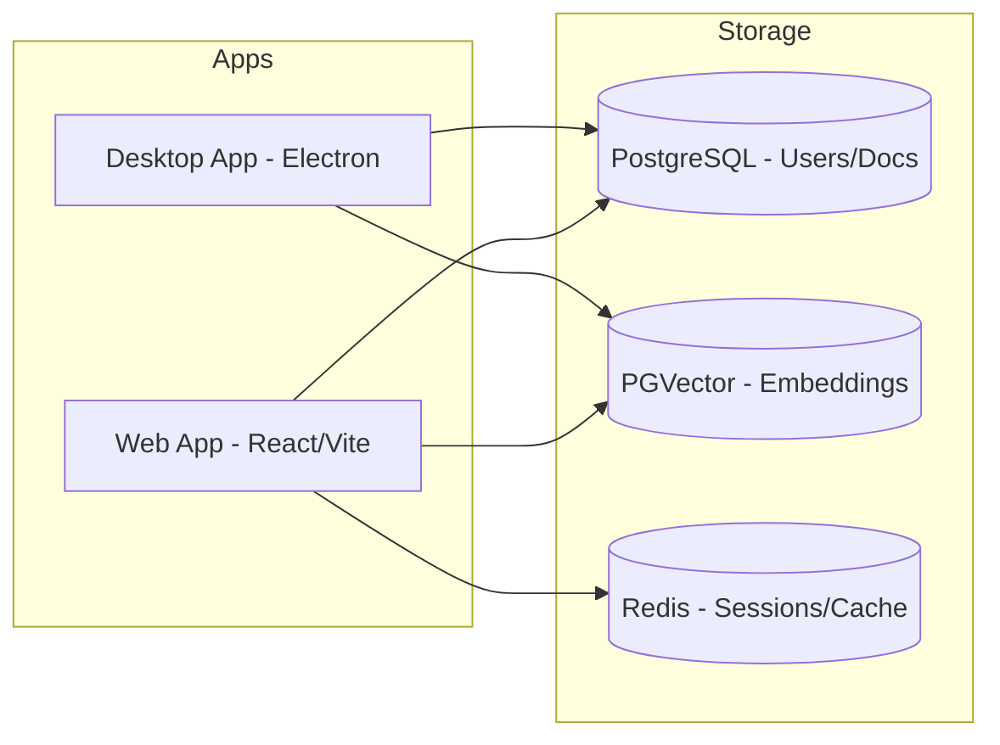

**Fixes applied**:
1. Quoted all labels
2. Used cylinder syntax for all databases: `[("...")]`
3. Kept slashes in quoted labels (safe)
4. Replaced `:` with `-` for clarity

---

## Example 8: Real Project Architecture Diagram

This is from `apps/docs/docs/architecture/02-container-view.md` (simplified):

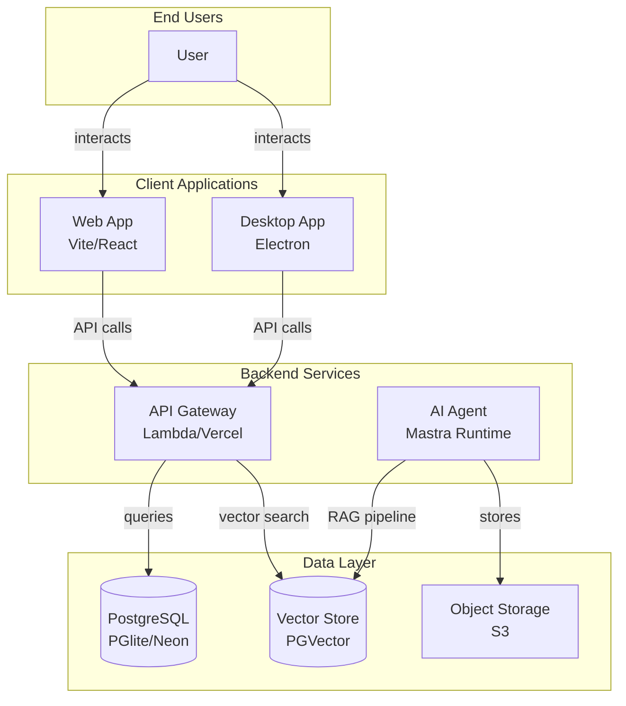

**Best practices demonstrated**:
1. All labels quoted (contain `<br/>`, `/`, or special chars)
2. Cylinder syntax for databases: `[("...")]`
3. `<br/>` for multi-line labels
4. Descriptive subgraph names
5. Clear, semantic node IDs (W, D, API, PG, etc.)
6. Labeled edges showing relationships

---

## Quick Reference: Before/After Patterns

| Before (Wrong) | After (Correct) | Reason |
|---------------|-----------------|--------|
| `[Label (text)]` | `["Label - text"]` | Parentheses need quoting |
| `[Label: text]` | `["Label: text"]` | Colons need quoting |
| `[Line1\\nLine2]` | `["Line1<br/>Line2"]` | Multi-line needs quoting + `<br/>` |
| `field // comment` (ER) | Remove comment | No comments in ER diagrams |
| `[(DB (name))]` | `[("DB - name")]` | Quote cylinder labels with parens |
| `[Path/to/file]` | `["Path/to/file"]` | Slashes need quoting |

---

## Validation Output Examples

### Successful Validation

```bash
$ node .claude/skills/mermaid-diagrams/scripts/validate-mermaid.mjs

Checking apps/docs/docs/architecture/01-system-context.md...
  ✓ Diagram 1: Syntax looks valid

Checking apps/docs/docs/architecture/02-container-view.md...
  ✓ Diagram 1: Syntax looks valid
  ✓ Diagram 2: Syntax looks valid

✅ All Mermaid diagrams pass syntax validation
```

### Failed Validation

```bash
$ node .claude/skills/mermaid-diagrams/scripts/validate-mermaid.mjs

Checking apps/docs/docs/architecture/new-diagram.md...
  ✗ Diagram 1: SYNTAX ERRORS
    Line 3: Parentheses in unquoted label: A[Web App (React)]
    Line 5: Parentheses in unquoted label: DB[(PostgreSQL (PG))]
    Diagram preview:
      flowchart LR
        A[Web App (React)]
        B[API]
        DB[(PostgreSQL (PG))]

❌ Validation found syntax errors
```

**How to fix**:
1. Line 3: Change to `A["Web App - React"]`
2. Line 5: Change to `DB[("PostgreSQL - PG")]`
3. Re-run validation

---

## Summary

These examples show the most common Mermaid syntax errors in the BrainStrike project and how to fix them:

1. **Quote labels** with special characters: `()`, `:`, `,`, `/`, etc.
2. **Use `<br/>`** for multi-line labels
3. **NO comments** in ER diagram field definitions
4. **Cylinder syntax** for databases: `[("Label")]`
5. **Always validate** after editing

For more examples, see the existing architecture diagrams in `apps/docs/docs/architecture/*.md`.
