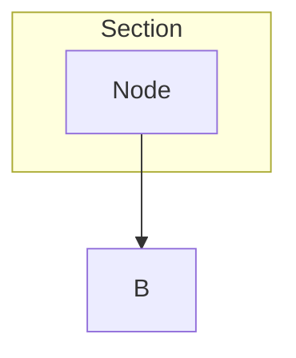
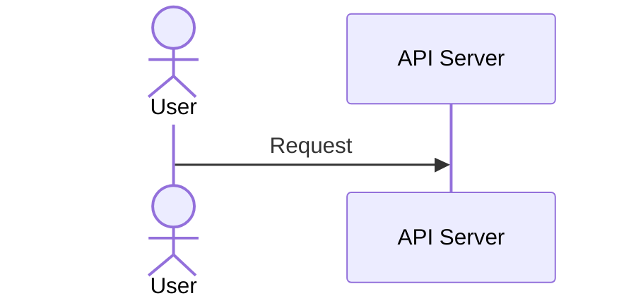
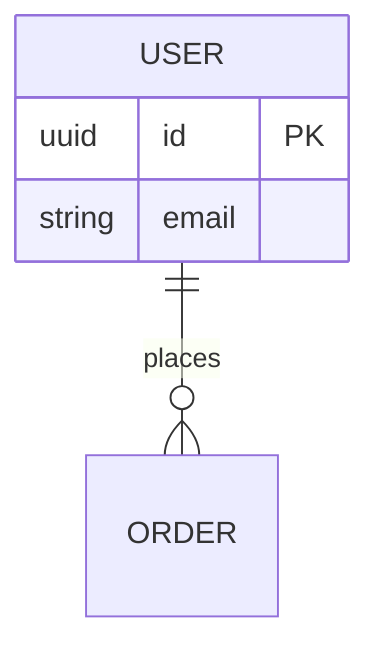
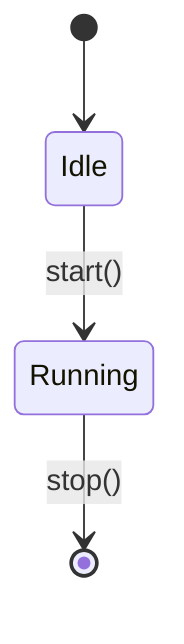

# Mermaid Quick Reference Card

Fast lookup for common patterns and fixes.

## Essential Commands

```bash
# Validate all diagrams
node .claude/skills/mermaid-diagrams/scripts/validate-mermaid.mjs

# Test a single diagram
node .claude/skills/mermaid-diagrams/scripts/test-one-diagram.mjs
```

## Common Fixes (Copy-Paste Ready)

### Parentheses → Quote or Replace

```mermaid
# WRONG
[Web App (React)]

# CORRECT - Option 1: Quote
["Web App (React)"]

# CORRECT - Option 2: Replace
["Web App - React"]
```

### Colons → Quote

```mermaid
# WRONG
[API: Gateway]

# CORRECT
["API: Gateway"]
```

### Slashes → Quote

```mermaid
# WRONG
[src/app/main.ts]

# CORRECT
["src/app/main.ts"]
```

### Line Breaks → Use `<br/>`

```mermaid
# WRONG
[Line 1\\nLine 2]

# CORRECT
["Line 1<br/>Line 2"]
```

### Database Nodes → Cylinder Syntax

```mermaid
# WRONG
[(PostgreSQL (PG))]

# CORRECT
[("PostgreSQL - PG")]
```

### ER Diagram Comments → Remove

```mermaid
# WRONG
erDiagram
  USER {
    uuid id  // Primary key
  }

# CORRECT
erDiagram
  USER {
    uuid id
  }
```

## Node Shapes

| Shape | Syntax | Example |
|-------|--------|---------|
| Rectangle | `[Label]` | `A[Process]` |
| Rounded | `(Label)` | `B(Start)` |
| Stadium | `([Label])` | `C([Event])` |
| Cylinder | `[(Label)]` | `D[(Database)]` |
| Database (quoted) | `[("Label")]` | `E[("PostgreSQL")]` |
| Diamond | `{Label}` | `F{Decision}` |
| Hexagon | `{{Label}}` | `G{{Service}}` |

## Arrow Types

| Type | Syntax | Example |
|------|--------|---------|
| Solid | `-->` | `A --> B` |
| Dotted | `-.->` | `A -.-> B` |
| Thick | `==>` | `A ==> B` |
| Labeled | `-- text -->` | `A --text--> B` |
| Bidirectional | `<-->` | `A <--> B` |

## Diagram Types

### Flowchart



Directions: `TB` (top-bottom), `LR` (left-right), `BT`, `RL`

### Sequence



### ER Diagram



### State Diagram



## Special Characters That Need Quoting

- `()` - Parentheses
- `:` - Colon
- `,` - Comma
- `/` - Slash
- `*` - Asterisk
- `&` - Ampersand
- `@` - At symbol
- `#` - Hash
- `%` - Percent (except in `%%` comments)

## Validation Error Patterns

| Error Message | Fix |
|--------------|-----|
| `Parentheses in unquoted label` | Add quotes: `["Label (text)"]` |
| `Comments not allowed in ER diagrams` | Remove `//` comments |
| Diagram doesn't render on GitHub | Run validation, fix all errors |

## Resources

- Full guide: `apps/docs/docs/reference/tooling/mermaid-guide.md`
- Examples: See `EXAMPLES.md` in this skill
- Live editor: https://mermaid.live/
- Documentation: https://mermaid.js.org/

## Emergency Fix Checklist

When a diagram is broken:

- [ ] Quote all labels with `()`, `:`, `,`, `/`
- [ ] Replace `\\n` with `<br/>` in multi-line labels
- [ ] Remove `//` comments from ER diagrams
- [ ] Use `[("...")]` for database nodes with special chars
- [ ] Run `node .claude/skills/mermaid-diagrams/scripts/validate-mermaid.mjs`
- [ ] All checks pass? ✅ Safe to commit

## Most Common Error (90% of cases)

**Unquoted parentheses in labels**

```mermaid
# WRONG ❌
A[Web App (React)]

# CORRECT ✅
A["Web App - React"]
```

**Remember**: When in doubt, quote the label!
