# Mermaid Diagram Validation & Best Practices

Expert guidance for creating and maintaining error-free Mermaid diagrams in the BrainStrike project.

## Critical Rule

**⚠️ ALWAYS run validation after ANY diagram edit:**

```bash
node .claude/skills/mermaid-diagrams/scripts/validate-mermaid.mjs
```

**Never commit diagram changes without validation.** The validation script catches syntax errors that GitHub's renderer will reject.

## Quick Reference: Common Errors

### 1. Parentheses in Unquoted Labels ⚠️ MOST COMMON ERROR

**WRONG** ❌:
```mermaid
flowchart LR
  A[Web App (Vite/React)]
  B[Lambda: Auth (verify)]
```

**CORRECT** ✅:
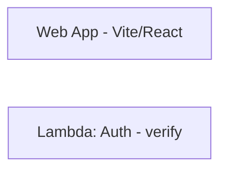

**Or quote the entire label:**
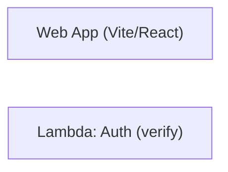

**Rule**: If a label contains `()`, `:`, `,`, `/`, or other special characters, **quote it with double quotes**.

### 2. Comments in ER Diagrams ❌ NOT ALLOWED

**WRONG** ❌:
```mermaid
erDiagram
  USER {
    uuid id PK
    vector vec  // pgvector type
  }
```

**CORRECT** ✅:
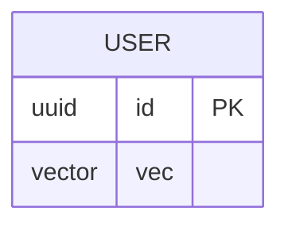

**Rule**: ER diagrams do NOT support `//` comments. Add notes in the surrounding markdown instead.

### 3. Line Breaks in Labels

**RECOMMENDED** ✅:
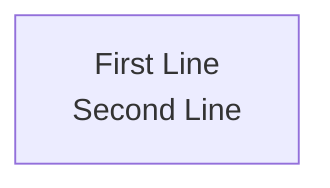

**ALSO WORKS** (quoted labels only):
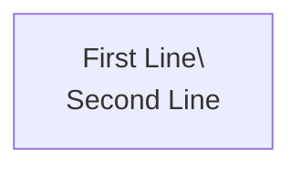

**Rule**: Use `<br/>` for line breaks (works everywhere). `\\n` only works in quoted labels.

### 4. Special Characters Require Quoting

Characters that need quoting: `()`, `:`, `,`, `/`, `*`, `&`, `@`, etc.

**WRONG** ❌:
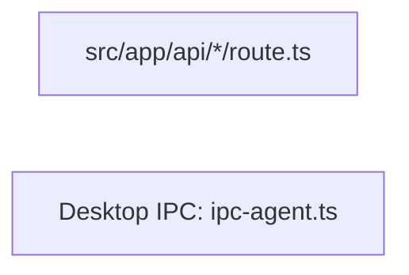

**CORRECT** ✅:


## Node Shapes Quick Reference

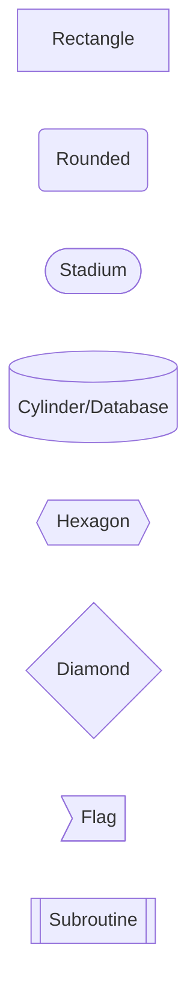

**Special Case - Cylinder/Database Nodes:**

The `[(` and `)]` syntax is valid for cylinder nodes:

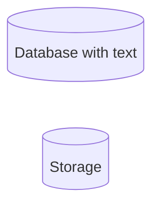

This is the ONLY valid use of parentheses without outer quotes.

## Validation Scripts

### Primary Validation Script

**Location**: `.claude/skills/mermaid-diagrams/scripts/validate-mermaid.mjs`

**What it checks**:
- Unquoted parentheses in labels
- Invalid comments in ER diagrams
- Common syntax violations

**Usage**:
```bash
# From project root
node .claude/skills/mermaid-diagrams/scripts/validate-mermaid.mjs
```

**Output on success**:
```
✅ All Mermaid diagrams pass syntax validation
```

**Output on errors**:
```
✗ Diagram 1: SYNTAX ERRORS
  Line 5: Parentheses in unquoted label: Node[Label (error)]
```

### Test Script (For Development)

**Location**: `.claude/skills/mermaid-diagrams/scripts/test-one-diagram.mjs`

**Purpose**: Test a single diagram in isolation

**Usage**: Edit the diagram in the script, then run:
```bash
node .claude/skills/mermaid-diagrams/scripts/test-one-diagram.mjs
```

## Workflow for Creating/Editing Diagrams

### Step-by-Step Process

1. **Create or edit** the Mermaid diagram in markdown

2. **Run validation immediately**:
   ```bash
   node .claude/skills/mermaid-diagrams/scripts/validate-mermaid.mjs
   ```

3. **Fix any errors** reported by the script

4. **Test in GitHub** (optional but recommended):
   - Push to a branch
   - Check rendering on GitHub
   - GitHub's Mermaid renderer is strict - if validation passes, GitHub should render correctly

5. **Commit** only after validation passes

### When Validation Fails

1. **Read the error message carefully**:
   ```
   ✗ Diagram 1: SYNTAX ERRORS
     Line 5: Parentheses in unquoted label: Node[Label (error)]
     Diagram preview:
       flowchart LR
         A[Start]
         B[Process (step 1)]  ← Error here!
   ```

2. **Apply the fix** based on error type:
   - Parentheses error → Quote the label or replace `()` with `-`
   - Comment error → Remove `//` comments from ER diagram
   - Special character error → Quote the entire label

3. **Re-run validation** until it passes

4. **Commit** the fixed diagram

## Common Diagram Types

### Flowcharts (Most Common)

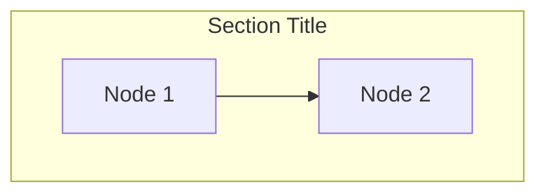

**Directions**: `TB` (top-bottom), `LR` (left-right), `BT`, `RL`

**Best practices**:
- Use descriptive node IDs (e.g., `API` not `A`)
- Group related nodes in subgraphs
- Quote all labels with special characters
- Use `<br/>` for multi-line labels

### Sequence Diagrams

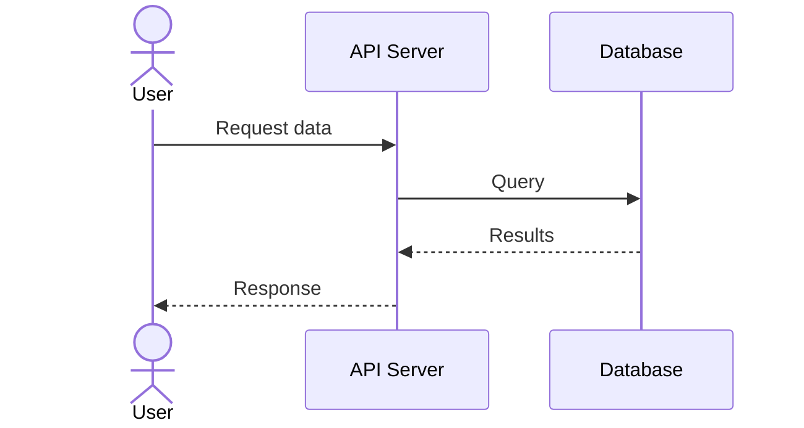

**Key points**:
- No parentheses in participant names without quotes
- Use `as` for aliases
- Use `actor` for user-type participants

### ER Diagrams

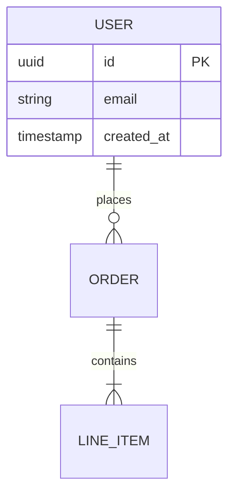

**Key points**:
- **NO comments allowed** in field definitions
- Use relationship syntax: `||--o{` (one-to-many), `||--||` (one-to-one)
- Document field meanings in surrounding markdown, NOT in diagram

### State Diagrams

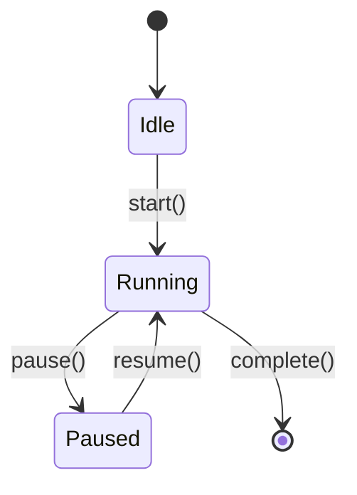

## Architecture Diagrams (Project-Specific)

**Location**: `docs/architecture/*.md`

**Naming convention**: Use 2-digit numbers: `01-system-context.md`, `02-container-view.md`, etc.

**Follow C4 model conventions**:
- Level 1: System Context
- Level 2: Container View
- Level 3: Component View
- Level 4: Code View

**Best practices**:
- Keep diagrams focused (split complex ones)
- Add verification notes for assumptions
- Use consistent terminology across diagrams
- Quote all labels with special characters

## Best Practices

### 1. Consistency

- Use double quotes `"` for all quoted labels
- Use `<br/>` for line breaks (not `\\n`)
- Use descriptive node IDs (e.g., `WebApp` not `A`)
- Be consistent with arrow styles

### 2. Readability

- Add subgraphs to organize complex diagrams
- Use meaningful labels that explain the node's purpose
- Keep diagrams focused on one concept
- Split overly complex diagrams into multiple simpler ones

### 3. Maintainability

- **Always validate** after edits: `node .claude/skills/mermaid-diagrams/scripts/validate-mermaid.mjs`
- Add comments in markdown text, NOT in diagrams (except flowchart `%%` comments)
- Document diagram purpose in surrounding text
- Use consistent naming across related diagrams

### 4. Testing

- Run validation script after every edit
- Test rendering on GitHub when possible
- Use Mermaid Live Editor for complex diagrams: https://mermaid.live/
- Keep validation output clean (no warnings)

## Troubleshooting

### Problem: Validation Script Fails to Run

**Check**:
1. Running from project root: `pwd` should show `brainstrike` directory
2. Dependencies installed: `pnpm install`
3. Script exists: `ls .claude/skills/mermaid-diagrams/scripts/validate-mermaid.mjs`

### Problem: Diagram Looks Wrong on GitHub

**Cause**: GitHub's Mermaid renderer is strict about syntax

**Solution**:
1. Run `node .claude/skills/mermaid-diagrams/scripts/validate-mermaid.mjs`
2. Fix all reported errors
3. Test in Mermaid Live Editor: https://mermaid.live/
4. Push again after fixes

### Problem: Need Parentheses in Label

**Solutions (in order of preference)**:
1. Replace with dashes: `["Label - with dashes"]`
2. Quote the entire label: `["Label (with parens)"]`
3. For database nodes only: `[("DB (PostgreSQL)")]`

### Problem: Multi-line Labels Don't Work

**Solution**:
- Use `<br/>` in quoted labels: `["Line 1<br/>Line 2"]`
- Or use `\\n` in quoted labels: `["Line 1\\nLine 2"]`
- Never use unquoted multi-line labels

## Resources

- **Full Guide**: `docs/mermaid-guide.md` (comprehensive reference)
- **Mermaid Documentation**: https://mermaid.js.org/
- **Live Editor**: https://mermaid.live/ (test diagrams interactively)
- **Syntax Reference**: https://mermaid.js.org/syntax/
- **Validation Script**: `.claude/skills/mermaid-diagrams/scripts/validate-mermaid.mjs`
- **Test Script**: `.claude/skills/mermaid-diagrams/scripts/test-one-diagram.mjs`
- **Architecture Docs**: `docs/architecture/` (examples of well-formed diagrams)

## Instructions for Claude

When creating or editing Mermaid diagrams:

1. **Check existing diagrams** first:
   - Use `Grep` to search for similar diagrams
   - Use `Read` to examine existing architecture docs
   - Follow the established patterns

2. **Create the diagram**:
   - Quote ALL labels with special characters
   - Use `<br/>` for line breaks
   - NO comments in ER diagrams
   - Use descriptive node IDs

3. **Validate IMMEDIATELY**:
   ```bash
   node .claude/skills/mermaid-diagrams/scripts/validate-mermaid.mjs
   ```

4. **Fix any errors**:
   - Read error messages carefully
   - Apply fixes from Quick Reference above
   - Re-validate until clean

5. **Provide context**:
   - Show the user the validation output
   - Explain what was fixed if errors were found
   - Confirm the diagram is valid before finishing

6. **For complex diagrams**:
   - Consider splitting into multiple simpler diagrams
   - Add subgraphs for organization
   - Keep related concepts together

7. **Reference the full guide** when needed:
   - For detailed syntax rules: `docs/mermaid-guide.md`
   - For examples: `docs/architecture/*.md`

## Example: Creating a Valid Diagram

**User asks**: "Create a flowchart showing the authentication flow"

**Your response should include**:

1. **The diagram**:
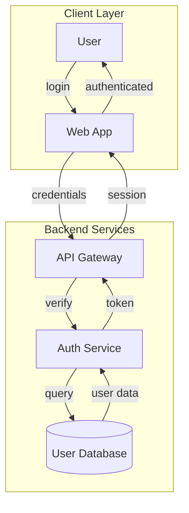

2. **Validation**:
```bash
node .claude/skills/mermaid-diagrams/scripts/validate-mermaid.mjs
```

3. **Confirmation**:
```
✅ All Mermaid diagrams pass syntax validation
```

4. **Explanation**:
"Created authentication flow diagram with:
- All labels quoted (special characters and colons)
- Database node using proper cylinder syntax: `[("...")]`
- Subgraphs for logical grouping
- Descriptive node IDs
- Validated successfully ✓"

## Summary

- ✅ **ALWAYS validate**: `node .claude/skills/mermaid-diagrams/scripts/validate-mermaid.mjs`
- ✅ **Quote labels** with special characters: `["Label (text)"]`
- ✅ **Use `<br/>`** for line breaks
- ✅ **NO comments** in ER diagrams
- ✅ **Test before commit**: Validation must pass
- ✅ **Reference full guide**: `docs/mermaid-guide.md`

**Remember**: Manual edits to Mermaid diagrams are error-prone. Validation is not optional - it's mandatory!

