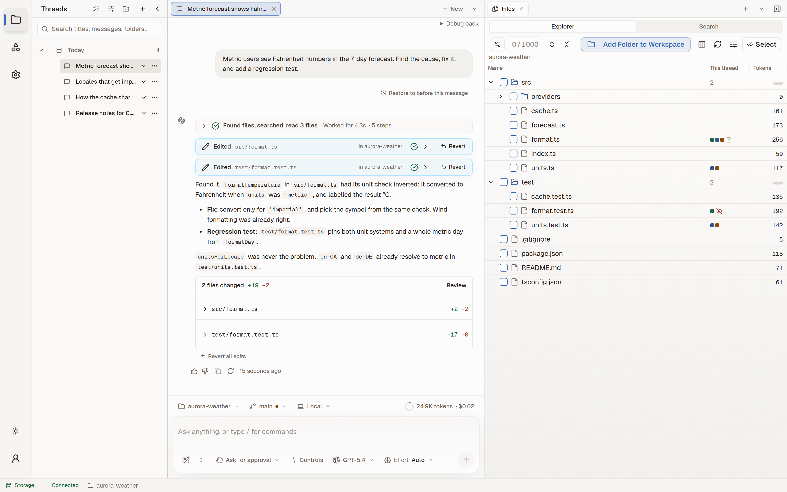
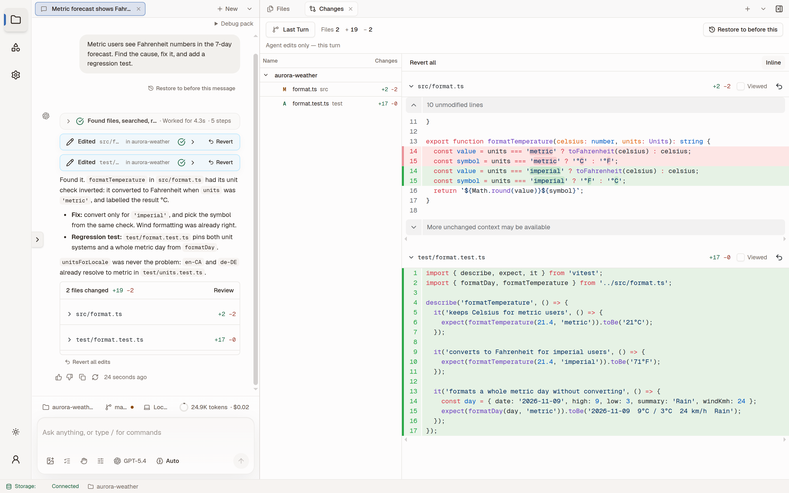

<p align="center">
  <a href="https://brainstrike.ai"></a>
</p>

<p align="center">
  <a href="https://brainstrike.ai"></a>
  <a href="https://github.com/seandearnaley/brainstrike/actions/workflows/nightly.yml"></a>
  <a href="https://app.codecov.io/github/seandearnaley/brainstrike"></a>
  <a href="LICENSE"></a>
  
</p>

<p align="center">
  <strong>Brainstrike runs agents inside your folders and shows you every step.</strong><br>
  Every file it reads, search it runs and line it changes is on screen, ready to review, revert or redirect.<br>
  A desktop app for macOS, Windows and Linux, in beta.
</p>

<p align="center">
  <a href="https://brainstrike.ai"><strong>Download</strong></a> ·
  <a href="https://github.com/seandearnaley/brainstrike-releases/releases">Release notes</a> ·
  <a href="CONTRIBUTING.md">Contributing</a> ·
  <a href="docs/adr/">Design decisions</a>
</p>

<picture>
  <source media="(prefers-color-scheme: dark)" srcset="assets/readme/thread-dark.webp">
  <source media="(prefers-color-scheme: light)" srcset="assets/readme/thread-light.webp">
  
</picture>

## Features

### Watch the work

- **Every step in the thread.** Searches, file reads, edits, commands, plans and approvals appear as they happen, grouped per turn with how long it worked.
- **You choose how much it asks.** *Ask for approval* stops before every edit or command; *Auto* lets a quick model approve routine actions and asks only for risky ones; *Full access* runs unattended. Plan mode, task lists and questions back to you are built in.
- **Subagents you can follow.** The agent hands work to Explorer, Analyst and Worker helpers that run in the background as live cards, each on the model you pick for it.

### Review every change

- **Each turn lists what it changed**, including side effects from commands, and opens in the Changes tab, drawn from git's own patch.
- **Stage, unstage or revert** by hunk, file or whole turn. *Restore to before this message* rewinds a thread, reverts the runs it started and puts your prompt back to edit.
- **Comment on a diff line** and the comment goes into your next message, with the file, line and code quoted.

<picture>
  <source media="(prefers-color-scheme: dark)" srcset="assets/readme/review-dark.webp">
  <source media="(prefers-color-scheme: light)" srcset="assets/readme/review-light.webp">
  
</picture>

### Work in your repository

- **Worktrees as thread checkouts.** A thread can work in its own git worktree, shown on the branch chip and the Worktrees map.
- **Sandboxed commands.** On macOS and Linux, shell commands and the bundled Python run inside an OS sandbox. Long-running command sessions and a Terminal tab sit beside the thread.
- **See what the model sees.** The explorer marks the files each thread touched and their token counts, Search greps the live files with ripgrep, and the Context map shows what each model call received, with a lane per subagent.

### Bring your models and tools

- **Hosted models with your own key:** OpenAI, Anthropic, Google AI Studio (Gemini), OpenRouter and Amazon Bedrock. Saved keys are encrypted with the operating system's credential store.
- **MCP servers** over stdio, Streamable HTTP or SSE, with OAuth sign-in, a catalog with Linear, GitHub, Atlassian, GitLab and Suno, MCP Apps, and server prompts as slash commands.
- **Agent Skills** from `.brainstrike/skills` or `.claude/skills`, plus `AGENTS.md` and `CLAUDE.md` instructions and hooks, loaded only from folders you trust.
- **The web.** An agent browser that navigates, clicks and types behind an egress proxy, and web search through the provider's own search or Tavily.

### Pick up where you left off

- **Thread search** over titles, messages and folders, and **branching**: edit any message to try another path, then step between branches.
- **Memory:** Mastra's observational and working memory keep long threads in context, per thread or shared across them.
- **Canvas and Artifacts**, cost tracking, notifications, a tray icon that keeps runs going with the window closed, in-app updates with a beta channel, and light and dark themes with your own fonts.

> [!NOTE]
> Brainstrike is in beta. On Windows, commands run without a sandbox, no Python is bundled, and the installer is not yet code-signed, so SmartScreen warns before it runs.

## Install

Download the build for your platform from **[brainstrike.ai](https://brainstrike.ai)**, then add a key for one of the providers in Settings.

| Platform | Build |
| --- | --- |
| macOS 12 or later | DMG for Apple silicon or Intel, signed and notarized |
| Windows 10 or 11 | x64 installer |
| Linux | AppImage for x64 or arm64: `chmod +x`, then run it |

Every release lists its SHA-256 checksums in `SHA256SUMS`. Installers and release notes are published in [brainstrike-releases](https://github.com/seandearnaley/brainstrike-releases/releases).

## Build from source

Use the Node version in [`.nvmrc`](.nvmrc) and the pnpm version in [`package.json`](package.json), then from the repository root:

```sh
pnpm install
pnpm build
pnpm dev --filter @brainstrike/desktop
```

[CONTRIBUTING.md](CONTRIBUTING.md) covers the checks, the merge queue and the build and test configuration.

## How it's built

- **Desktop:** Electron hosts the React UI. A separate agent host process owns runs, conversations and workspace access, and records them in its SQLite state store; the window can close while it works.
- **Runs:** the [AI SDK](https://ai-sdk.dev) drives the model loop, and Mastra supplies only memory. Every model is hosted; nothing runs locally.
- **Search:** threads are searched through a local SQLite FTS5 index, and workspaces with ripgrep.
- **Stack:** TypeScript, React, Electron, Effect, Vite, Vitest, Playwright, Tailwind CSS, Turborepo and pnpm workspaces.
- **Docs:** [design decisions](docs/adr/) and [subsystem contracts](docs/agents/).

## License

[MIT](LICENSE) © 2024 Sean Dearnaley. Package-specific notices stay with each package.
