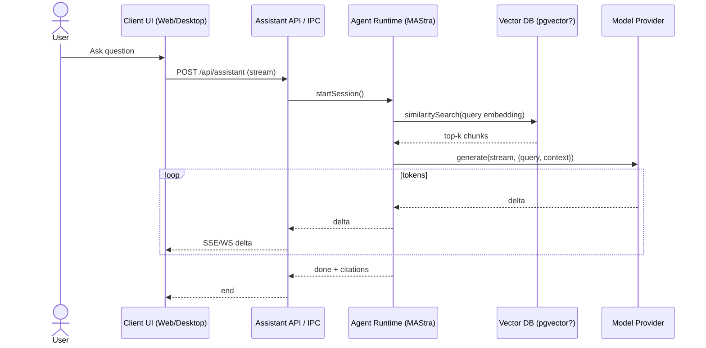

# Chat & RAG Path (Assistant)

**Blocking points**
- DB vector search latency (tune HNSW/IVFFlat or pgvector parameters if used).
- Provider request rate limits → use retry/backoff and cost-aware batching.
- Streaming stability — ensure *exactly-once* stream termination and client abort handling (see `docs/abort-signal-flow.md` if present).
