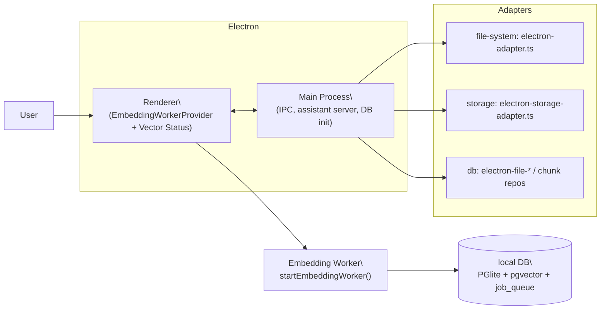

# Desktop App (Electron) Overview

**Notes**
- Desktop keeps embedding work in the renderer for privacy and to ensure Web Workers are available for local models.
- Hosted embedding providers (OpenAI/Google) still run in the renderer today; main process remains IPC + lifecycle only.
- DB providers/repositories have electron-specific implementations for performance and sandboxing.
