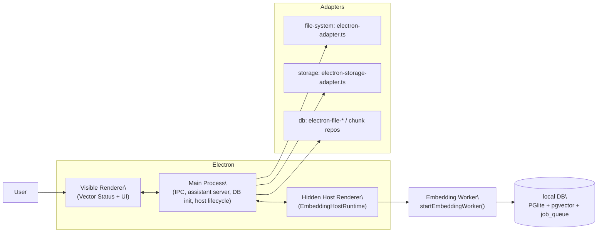

# Desktop App (Electron) Overview

**Notes**
- Desktop keeps embedding work in renderer context for privacy and to ensure Web Workers are available for local models.
- The visible window no longer starts the worker. Electron main owns a hidden host `BrowserWindow` and exposes lifecycle/status through `window.embeddingHost`.
- Hosted embedding providers (OpenAI/Google) still run through the same hidden renderer worker path today; main process remains IPC + lifecycle only.
- Only the hidden host disables `backgroundThrottling`; the visible window explicitly keeps
  Chromium background throttling enabled.
- DB providers/repositories have electron-specific implementations for performance and sandboxing.
