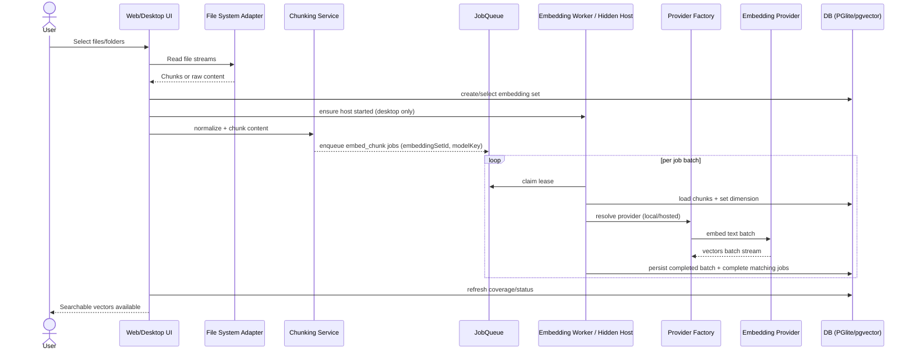
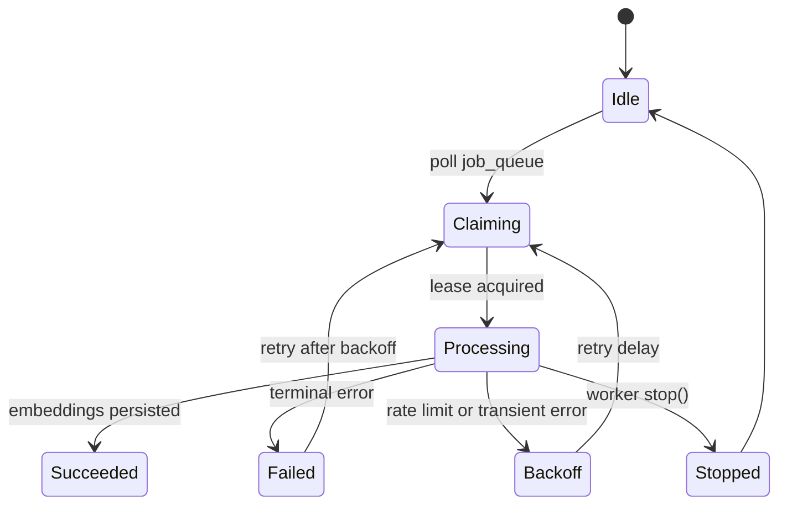

# Embedding Pipeline (Flows, Sequences, and State)

## 3.1 High-Level Flow

**Status**: The durable queue + embedding worker path below is live.
`@brainstrike/pipeline` now owns the durable embedding job queue port used by
`packages/db-explorer/src/enhanced-file-import-service.ts` when
`EMBED_QUEUE_ENABLED=true`. Streaming orchestrator stages still exist for
higher-level workflow ownership, but the package is no longer dormant or
ambiguous.

```mermaid
flowchart LR
  A["Source Ingest\\nfile picker, folder, drag-drop, etc."] --> B["Chunking Service\\npackages/db/src/services/chunking-service.ts"]
  B --> C["Create/Select Embedding Set\\nembedding_sets (model_key, dimensions)"]
  C --> D["JobQueue Enqueue\\npackages/db/src/queue/job-queue.ts"]
  D --> E{Runtime}
  E -->|Web| F["Renderer Worker\\nstartEmbeddingWorker()"]
  E -->|Desktop| G["Hidden Host Renderer\\nEmbeddingHostRuntime"]
  F & G --> H["Provider Resolution\\nprovider::modelId + models table"]
  H --> I{Provider Type}
  I -->|Local| J["TransformersBackend\\nWebGPU/WASM"]
  I -->|Hosted| K["Hosted Provider\\nOpenAI/Google"]
  J & K --> L["Optional Embedding Cache\\nembedding_cache (BST-170)"]
  L --> M["Persist to DB\\nfile_chunks + job_queue"]
  M --> N["Vector Status UI\\npackages/vector-management"]
```

## 3.2 Sequence — File Import ➜ Searchable Vectors

## 3.3 Worker State Machine

## 3.4 Backpressure & Throughput (Guidance)

- Keep job payloads *small and uniform* (chunk IDs + embeddingSetId + modelKey). Avoid large text blobs in the queue payload.
- Desktop visible windows do not run the worker directly. They proxy lifecycle/status through `window.embeddingHost` while a hidden renderer owns inference.
- Use provider-side batching where supported; otherwise N-way parallelism at the worker level.
- Persist *incrementally* to DB to make progress visible in `vector-status` and to enable partial search.
- Hosted providers require API keys; the worker currently supports OpenAI and Google. Cohere/Voyage providers exist in `@brainstrike/embeddings` but are not wired into the worker yet.
- The optional `embedding_cache` can dedupe content-level embeddings across chunks when injected into `startEmbeddingWorker`.
