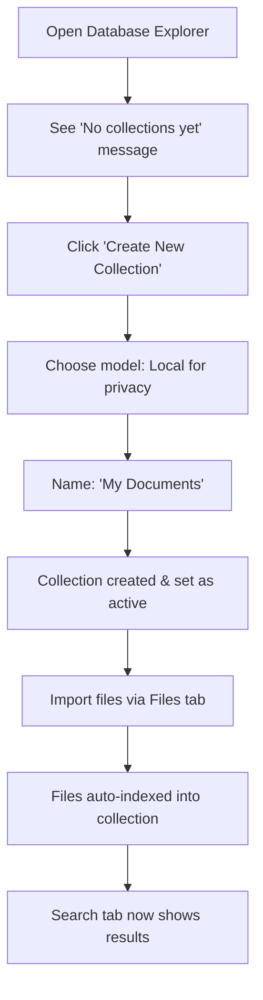
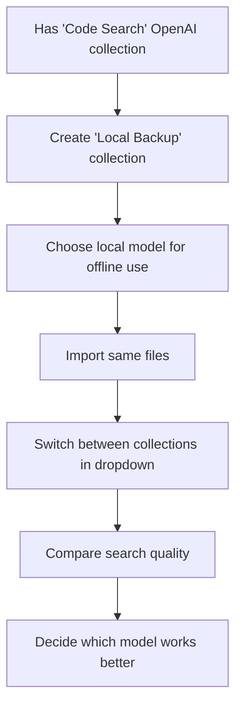
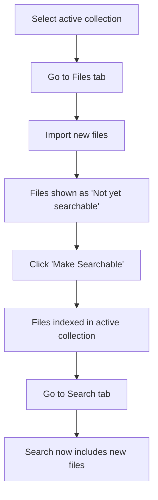

# Search Collections UX Redesign

**Epic**: brainstrike-d537
**Status**: In Planning
**Created**: 2025-11-01
**Author**: Claude & Sean

## Executive Summary

This design document outlines a comprehensive UX redesign for the Database Explorer panel, replacing technical "embedding set" terminology with user-friendly "search collections" and restructuring the interface to make the active collection the primary working context.

## Problem Statement

### Current Issues

1. **Confusing Terminology**: "Embedding sets" and "dimensions" are technical concepts that confuse non-technical users
2. **Disconnected Actions**: Import → Model Selection → Embedding Set → Search are separate, non-obvious steps
3. **Hidden Dependencies**: Users can't see that search depends on embedding set, which depends on model
4. **Redundant Controls**: Model/set selection appears in multiple places (Vector Status, Import Settings)
5. **Wrong Hierarchy**: "Active Embedding Set" is buried instead of being the primary context selector

### User Mental Model Mismatch

Users think:
> "I want to search my files"

System requires:
> "Pick model → Create set → Import files → Embed → Search"

## Solution Overview

Replace the technical embedding model with a familiar **"Collections"** metaphor that users understand from:
- Email (Gmail collections/labels)
- Photos (albums/collections)
- Music (playlists/collections)
- Documents (folders/collections)

## Proposed Design

### Visual Mockup

```
┌──────────────────────────────────────────────────────────────────┐
│ 🗄️ Database Explorer                          [Connected ✓]      │
├──────────────────────────────────────────────────────────────────┤
│                                                                   │
│ 💡 Your Search Collection                                        │
│ ┌──────────────────────────────────────────────────────────────┐ │
│ │ You're searching in:                                         │ │
│ │                                                              │ │
│ │ [📦 Code Search (OpenAI)                            ▼]      │ │
│ │                                                              │ │
│ │ • 1,234 documents indexed                                   │ │
│ │ • Last updated 2 minutes ago                                │ │
│ │ • Best for: code and technical content                      │ │
│ │                                                              │ │
│ │ ℹ️  Why different collections?                               │ │
│ │ Different AI models "understand" content differently.        │ │
│ │ Create separate collections to compare search quality.       │ │
│ │                                                              │ │
│ │ [📋 Manage Collections]  [➕ Create New Collection]          │ │
│ └──────────────────────────────────────────────────────────────┘ │
│                                                                   │
│ ┌──────────────────────────────────────────────────────────────┐ │
│ │ 📁 Files  │  🔍 Search  │  ⚙️ Settings                        │ │
│ └──────────────────────────────────────────────────────────────┘ │
│                                                                   │
│ [Tab content below...]                                           │
└──────────────────────────────────────────────────────────────────┘
```

### Collection Selector Dropdown

```
┌─────────────────────────────────────────────────────────┐
│ Select a search collection:                             │
├─────────────────────────────────────────────────────────┤
│ 📦 Code Search (OpenAI)                         ✓       │
│    1,234 docs • Fast & accurate for code                │
│    ────────────────────────────────────────────────     │
│ 📦 General Content (Local)                              │
│    856 docs • Works offline, great for privacy          │
│    ────────────────────────────────────────────────     │
│ 📦 Multilingual Docs (Cohere)                           │
│    432 docs • Best for non-English content              │
│    ────────────────────────────────────────────────     │
│ ➕ Create New Collection...                             │
└─────────────────────────────────────────────────────────┘
```

### Create Collection Dialog

```
┌──────────────────────────────────────────────────────────┐
│ Create a New Search Collection                           │
├──────────────────────────────────────────────────────────┤
│                                                          │
│ Name your collection:                                    │
│ [Code Search                                        ]    │
│                                                          │
│ Choose an AI model:                                      │
│ ┌────────────────────────────────────────────────────┐  │
│ │ ○ OpenAI (text-embedding-3-small)                  │  │
│ │   💰 Best for: Code, technical docs                │  │
│ │   💡 Cost: ~$0.02 per 1000 docs                    │  │
│ │   🌐 Requires internet & API key                   │  │
│ │                                                    │  │
│ │ ● Local Model (jinaai/jina-embeddings-v2-base-code) │  │
│ │   🔒 Best for: Privacy, offline use                │  │
│ │   💡 Cost: Free                                    │  │
│ │   📱 Runs on your device                           │  │
│ │                                                    │  │
│ │ ○ Cohere (embed-multilingual)                      │  │
│ │   🌍 Best for: 100+ languages                      │  │
│ │   💡 Cost: ~$0.10 per 1000 docs                    │  │
│ │   🌐 Requires internet & API key                   │  │
│ └────────────────────────────────────────────────────┘  │
│                                                          │
│ Description (optional):                                  │
│ [Best for searching code files and technical docs  ]    │
│                                                          │
│ Tags (optional):                                         │
│ [code, programming, technical                       ]    │
│                                                          │
│ ℹ️  Collections are like separate search indexes.        │
│    You can switch between them anytime to compare        │
│    search results from different AI models.              │
│                                                          │
│ [Cancel]                              [Create Collection]│
└──────────────────────────────────────────────────────────┘
```

### Files Tab with Collection Context

```
📁 Your Files (Searching in: Code Search)

┌──────────────────────────────────────────────────────┐
│ 📄 config.ts (1.2 KB)                                │
│    ✅ Searchable in this collection                  │
│    3 chunks • Last indexed 5 minutes ago             │
│    [🔄 Re-index]  [🗑️ Delete]                        │
│                                                      │
│ 📄 README.md (4.5 KB)                                │
│    ⚠️  Not yet searchable                            │
│    12 chunks created • Needs indexing                │
│    [⚡ Make Searchable] ← Add to Code Search         │
│                                                      │
│ 📄 api.py (3.8 KB)                                   │
│    ✅ Searchable in this collection                  │
│    📊 Also searchable in 2 other collections         │
│    8 chunks • Last indexed 1 hour ago                │
│    [🔄 Re-index]  [🗑️ Delete]                        │
└──────────────────────────────────────────────────────┘

💡 Tip: Files need to be "indexed" before you can search them.
   Click "Make Searchable" to add files to your active collection.
```

### Search Tab with Collection Context

```
🔍 Search Your Files

Searching in: 📦 Code Search (OpenAI)
             1,234 documents available to search

[                    search query...                    ]

───────────────────────────────────────────────────────

Results (showing 5 of 23):

📄 config.ts
   ...configuration options for the database connection...
   Collection: Code Search • 95% match

📄 database.py
   ...initialize the connection pool and set timeout...
   Collection: Code Search • 87% match

───────────────────────────────────────────────────────

💡 Not finding what you need?
   • Try searching in a different collection
   • Make sure your files are indexed (see Files tab)
   • Switch to "General Content" collection for broader results
```

## Information Architecture Changes

### Old Structure
```
Database Explorer
├── Import (tab)
│   └── Choose files, embed with model X
├── Browse Files (tab)
│   └── View all files
├── Search (tab)
│   └── Search (but in which embedding set?)
├── Import Settings (tab)
│   └── Model selection (redundant)
└── Vector Status (separate panel)
    └── Active Embedding Set (buried)
```

### New Structure
```
Database Explorer
├── Search Collection (header - ALWAYS VISIBLE)
│   ├── Active collection dropdown
│   ├── Stats (doc count, last updated)
│   ├── Help tooltip
│   └── Manage/Create buttons
├── Files (tab)
│   ├── Shows collection-specific status
│   ├── Inline embed actions
│   └── Import files (auto-chunks)
├── Search (tab)
│   ├── Collection context visible
│   ├── Search in active collection
│   └── Quick switcher
└── Settings (tab)
    └── Chunking preferences only

Vector Status (separate panel)
├── Queue stats
├── Worker controls
└── Backfill (uses active collection from context)
```

## Data Model (No Changes Required)

The existing schema is correct:

```
┌─────────────────┐
│  file_records   │
│  (id)           │
└────────┬────────┘
         │
         │ ON DELETE CASCADE
         │ (MANDATORY)
         ↓
┌─────────────────┐         ┌──────────────────┐
│  file_chunks    │         │ embedding_sets   │
│  file_record_id │────┬───→│ (id)             │
│  embedding_set_id    │    │ model_key        │
└─────────────────┘    │    │ dimensions       │
                       │    │ distance         │
                    OPTIONAL └──────────────────┘
                  (NO FK)
```

**Key Properties:**
- Chunks MUST belong to a file (FK enforced)
- Chunks MAY belong to an embedding set (optional, for backward compat)
- One file CAN have chunks in multiple sets (not currently used)
- Application enforces set requirement for searches (dimension safety)

## User Flows

### Flow 1: First-Time User



### Flow 2: Power User with Multiple Models



### Flow 3: Import and Search



## Terminology Mapping

| Old (Technical) | New (User-Friendly) | Context |
|----------------|---------------------|---------|
| Embedding Set | Search Collection | Primary term |
| Active Embedding Set | Current Collection | Selection context |
| Model Key | AI Model | Model selection |
| Dimensions | (hidden from users) | Technical detail |
| Distance Metric | (hidden from users) | Technical detail |
| Embed | Index / Make Searchable | Action |
| Has Embeddings | Searchable | Status |
| Chunk | Document segment | When needed |
| Vector Search | Semantic Search | Search type |

## Component Architecture

```
SearchCollectionSelector (new)
├── CollectionDropdown
│   ├── ActiveCollectionDisplay
│   │   ├── Name + Model
│   │   ├── Stats (doc count, updated)
│   │   └── Help tooltip
│   └── CollectionListItem (each collection)
│       ├── Icon + Name
│       ├── Stats
│       └── Use case description
├── ManageButton → ManageCollectionsDialog
└── CreateButton → CreateCollectionDialog

ManageCollectionsDialog (updated)
├── Collection list
│   ├── Stats display
│   ├── Edit action
│   ├── Delete action
│   └── Set as Active action
└── Empty state

CreateCollectionDialog (updated)
├── Name input
├── Model selection
│   ├── Model cards
│   │   ├── Icon
│   │   ├── Use case
│   │   ├── Cost indicator
│   │   └── Online/offline badge
│   └── Help text
├── Description input
└── Tags input

FilesTab (updated)
├── Collection context header
├── File list
│   ├── Status indicators
│   │   ├── ✅ Searchable
│   │   ├── ⚠️ Not indexed
│   │   └── 📊 In other collections
│   └── Inline actions
│       ├── Make Searchable
│       ├── Re-index
│       └── Delete
└── Help tooltip

SearchTab (updated)
├── Collection context header
├── Search box
├── Results
│   └── Collection provenance
└── No-results help
```

## Implementation Plan

### Phase 1: Foundation (P1)
1. Rename terminology across codebase
2. Create SearchCollectionSelector component
3. Update Create Collection dialog with user-friendly copy
4. Integrate selector into Database Explorer header

### Phase 2: Context Awareness (P2)
5. Add collection context to Files tab with status indicators
6. Add collection context to Search tab with helpful tips
7. Remove embedding set selector from Vector Status
8. Remove model selection from Import Settings

### Phase 3: Polish (P3)
9. Update Manage Collections dialog
10. Add comprehensive documentation and tooltips
11. Update all tests

## Success Metrics

### User Understanding
- [ ] Users can explain what a "collection" is in their own words
- [ ] Users know which collection they're searching in at any time
- [ ] Users understand why files need to be "indexed"

### Usability
- [ ] 90% reduction in "where do I select the model?" support questions
- [ ] Users successfully create collections on first try
- [ ] Users can find and use "Make Searchable" action

### Technical
- [ ] No breaking changes to data model
- [ ] All tests pass
- [ ] Performance maintained (no regression)

## Risks & Mitigations

| Risk | Impact | Mitigation |
|------|--------|------------|
| Users don't understand "collections" | High | Add contextual help everywhere |
| Breaking existing user workflows | Medium | Graceful migration, preserve settings |
| Performance with many collections | Low | Optimize collection loading |
| Confusion about indexing vs import | Medium | Clear language, visual indicators |

## Future Enhancements (Out of Scope)

- Multi-collection search comparison
- Auto-suggest which collection to use
- Collection templates/presets
- Bulk operations across collections
- Collection sharing/export

## Appendix: User Research Insights

From user feedback and observation:
- Users think "search" is a single action, not model-dependent
- "Embedding" and "vector" are intimidating terms
- Users want to know "what am I searching?" upfront
- Inline status indicators are more discoverable than separate tabs
- Cost transparency helps model selection decisions

## Related Documents

- [Database Schema Documentation](/architecture/data-model)
- [Embedding Models Guide](/ai/embedding-models)
- [GitHub Issues](https://github.com/seandearnaley/brainstrike/issues)
