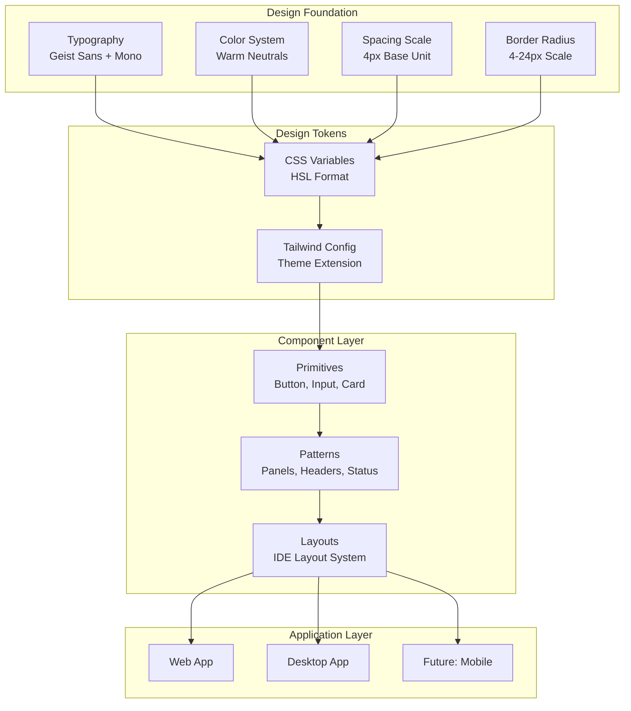
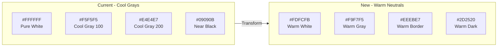
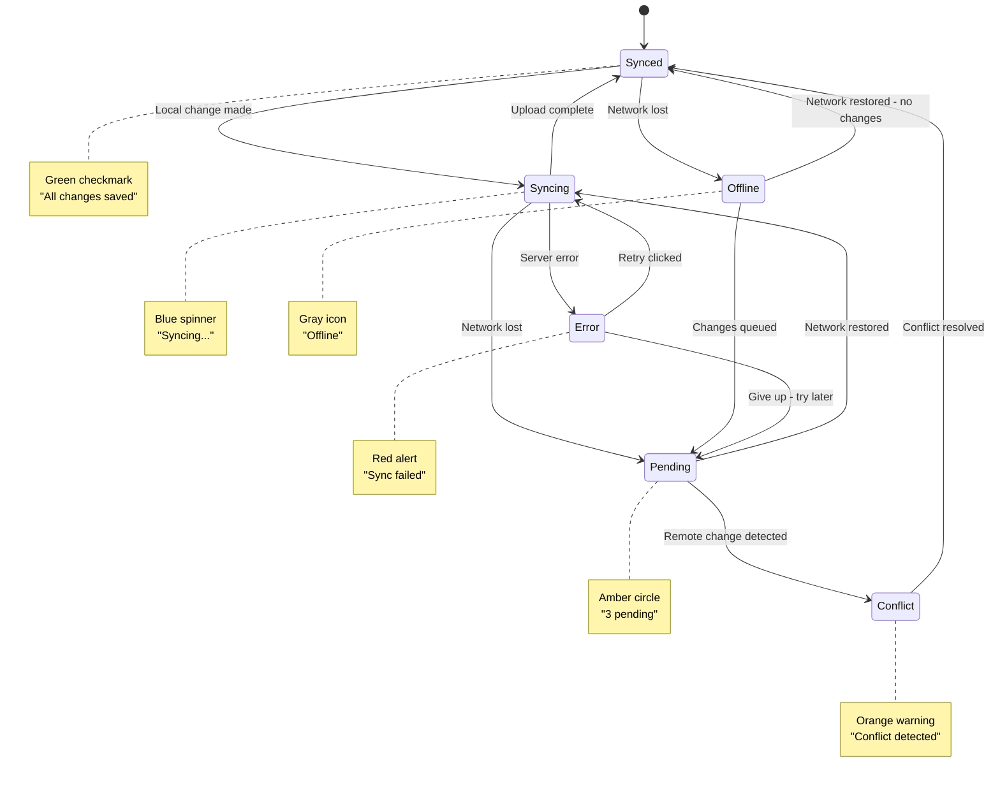
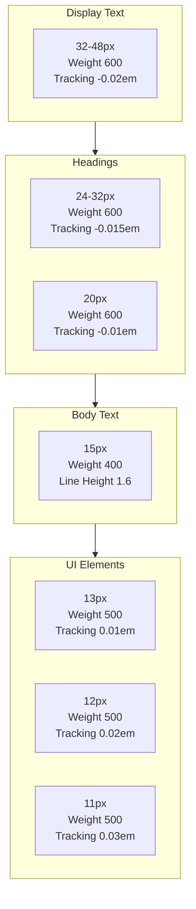
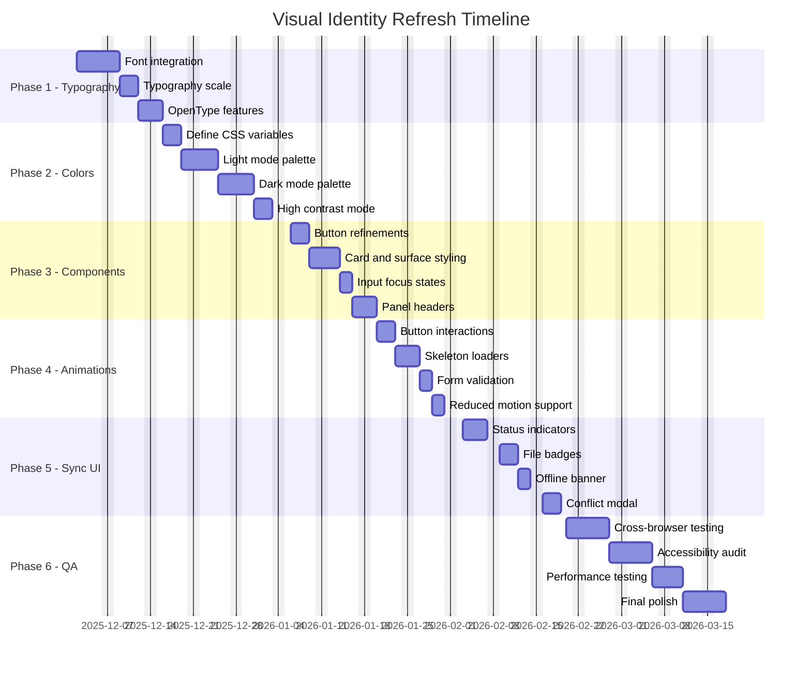
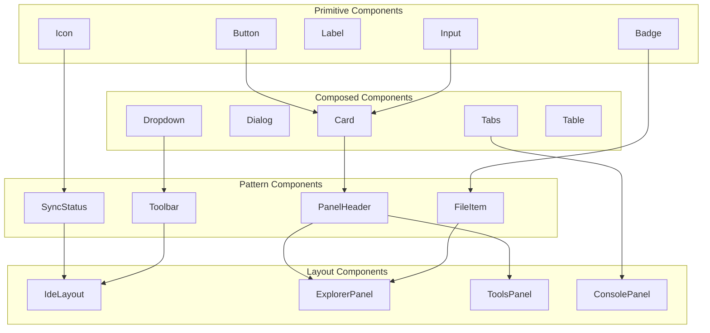
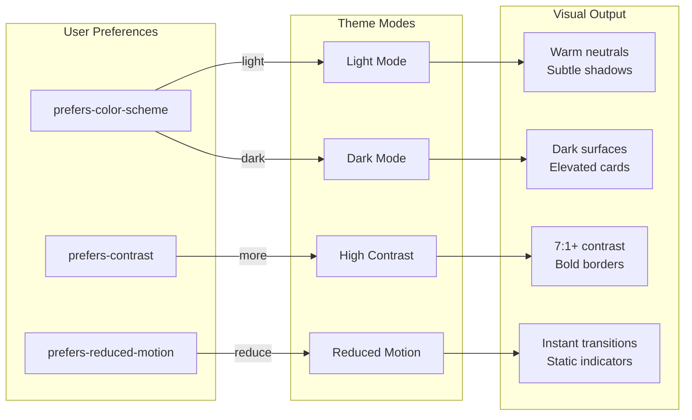

# Visual Identity Transformation Diagrams

## Design System Architecture



## Color Transformation: Cool to Warm



## Sync Status Visual System



## Typography Hierarchy



## Button State Transitions

```mermaid
stateDiagram-v2
  [*] --> Default

  Default --> Hover: Mouse enter
  Hover --> Default: Mouse leave
  Hover --> Active: Mouse down
  Active --> Hover: Mouse up
  Default --> Focus: Tab key
  Focus --> Default: Blur
  Focus --> Active: Enter/Space
  Default --> Disabled: disabled=true
  Disabled --> Default: disabled=false

  note right of Default
    Base shadow
    No transform
  end note

  note right of Hover
    Lift -1px
    Enhanced shadow
    150ms ease
  end note

  note right of Active
    Return to 0
    Pressed shadow
    50ms ease
  end note

  note right of Focus
    Focus ring
    3px primary/15%
  end note

  note right of Disabled
    50% opacity
    No pointer events
  end note
```

## Implementation Phases



## Component Hierarchy



## Accessibility Modes


