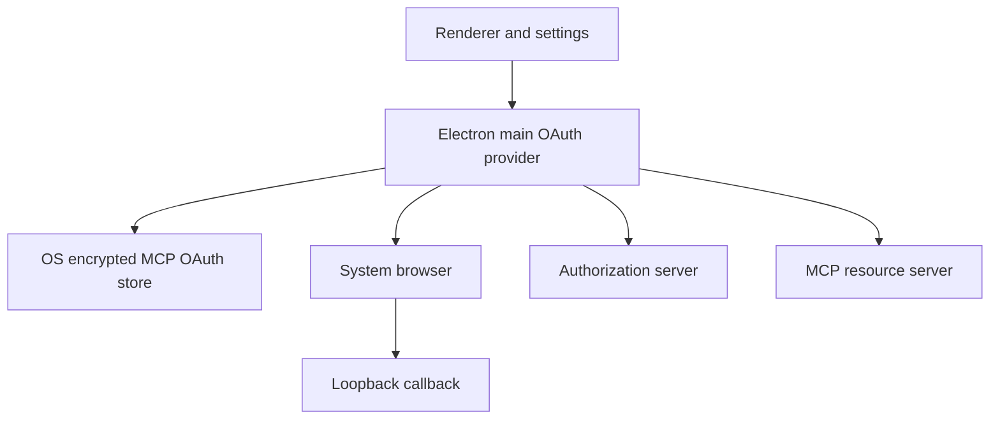

# Brainstrike BST-1468 MCP OAuth threat model

## Executive summary

BST-1468 adds a desktop-main OAuth client for remote HTTP MCP servers. The
highest-risk assets are refresh tokens, authorization codes, PKCE verifiers,
client registrations, and resource/issuer binding. The implementation limits
exposure with OS-backed safeStorage, issuer/resource partitioning, loopback
Host and state checks, SDK RFC validation, and token-free renderer contracts.
The remaining material risk is incorrect downstream composition that bypasses
the provider fetch seam or opens background authorization without an explicit
user action.

## Scope and assumptions

- In scope: `apps/desktop/src/mcp/oauth-client-provider.ts`, MCP config parsing,
  the official SDK v2 transport seam, the desktop safeStorage adapter, and the
  focused tests.
- Out of scope: subscription OAuth, stdio authentication, MCP OAuth UX/IPC,
  live Linear authorization, and the full MCP 2026 client surface.
- Assumed deployment: a single-user local Electron desktop app connecting to
  operator-selected remote MCP servers over HTTP(S).
- Assumed attackers: a malicious or compromised remote MCP/authorization
  server, a process able to send loopback requests, or a compromised renderer.
- Open question: the later host/UX composition must prove that startup does
  not pass an empty OAuth provider to a background connection and that every
  authenticated transport receives the provider fetch seam.

## System model

### Primary components

Electron main owns the OAuth provider, loopback callback, encrypted MCP OAuth
store, and SDK transport. The system browser is the user-agent handoff. The
authorization server issues registrations and tokens; the MCP resource server
validates bearer tokens. Renderer state is outside this provider and must
receive only token-free status DTOs.

### Data flows and trust boundaries

- Renderer/settings -> desktop main: token-free config/auth actions over
  authorized IPC; config carries only auth modes and credential references.
  Evidence: `apps/desktop/src/mcp-loader.ts` and
  `apps/desktop/src/ipc-domains/provider-auth.ts`.
- Desktop main -> safeStorage store: encrypted tokens, client information,
  verifier, discovery state, issuer, and resource identity. Evidence:
  `createSafeStorageMcpOAuthStore` in
  `apps/desktop/src/mcp/oauth-client-provider.ts`.
- Desktop main -> authorization server: SDK discovery, registration, code
  exchange, and refresh; `resource` is supplied by the SDK and validated by
  the provider.
- Browser -> loopback callback: authorization response query parameters cross
  the local boundary. The listener accepts loopback hosts and matching state;
  PKCE and SDK `finishAuth(URLSearchParams)` protect code exchange.
- Desktop main -> MCP resource server: the v2 transport attaches
  `Authorization: Bearer` on each request; access tokens are not query values.

#### Diagram

## Assets and security objectives

| Asset | Why it matters | Security objective |
| --- | --- | --- |
| Access and refresh tokens | Authorize the user’s MCP data; refresh tokens mint access | C/I |
| Authorization code and PKCE verifier | Interception is dangerous if state/PKCE binding fails | C/I |
| Client registration and issuer/resource identity | Wrong-AS or wrong-resource reuse redirects credentials | I |
| Discovery and scope state | Controls server and permissions for a token | I |
| Renderer and durable diagnostics | Projection can turn a renderer bug into token theft | C/I |
| Loopback listener | Local callers can inject callbacks or cause denial | I/A |

## Attacker model

### Capabilities

An attacker may control a remote endpoint or authorization response, send
crafted HTTP requests to the loopback listener, observe public callback URLs,
or exploit a renderer bug to invoke exposed IPC. A compromised local account
may read ordinary files, but safeStorage is expected to protect ciphertext
from plaintext disclosure.

### Non-capabilities

This model does not assume kernel compromise, direct access to the OS keychain
master key, or a trusted user approving a malicious consent screen.

## Entry points and attack surfaces

| Surface | How reached | Trust boundary | Notes | Evidence |
| --- | --- | --- | --- | --- |
| MCP JSON config | User file load | User file -> main | Strict modes; no OAuth on stdio; auth/header conflict rejected | `apps/desktop/src/mcp-loader.ts` |
| Discovery and token HTTP | SDK fetch | Remote -> main | Provider rejects non-HTTPS non-loopback targets | `apps/desktop/src/mcp/oauth-client-provider.ts` |
| Loopback callback | Browser/local HTTP | Local process -> main | Exact loopback Host, path, size, and state checks | `startLoopbackCallback` |
| Encrypted OAuth store | Main read/write | Main -> keychain | Dedicated store; insecure backend fails closed | `createSafeStorageMcpOAuthStore` |
| Renderer projection | IPC/status adapters | Main -> renderer | This slice has no token-returning bridge | `apps/desktop/SECURITY.md` |

## Top abuse paths

1. A local attacker sends a code with a guessed/wrong state -> callback stays
   pending and returns generic 400 -> the flow is not completed.
2. A malicious authorization server publishes a wrong issuer/resource -> the
   SDK/provider rejects before token exchange or persistence.
3. Two callers refresh concurrently -> identical refresh requests coalesce ->
   one rotated result is persisted instead of replaying the old token.
4. Disconnect races refresh -> generation increments and state clears -> a
   retired response is not persisted.
5. Renderer code serializes provider/config -> only status/references are
   projected -> credential material remains main-side.

## Threat model table

| Threat ID | Threat source | Prerequisites | Threat action | Impact | Impacted assets | Existing controls | Gaps | Recommended mitigations | Detection ideas | Likelihood | Impact severity | Priority |
| --- | --- | --- | --- | --- | --- | --- | --- | --- | --- | --- | --- | --- |
| TM-001 | Local callback attacker | Can reach loopback | Inject code/error or wrong Host/state | Hijack or denial | Code, verifier, listener | Loopback bind, Host allow-list, size bound, non-terminal state rejection, PKCE | Same-user process can consume resources | Keep callback lifetime bounded; no HTTP cancel | Count generic rejects without query values | medium | high | high |
| TM-002 | Malicious/misconfigured AS/resource | Controls remote metadata | Publishes wrong issuer/resource | Credential disclosure or wrong audience | Tokens, binding state | SDK RFC 9728/8414/9207/8707; resource validator; HTTPS | Downstream composition must preserve provider/fetch | Keep issuer validation enabled; invalidate stale discovery on changed 401 | Typed provider/server failure codes only | medium | critical | high |
| TM-003 | Compromised renderer | Renderer exploit plus sensitive bridge | Requests or serializes OAuth material | Token theft | Tokens, verifier, client secret | Main-only provider; reference-only config; token-free security contract | UX/IPC still downstream | Add token-free DTO tests for every MCP auth action | Secret-scan IPC and exports | medium | critical | high |
| TM-004 | Store/keychain fault | Corrupt state or unavailable safeStorage | Supplies malformed state or triggers fallback | Cross-account or plaintext use | Persisted state | Dedicated store; `basic_text` refusal; malformed rejection | Recovery UX downstream | Surface reconnect/persistence failure; require explicit reauth | Alert on backend changes and parse failures | low | high | medium |
| TM-005 | Concurrent main callers | Rotating refresh token | Races refresh/disconnect and overwrites state | Credential loss/replay | Refresh token, generation | Token-flight coalescing, generation tags, serialized writes | Active only when provider fetch is passed to transport | Wire provider/fetch at host seam and add concurrent host test | Count refreshes per server identity without tokens | medium | high | high |

## Criticality calibration

- Critical: a mix-up or renderer projection obtains a usable user token. Examples: TM-002 and TM-003.
- High: authorization can be completed/interfered with or a rotating refresh token can be replayed. Examples: TM-001 and TM-005.
- Medium: failure causes visible reconnect or session loss without credential exposure. Examples: malformed state and timeout.
- Low: bounded diagnostic noise with no authorization impact. Examples: rejected callback probes.

## Focus paths for security review

| Path | Why it matters | Related Threat IDs |
| --- | --- | --- |
| `apps/desktop/src/mcp/oauth-client-provider.ts` | Storage, callback, issuer/resource, and generation authority | TM-001, TM-002, TM-004, TM-005 |
| `apps/desktop/src/mcp-loader.ts` | Auth mode admission and secret-free config | TM-003, TM-004 |
| `packages/agent/src/mcp/explicit-http-client.ts` | Transport auth options and fetch wiring | TM-002, TM-005 |
| `apps/desktop/src/ipc-domains/provider-auth.ts` | Sensitive IPC sender policy for later UX | TM-003 |
| `apps/desktop/src/desktop-factory-reset.ts` | Durable reset boundary | TM-004 |

## Notes on use

This report is implementation-grounded on BST-1468. The open composition
question is intentional: the later UX/host integration must prove that
background startup does not open a browser and that every authenticated SDK
transport receives the generation-safe provider fetch seam.
