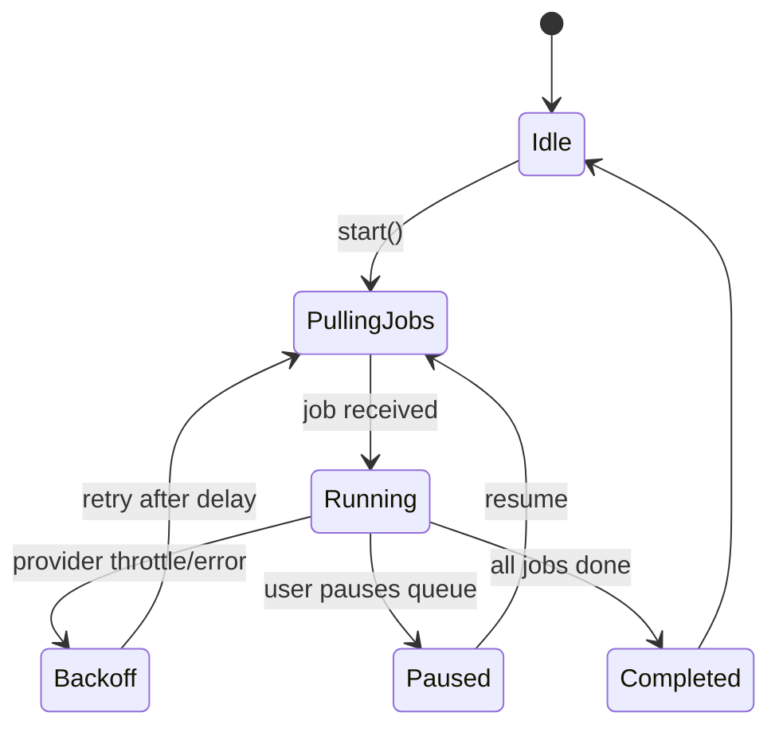

# 3) Embedding Pipeline (Flows, Sequences, and State)

## 3.1 High-Level Flow

```mermaid
flowchart LR
  A[Source Ingest\\n(file picker, folder, drag-drop, etc.)] --> B[Chunking Service\\n`packages/db/src/services/chunking-service.ts`]
  B --> C[Queue Enqueue\\n`create-embedding-queue.ts`]
  C --> D{Worker Type}
  D -->|Web| E[Web Worker\\n`apps/web/src/workers/embedding-worker-web.ts`]
  D -->|Desktop| F[Electron Worker\\n`packages/embedding-worker/src/embedding.worker.ts`]
  E & F --> G[Embedding Provider Factory\\n`packages/embeddings/src/factory.ts`]
  G --> H[(LLM/Embedding Providers)]
  H --> I[Vectors Returned]
  I --> J[Persist to DB\\nmodels/repos\\n`packages/db`]
  J --> K[Vector Index Helpers\\n`vector-index-helpers.ts`]
  K --> L[(Search-ready\\npgvector index)]
  L --> M[Vector Status UI\\n`packages/vector-management`]
```

## 3.2 Sequence — File Import ➜ Searchable Vectors

```mermaid
sequenceDiagram
  actor User
  participant UI as Web/Desktop UI
  participant FS as File System Adapter
  participant CH as Chunking Service
  participant Q as Embedding Queue
  participant W as Embedding Worker
  participant PF as Provider Factory
  participant EP as Embedding Provider
  participant DB as DB (PGlite/pgvector?)

  User->>UI: Select files/folders
  UI->>FS: Read file streams
  FS-->>UI: Chunks or raw content
  UI->>CH: normalize + chunk(content)
  CH-->>Q: enqueue(batch of chunk jobs)
  loop per job (concurrency N)
    Q->>W: dispatch(job)
    W->>PF: resolve provider & dims
    PF->>EP: embed(text[])
    EP-->>PF: vectors[]
    W->>DB: upsert embeddings + metadata
  end
  UI->>DB: mark embedding-set complete
  UI-->>User: Status updated; searchable
```

## 3.3 Worker State Machine



## 3.4 Backpressure & Throughput (Guidance)

- Keep job payloads *small and uniform* (e.g., chunk IDs + text refs) to avoid IPC serialization overhead on Desktop.
- Use provider-side batching where supported; otherwise N-way parallelism at the worker level.
- Persist *incrementally* (streaming) to DB to make progress visible in `vector-status` and to enable partial search.
- Consider a **dimension registry** (see `packages/types/src/embedding-constants.ts`) to validate dimension/column assignments at enqueue time.
