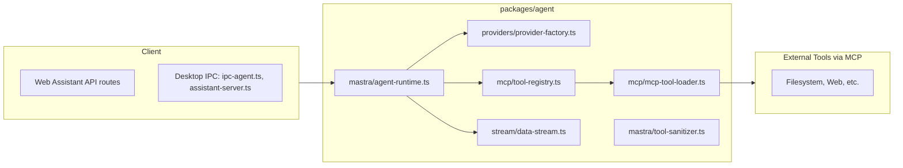

# 4) Agent Runtime & MCP

**Notes**
- MAStra runtime mediates between client surfaces and provider-specific capabilities.
- MCP tool loading is centralized, enabling consistent tool availability across web & desktop.
- `assistant-stream-helpers.ts` (web) participates in streaming UX.
