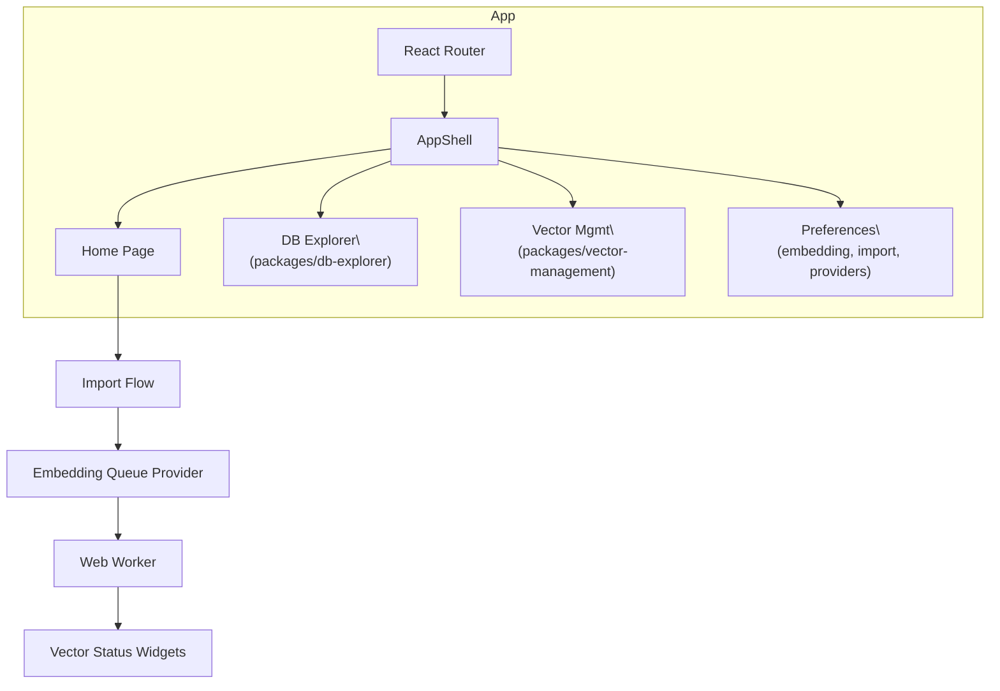
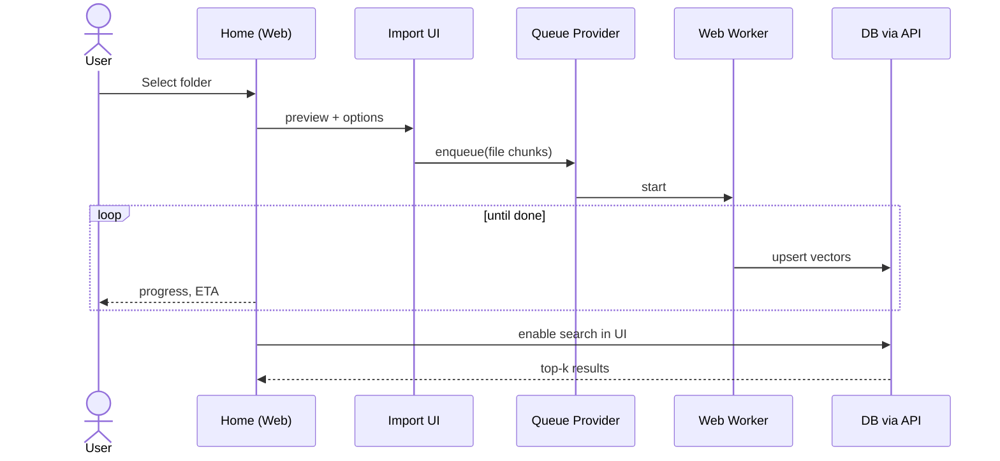

# 5) Web App (Vite/React) Overview

## 5.1 Page/App Shell

## 5.2 Homepage “Happy Path”

**Implementation anchors**
- `apps/web/vite.config.mts`
- `apps/web/src/app/api/*` (assistant & chat routes)
- `apps/web/src/workers/embedding-worker-web.ts`
- `packages/vector-management/*`
- `packages/db-explorer/*`
