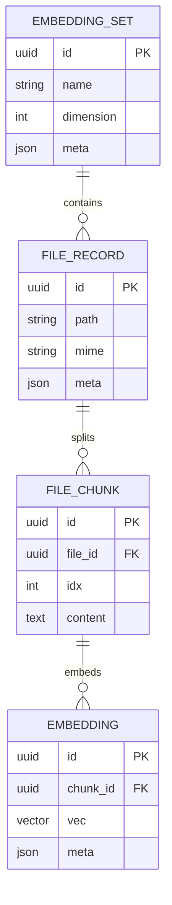

# 7) Data Model (High-Level)

> High-level sketch inferred from migration filenames and repository names. Confirm exact columns and constraints from `packages/db/src/migrations/*`.

**Indices & Helpers**
- Vector index helpers (see `vector-index-helpers.ts`) likely manage `CREATE INDEX` and compatibility across dimensions.
- A migration called `010-flexible-embedding-dimensions.ts` implies schema supports multiple dimensions concurrently.
