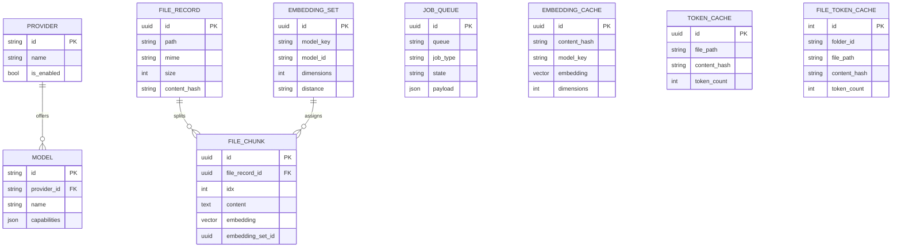

# 7) Data Model (High-Level)

> High-level sketch based on `packages/db/src/schema/index.ts` and migrations. Confirm exact columns and constraints from `packages/db/src/migrations/*`.

**Indices & Helpers**
- `file_chunks.embedding` is a dimensionless `VECTOR` column; dimension-specific indexes are created via expression casts (see `dimension-index-helpers.ts`).
- `embedding_sets.dimensions` is the source of truth for expected vector length.
- `job_queue.payload` references `chunkId` and `embeddingSetId` (no direct FK).
