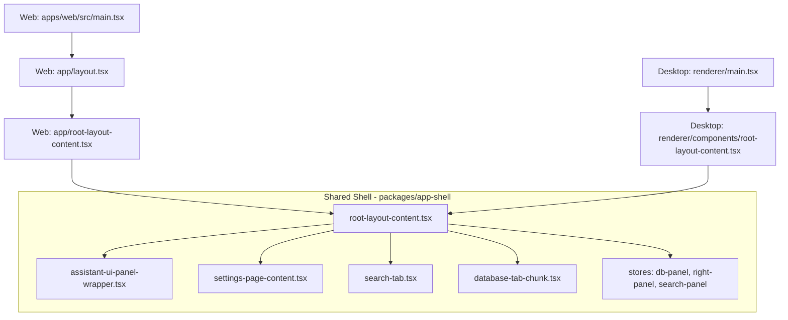
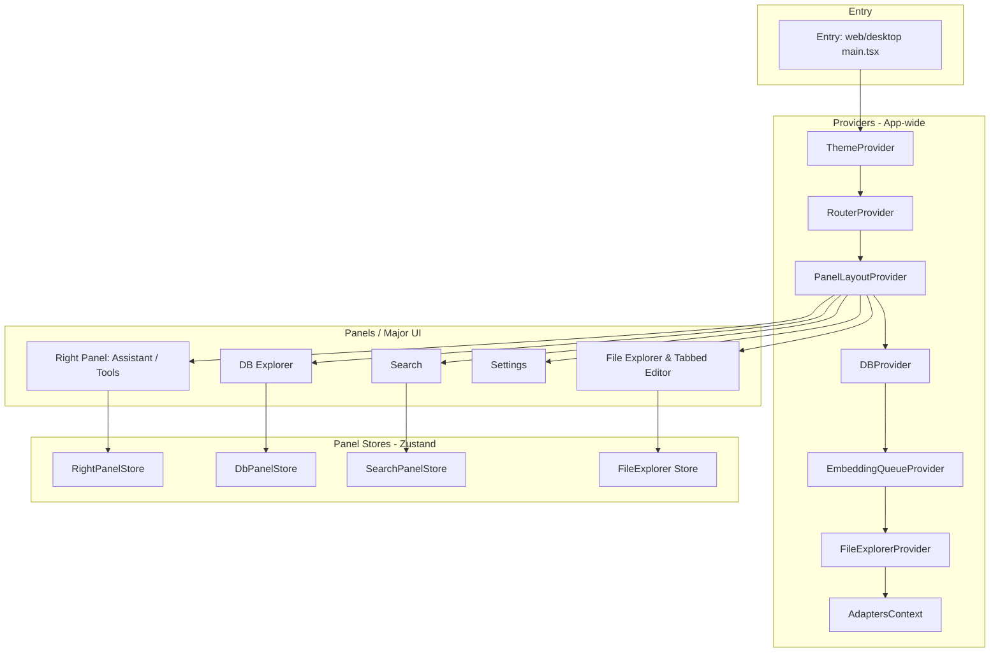
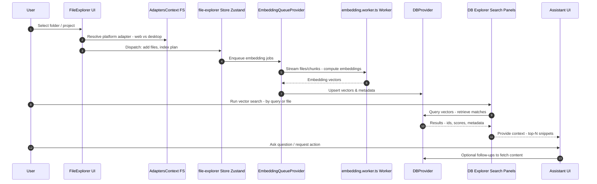
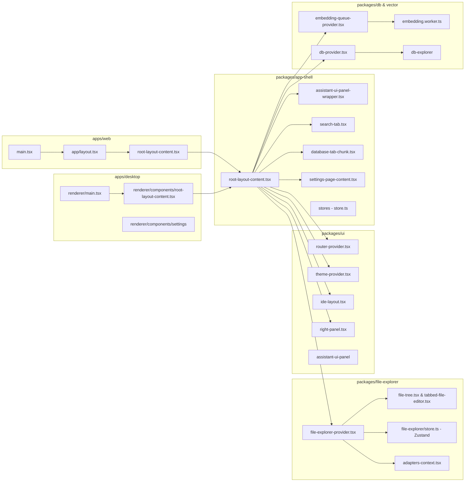

# Brainstrike Frontend (React) — Architecture-at-a-Glance

> **Scope**: This is a high-level, source-linked map of the React “frontend model” in the private repo **seandearnaley/brainstrike**.  
> **Focus**: Component composition, providers/state layers, major panels, and key data flows you’ll care about when extending the UI.

---

## Top-Level Layout (web & desktop)

The product ships as both a **Web SPA** and an **Electron** desktop app. They share a common shell and many UI packages.

- **Web entry**: [`apps/web/src/main.tsx`](https://github.com/seandearnaley/brainstrike/blob/main/apps/web/src/main.tsx) → [`apps/web/src/app/layout.tsx`](https://github.com/seandearnaley/brainstrike/blob/main/apps/web/src/app/layout.tsx) → [`apps/web/src/app/root-layout-content.tsx`](https://github.com/seandearnaley/brainstrike/blob/main/apps/web/src/app/root-layout-content.tsx)
- **Desktop entry (renderer)**: [`apps/desktop/src/renderer/main.tsx`](https://github.com/seandearnaley/brainstrike/blob/main/apps/desktop/src/renderer/main.tsx) → [`apps/desktop/src/renderer/components/root-layout-content.tsx`](https://github.com/seandearnaley/brainstrike/blob/main/apps/desktop/src/renderer/components/root-layout-content.tsx)
- **Shared shell**: [`packages/app-shell/src/root-layout-content.tsx`](https://github.com/seandearnaley/brainstrike/blob/main/packages/app-shell/src/root-layout-content.tsx)

---

## Provider & State Stack (the “React model”)

Core providers create app-wide context. Panels then consume them, and local **Zustand** stores manage focused state per area.

- **Routing & Layout**: [`packages/ui/src/router-provider.tsx`](https://github.com/seandearnaley/brainstrike/blob/main/packages/ui/src/router-provider.tsx), [`packages/ui/src/providers/panel-layout-provider.tsx`](https://github.com/seandearnaley/brainstrike/blob/main/packages/ui/src/providers/panel-layout-provider.tsx), [`packages/ui/src/layout/ide-layout.tsx`](https://github.com/seandearnaley/brainstrike/blob/main/packages/ui/src/layout/ide-layout.tsx), [`packages/ui/src/layout/right-panel.tsx`](https://github.com/seandearnaley/brainstrike/blob/main/packages/ui/src/layout/right-panel.tsx)
- **Theme**: [`packages/ui/src/theme-provider.tsx`](https://github.com/seandearnaley/brainstrike/blob/main/packages/ui/src/theme-provider.tsx)
- **DB access**: [`packages/db/src/db-provider.tsx`](https://github.com/seandearnaley/brainstrike/blob/main/packages/db/src/db-provider.tsx)
- **Vectors & embeddings**: [`packages/vector-management/src/embedding-queue-provider.tsx`](https://github.com/seandearnaley/brainstrike/blob/main/packages/vector-management/src/embedding-queue-provider.tsx), [`packages/embedding-worker/src/embedding.worker.ts`](https://github.com/seandearnaley/brainstrike/blob/main/packages/embedding-worker/src/embedding.worker.ts)
- **File system adapters**: [`packages/file-explorer-hooks/src/adapters-context.tsx`](https://github.com/seandearnaley/brainstrike/blob/main/packages/file-explorer-hooks/src/adapters-context.tsx)
- **File explorer**: [`packages/file-explorer-ui/src/file-explorer-provider.tsx`](https://github.com/seandearnaley/brainstrike/blob/main/packages/file-explorer-ui/src/file-explorer-provider.tsx), [`packages/file-explorer/src/store.ts`](https://github.com/seandearnaley/brainstrike/blob/main/packages/file-explorer/src/store.ts) (Zustand)
- **App shell stores (Zustand)**: [`packages/app-shell/src/stores/db-panel-store.ts`](https://github.com/seandearnaley/brainstrike/blob/main/packages/app-shell/src/stores/db-panel-store.ts), [`packages/app-shell/src/stores/right-panel-store.ts`](https://github.com/seandearnaley/brainstrike/blob/main/packages/app-shell/src/stores/right-panel-store.ts), [`packages/app-shell/src/stores/search-panel-store.ts`](https://github.com/seandearnaley/brainstrike/blob/main/packages/app-shell/src/stores/search-panel-store.ts)

---

## Major Feature Buckets & Where Things Live

**Assistant UI**  
- Shell wrapper: [`packages/app-shell/src/assistant-ui-panel-wrapper.tsx`](https://github.com/seandearnaley/brainstrike/blob/main/packages/app-shell/src/assistant-ui-panel-wrapper.tsx)  
- UI internals: [`packages/ui/src/assistant-ui-panel/assistant-ui-panel.tsx`](https://github.com/seandearnaley/brainstrike/blob/main/packages/ui/src/assistant-ui-panel/assistant-ui-panel.tsx), [`shiki-highlighter.tsx`](https://github.com/seandearnaley/brainstrike/blob/main/packages/ui/src/assistant-ui-panel/shiki-highlighter.tsx), [`tool-fallback.tsx`](https://github.com/seandearnaley/brainstrike/blob/main/packages/ui/src/assistant-ui-panel/tool-fallback.tsx)

**Search / Database Panels**  
- Search tab: [`packages/app-shell/src/search-tab.tsx`](https://github.com/seandearnaley/brainstrike/blob/main/packages/app-shell/src/search-tab.tsx)  
- DB chunks & views: [`packages/app-shell/src/database-tab-chunk.tsx`](https://github.com/seandearnaley/brainstrike/blob/main/packages/app-shell/src/database-tab-chunk.tsx), [`packages/db-explorer/src/components/chunks-view.tsx`](https://github.com/seandearnaley/brainstrike/blob/main/packages/db-explorer/src/components/chunks-view.tsx), [`search-view-table.tsx`](https://github.com/seandearnaley/brainstrike/blob/main/packages/db-explorer/src/components/search-view-table.tsx)  
- DB inspector UI: [`db-info-display.tsx`](https://github.com/seandearnaley/brainstrike/blob/main/packages/db-explorer/src/components/db-info-display.tsx), [`embeddings-panel.tsx`](https://github.com/seandearnaley/brainstrike/blob/main/packages/db-explorer/src/embeddings-panel.tsx), [`settings-panel.tsx`](https://github.com/seandearnaley/brainstrike/blob/main/packages/db-explorer/src/components/settings-panel.tsx)

**File Explorer & Editor**  
- Provider/context: [`file-explorer-provider.tsx`](https://github.com/seandearnaley/brainstrike/blob/main/packages/file-explorer-ui/src/file-explorer-provider.tsx), [`file-content-context.tsx`](https://github.com/seandearnaley/brainstrike/blob/main/packages/file-explorer-ui/src/file-content-context.tsx), [`contexts/file-editor-context.tsx`](https://github.com/seandearnaley/brainstrike/blob/main/packages/file-explorer-ui/src/contexts/file-editor-context.tsx)  
- UI: [`file-tree.tsx`](https://github.com/seandearnaley/brainstrike/blob/main/packages/file-explorer-ui/src/file-tree.tsx), [`tabbed-file-editor.tsx`](https://github.com/seandearnaley/brainstrike/blob/main/packages/file-explorer-ui/src/tabbed-file-editor.tsx), [`folder-selection-dialog.tsx`](https://github.com/seandearnaley/brainstrike/blob/main/packages/file-explorer-ui/src/folder-selection-dialog.tsx)

**Preferences / Settings**  
- Unified settings surface in shell: [`settings-page-content.tsx`](https://github.com/seandearnaley/brainstrike/blob/main/packages/app-shell/src/settings-page-content.tsx)  
- Example section: [`token-counting-settings-section.tsx`](https://github.com/seandearnaley/brainstrike/blob/main/packages/preferences/src/token-counting/token-counting-settings-section.tsx)

**Agent & Providers**  
- LLM provider factory: [`packages/agent/src/providers/provider-factory.ts`](https://github.com/seandearnaley/brainstrike/blob/main/packages/agent/src/providers/provider-factory.ts)  
- (Desktop) Agent client loader: [`apps/desktop/src/agent-client-loader.ts`](https://github.com/seandearnaley/brainstrike/blob/main/apps/desktop/src/agent-client-loader.ts)

---

## Data Flow — “Open Folder → Embed → Query → Assist”

---

## How the Pieces Fit Together

- **Entrypoints** mount a **provider stack** (Theme → Router → Layout → DB → Vectors → FS).  
- The **shared shell** (`packages/app-shell`) composes the overall **IDE-like layout** (file tree, middle editor tabs, right panel for assistant/tools) using layout providers from `packages/ui`.  
- Each major surface owns a small **Zustand store** to keep its state local and testable (e.g., right-panel tabs, DB panel filters, search UI, file explorer selection).  
- Expensive work (embeddings) runs off-thread in a **Worker**, coordinated by `embedding-queue-provider`, with results persisted via **DBProvider** and visualized in **db-explorer**.  
- The **Assistant UI** consumes context (search results, selections) and talks to the **agent provider-factory** to execute LLM-backed actions/tools.

---

## Extension Hotspots (practical pointers)

- **Add a new right-panel tool**: start near [`packages/app-shell/src/right-panel-store.ts`](https://github.com/seandearnaley/brainstrike/blob/main/packages/app-shell/src/stores/right-panel-store.ts) and the right-panel layout in [`packages/ui/src/layout/right-panel.tsx`](https://github.com/seandearnaley/brainstrike/blob/main/packages/ui/src/layout/right-panel.tsx). Wire UI in `app-shell`, keep logic in its own small Zustand slice.  
- **New file format support**: add adapter hooks in [`file-explorer-hooks/adapters-context.tsx`](https://github.com/seandearnaley/brainstrike/blob/main/packages/file-explorer-hooks/src/adapters-context.tsx) and chunking/preview in `file-explorer-ui`.  
- **Custom search mode**: extend `db-explorer` components and, if needed, the **DB schema** behind [`packages/db/src/db-provider.tsx`](https://github.com/seandearnaley/brainstrike/blob/main/packages/db/src/db-provider.tsx).  
- **Assistant action**: add a tool UI under `packages/ui/src/assistant-ui-panel` and logic via the **agent provider-factory**.

---

## Component/Module Map (compact)

---

### Notes & Caveats

- I relied on **repository structure and filenames** to build this picture and linked directly to the relevant sources so you can jump in fast.  
- If you want a *code-level* dependency graph (imports → graphviz), I can generate one next; ideally I’d read the repo tree directly and emit a `.dot`/Mermaid dependency graph grouped by package.
