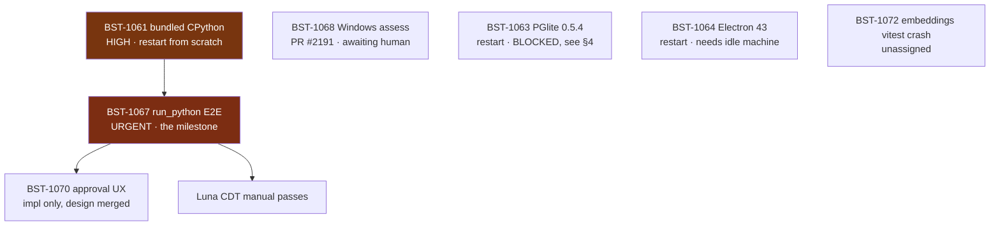

# Handoff — Agent Code Sandboxing (Two-Mode Path)

**Date:** 2026-08-01 · **Linear project:** [Agent Code Sandboxing — Two-Mode Path](https://linear.app/brainstrike/project/agent-code-sandboxing-two-mode-path-90a52846fbe8)

> ## ⏱️ Point-in-time snapshot — re-verify before acting
>
> **§1–§4 assert live state** (ticket statuses, PR numbers, "do not merge",
> "restart from scratch"). Those were true on 2026-08-01 and **will go stale**.
> Check Linear and `gh pr list` before following any status-dependent directive
> — acting on an expired "restart this lane" or "do not merge" is worse than
> having no handoff at all.
>
> **§5 (how to work) and §6 (the silent-failure pattern) do not expire.** Nor do
> the per-ticket *constraints* in §4 — only the statuses around them. When this
> snapshot is fully stale, move those durable parts into
> `docs/agents/code-execution.md` and delete the rest.

Read this file end to end before picking up a ticket. It carries findings that
are **not** in the tickets and not recoverable from the code — including three
real sandbox escapes that were found and fixed, and three lanes whose work was
lost with their worktrees.

---

## 1. Where the project stands

**Brainstrike can now execute code inside a real OS-level sandbox.** The seam,
the fence, and the adversarial test suite are all on `main`.

### Merged (9 tickets)

| Ticket | What landed | Commit |
| --- | --- | --- |
| BST-1060 | `CodeExecutor` seam + review hardening | `d809f0d`, `8448ffd` |
| BST-1062 | **FenceExecutor** — srt 0.0.67, Seatbelt/bubblewrap | `5277afc` |
| BST-1065 | transformers.js v4 vector-parity guard | `57756e1` |
| BST-1066 | quickjs-ng JS sandbox spike | `0f92dc0` |
| BST-1069 | Mode-two VM ADR (**Accepted**) | `29aab71` |
| BST-1070 | Approval UX **design spec only** | `9364140` |
| BST-1071 | **Escape-resistance suite + 3 real escape fixes** | `9b419c4` |
| BST-1073 | Plan-mode suspend bypass (security) | `fafd325` |
| BST-1074 | Windows guard footguns (security) | `ae67943` |

Three of those (1071's fixes, 1073, 1074) were **defects discovered during the
work**, not planned tickets. All three were the kind that fail silently.

### Authoritative docs — read before touching these areas

- `docs/agents/code-execution.md` — the seam contract. **Start here.**
- `docs/adr/0003-mode-two-full-isolation-vm.md` — mode two, Accepted.
- `docs/run-python-approval-ux-design-2026-08-01.md` — BST-1070's spec.
- `packages/agent/src/__tests__/fence-escape-resistance.README.md` — what the
  fence does and does **not** guarantee. Honest non-guarantees live here.

---

## 2. The remaining graph

**Critical path is exactly one chain:** BST-1061 → BST-1067 → BST-1070. Everything
else is parallel and independent.

---

## 3. Salvaged in-flight work — three draft PRs to pick up

BST-1061, BST-1063 and BST-1064 were being worked in agent worktrees that had
**never been pushed** and would have died with the session. All three were
salvaged at the end into draft PRs:

| Ticket | Draft PR | What's in it |
| --- | --- | --- |
| BST-1061 | #2205 | manifest + independently verified checksums; implementation not started |
| BST-1063 | #2206 | bump complete, BM25 re-qualified with evidence, one open question |
| BST-1064 | #2207 | measurements taken, the ticket's premise disproved, no baseline |

Each PR body itemises what remains. **Read the per-ticket sections below before
opening them** — in every case the findings are worth more than the diff, and
two of the three change what the ticket is even asking for.

---

## 4. Per-ticket context

### BST-1061 — Bundle a pinned CPython · **HIGH · start here**

Blocks the milestone. Restart from scratch, but with these constraints already
established (they are in the ticket, repeated here because they are easy to miss):

- `resolvePythonBinary()` **must return an absolute path**. `ExecPolicy` paths are
  absolute-only and a literal `~` is *rejected*, not expanded.
- **Verify the unpack location is readable inside the fence.** `ALWAYS_DENY_READ_PATHS`
  covers `~/.ssh`, `~/.aws`, `~/.config/gh`, `~/.npmrc` and friends. A per-user
  app-data dir should be fine — but an interpreter the sandbox can't read fails
  as an opaque spawn error, which is miserable to debug.
- **The interpreter is INJECTED**, not imported. `FenceExecutor` takes
  `FenceInterpreter { command, args?, env?, scriptExtension }`. Expose the
  resolver in a form desktop wiring can hand over.
- The typed "python unavailable" error must be **distinguishable** from
  `NoSandboxConfiguredError` / `ExecCapabilityMismatchError`, so `run_python` can
  tell the user which half is missing — no interpreter vs no sandbox.
- Build-time checksum-pinned fetch. **Not** `postinstall` (Electron 42 removed
  its own for supply-chain reasons; match that posture).
- Wire the unpacked dir into **factory reset**.

**Salvaged before the lane was lost — PR #2205 (draft), branch
`seandearnaley/bst-1061-bundle-a-pinned-cpython-...`.** It contains only
`apps/desktop/resources/python-runtime/manifest.json` plus a `.gitignore` rule,
but it carries the expensive part: the pinned release, **independently verified
by downloading both tarballs and hashing them**.

| Field | Value |
| --- | --- |
| Release tag | `20260728` |
| CPython | `3.13.14`, `install_only` |
| `aarch64-apple-darwin` | `a48399e6ddbb9ccf215eb5afea8f40eca289c808f99faa5d38f35f575a6f1784` |
| `x86_64-apple-darwin` | `1cae8109be20b827cf39abe76f0ef6fdb5cfc621ab1791beda77abf8ea7bb75e` |

Re-verify if you want, but these were hashed from the real downloads, not copied.

Two further notes from that lane: `app.getPath('userData')` is a **sibling of, not
a descendant of**, the fence's always-deny credential paths — reasoned-safe, but
verify it against the now-merged `ALWAYS_DENY_READ_PATHS` rather than trusting the
reasoning. And the planned error family (`python_unsupported_platform`,
`python_checksum_mismatch`, `python_unpack_failed`) was chosen to stay clear of
the seam's four typed errors; keep that separation.

The remaining checklist — fetch script, `resolvePythonBinary()`, call-site wiring,
factory-reset, `code-execution.md` note, third-party notices — is itemised in
#2205's body.

### BST-1067 — Ship `run_python` · **URGENT · the milestone**

The ticket carries a ⚠️ **Contract corrections** block. Read it: the original
wiring snippet in the ticket body *would throw* against the shipped schema.

Additional scope from BST-1070's design review that is **not** in the ticket:

1. **The pre-run approval card cannot show the writable path at all** without an
   additive typed `executionContext` field. It must be forwarded in **three**
   places — the approval chunk, `DataStreamMapper.handleToolApprovalRequired`
   (which rebuilds the request field-by-field), and rediscovery. Miss the mapper
   and every *live* approval degrades while only rediscovered ones work.
2. **Register it as the factory-returned Mastra Tool object directly**, not via
   the `{description, execute, id, inputSchema}` literal every other native tool
   uses. Copy the pattern from the `isLocalProvider` block in
   `assistant-tools.ts` that registers `createAskUserTool()` /
   `createSubmitPlanTool()` — that block is the *correct* example, and its
   comment explains why. Re-wrapping **drops `suspendSchema`**, and the failure
   is silent: `hasSuspendSchema` goes false, the network gate never fires, and
   the run executes with a non-empty `allowedDomains` and no prompt.
3. **Exclude it for the built-in local provider**, alongside `askUser`/`submitPlan`.
4. `suspend()` returns `Promise<void>` — it does **not** resolve to the decision.
   Branch on `context.agent.resumeData` before calling it. Mirror `ask-user-tool.ts`.
5. Do not reclassify `submitPlan`/`askUser` risk. They survive plan mode *only*
   because they are `read`; BST-1073's guard test pins this.

### BST-1070 — Approval UX · implementation only

Design is merged and detailed. Settled rulings: **two gates on two channels**
(approval channel = "may this run", suspension channel = "may it reach these
domains" — the latter per-call, argument-aware, structurally ungrantable);
**no carve-out** from the blanket session grant (the honest comparison is
`run_python` vs `executeCommand`, already covered and strictly more dangerous);
six seam gaps listed in the spec.

### BST-1068 — Windows fence · **human results ARE IN** · PR #2191

The Windows reviewer ran the plan on a real provisioned host (Windows 11 x64,
Node 24.14.0) and posted **7 findings, 4 of them P1**. The plan did its job: it
contradicted the document rather than confirming it. Being worked now — check the
PR for the resolved state before trusting the summary below.

**The premise that failed.** §6.8 assumed `realpath` resolves 8.3 short names via
`GetFinalPathNameByHandleW`. It does not: `cmd` produced `C:\SRT-SP~1\PROGRA~1`
and `fs.realpathSync` returned it unchanged. That was load-bearing for the
short-name-aliasing analysis, and it may be the same class of gap as BST-1074's
JS-vs-native `realpath` finding — worth checking whether `realpath.native`
behaves differently on Windows.

**The number the recommendation hinges on.** Ten real `initialize()`/`reset()`
cycles measured **~1531–1555 ms each** — that is the §6.6 per-exec-vs-per-workspace
decision, now measured rather than assumed, and it speaks directly to the
expressibility argument.

**Two tests that didn't prove what they claimed** (the same class the plan swept
for — one survived the sweep): the `allowRead`-only fixture at `C:\srt-spike`
inherited `Authenticated Users:(OI)(CI)(M)` from the default `C:\` ACL, and since
srt only *adds* grants it never demonstrated the restriction; and `t_c.py` — which
unconditionally treats successful HTTP as FAIL — was reused after widening
`allowedDomains`, where success is the expected outcome.

**Also measured:** CPython's real denial shape is `PermissionError errno=13
winerror=None` (the branch expected a `winerror`); `%APPDATA%\Roaming\Python`
already existed, so the `expect False` precondition can't establish where
`pip --user` writes; and both curl runs returned HTTP 200 under Schannel, leaving
the revocation differential with no defined outcome.

**Recommendation before these results:** absent factory on win32, no
elevated-install prompt, blocked on *expressibility* rather than maturity
(Windows srt fixes filesystem scope at `initialize()`). **Whether it survives the
new evidence is the open question — read the PR, not this paragraph.**

### BST-1063 — PGlite 0.5.4 · **draft PR #2206 · DO NOT MERGE**

> **🛑 Blocking correctness issue, found in review and verified against the tree.**
> **The migration-066 guard protects only GREENFIELD databases. Every existing
> install is unguarded and lands in the exact mixed-version state that caused the
> original corruption.**
>
> `customMigration(hash, ...)` in `drizzle/migrate.ts` takes `hash` as a fixed
> string **literal**, not a content digest. Rewriting 066's SQL changes what a
> *fresh* database runs and **nothing** about what an existing one does. An
> install that already recorded migration 66 skips it forever: its catalog still
> reads `extversion = '1.2.0'`, its BM25 index was built by the **1.2.0** engine,
> and after this merge the **1.3.1 binary reads and writes that index**. No
> `ALTER EXTENSION UPDATE` fires, and nothing at runtime asserts catalog-vs-binary
> agreement — `QUALIFIED_PG_TEXTSEARCH_VERSION` is referenced only by migration
> 066 and two tests.
>
> That 1.3.1-into-a-1.2.0-built-index path is **precisely** where the migration-065
> corruption lived. The 6/6 durability runs below were all greenfield and do not
> exercise it; the only upgrade-path evidence was an uncommitted 3-trial scratch
> script.
>
> **The change is qualified for new users and unqualified for every existing one —
> and existing users are the ones carrying data.**
>
> **Filed as [BST-1081](https://linear.app/brainstrike/issue/BST-1081) (Urgent).
> PR retitled `DO NOT MERGE`, kept draft, all 5 threads resolved.** Two results
> from that investigation change what the remediation can be:
>
> - **`ALTER EXTENSION UPDATE` alone is NOT a fix.** The real
>   `pg_textsearch--1.2.0--1.3.0.sql` (read from the actual npm tarball) is
>   catalog/function-only — `CREATE/DROP/ALTER FUNCTION`, `REVOKE`. It never
>   touches index pages, so it would **relabel** `extversion` while leaving the
>   physical BM25 index exactly as the 1.2.0 engine wrote it.
> - **A bare runtime fail-fast would brick every existing install.** Migration
>   066 never re-runs for them, so there is no recovery path; an agreement check
>   must ship *with* a remediation, not ahead of one. The lane deliberately did
>   not implement one for that reason, and flagged it as judgement rather than
>   quietly skipping it — that call was correct.
>
> So the live options are an upgrade migration that **rebuilds** the index under
> 1.3.1 (not just relabels), and/or a committed existing-install upgrade test
> exercising the real `file_chunks` path — which likely needs a second, aliased
> pglite/pg_textsearch pair pinned as a scoped devDependency to construct an
> old-format index repeatably. BST-1081 has the full analysis.
>
> Mitigating but insufficient: an uncommitted 3-trial script drove a 1.2.0-built
> index through 20 read/write/VACUUM cycles under 1.3.1 and came back clean 3/3.
> One platform, synthetic table, not reproducible by anyone else. Suggestive, not
> qualifying.

Salvaged with real evidence on branch
`seandearnaley/bst-1063-bump-pglite-to-054-...`. The BM25 fear that made this
look blocked has been **retired empirically**:

1. **The extension family cannot be split** — verified, not assumed: core 0.5.4
   paired with pg_textsearch held at 0.0.4 fails with `PGlite failed to
   initialize properly`. So 1.3.1 comes along or nothing does.
2. **pg_textsearch 1.3.1 re-qualified: 6/6 durability-gate runs clean, plus 3/3
   upgrade-path trials.** This is *correctness* evidence, not timing, so machine
   contention cannot fake a pass — which is exactly why it is trustworthy from
   this host. Migration 066's guard was moved to require `1.3.1` accordingly.
3. **The `process.type` audit is a no-op for us** — the fix is entirely inside
   pglite (`IN_NODE`, upstream PR #1033); every construction site uses bare
   imports so the bump propagates automatically. Nothing to remove.

**The one open question, explicitly unresolved:** 0.5.4 solo runs hit 1 worker
crash in 2 attempts, versus 0 in a single 0.5.3 solo control; the tie-breaker
came back clean. That is 2 short of the protocol (2 more solo runs each way).
The lane's read — labelled as judgement, not fact — is machine noise rather than
a regression. **Confirm or refute that before merging.**

Also **not done**: full type-check sweep across other PGlite consumers, lint,
react-doctor, and a real desktop launch smoke test.

**Unscoped finding, deliberately untouched:** `packages/build-utils/src/vite.ts`'s
CSP eval-warning allowlist now silently stops suppressing 2 EVAL warnings (build
still exits 0). That wants a real BST-573/594 security re-qualification, not a
quiet allowlist edit.

**Two review findings on #2206 that MUST be settled before it leaves draft** —
both are `docs/agents/database.md` claiming more than the evidence supports,
which is the §6 pattern aimed at a doc future agents trust without re-deriving:

1. The doc says every construction site was "verified post-bump", naming
   `apps/desktop/src/db-main.ts` as real Electron main — but that site was never
   launch-tested under Electron. **`process.type` is only defined in a real
   Electron process**, so a Node/jsdom unit run cannot exercise the code path the
   upstream fix changes. The one case the tests can't reach is the one claimed as
   verified. A real desktop launch smoke test is owed.
2. The section keeps the rule "repeated gate runs on **every supported desktop
   platform**" while, twenty lines earlier, recording that all evidence is macOS
   arm64 only. Same section, both "here is the bar" and "we went under it".
   Needs a **scoped, dated exception recorded in place** plus a follow-up ticket
   for Linux/Windows qualification — *not* a quietly relaxed bar. That bar is the
   only thing between users and the BM25 corruption the original pin existed to
   prevent.

### BST-1064 — Electron 43 · **the ticket's premise was wrong** · draft PR #2207

**Electron was already on 43.1.1 before this ticket was filed.** The major bump
landed in PR #1492 (2026-07-07) *with* a breaking-changes review, then a patch
bump in #1803. There is nothing to bump; the real gap was always the unmeasured
evaluation. Three weeks of clean Electron-43 CI history back that up.

**The harness was fixed after review and re-measured.** The original numbers had
`stdev ≈ 295 ms` on a median of 868 ms — which review correctly diagnosed as the
harness's own design, not host noise: one `mkdtemp` profile was shared across all
runs, so run 1 paid for profile creation, PGlite bootstrap and migrations while
runs 2..N were warm. Adding a discarded warm-up run dropped stdev to **~18 ms**,
which confirms the diagnosis empirically rather than by argument.

It also now measures the **production** boot path — `ELECTRON_IS_E2E_TEST` was
dropped (it is a first-class mode switch flipping renderer launch mode, macOS
activation policy, test-mode secret handling and preference overrides), leaving
only `--user-data-dir` for isolation.

Corrected numbers (n=10, Electron 43.1.1, warm-up discarded): spawn→app-ready
**863.1 ms**, spawn→assistant-listening **880.4 ms**, stdev **~18 ms**.

**There is still no before/after delta** — the 41.10.0 baseline never built. Do
**not** diff a fresh baseline against these; capture both fresh in one sitting on
an idle machine. That instruction is in the PR body too.

Native/WASM deps all check out (`secure-fs-native` 7/7, `windows-job-native`
builds, `node-pty` spawns, PGlite inits and queries) — all Node-API/WASM rather
than raw V8-ABI-coupled, which is why the bump was uneventful.

**Recommendation: keep 43.1.1 and close the spike with follow-ups** — not a
revert, and not a claim of completion. Still missing: the 41.10.0 baseline,
hidden-renderer/WebGPU runtime confirmation, and real E2E smoke.

If anyone does re-measure: **do it on an idle machine.** BST-1065's benchmark had
to be retracted after swinging from "+42% faster" to "2.5× slower" across four
runs of identical code. Report median *and* spread; if the distributions overlap,
say inconclusive rather than reporting a delta.

### BST-1072 — embeddings vitest worker crash · unassigned

Latent, not fixed. Any PR touching root `biome.json`/`tsconfig.json` marks all 43
packages affected and hits a reproducible `[vitest-pool]: Worker exited
unexpectedly` in the `packages/embeddings` integration lane (3/3 on PR #2187).
Ticket carries the repro recipe.

**Methodology gotcha preserved there:** turbo's `--filter="...[ref]"` diffs
**committed** refs and silently ignores working-tree changes. An earlier attempt
to test this by swapping config contents without committing produced a false
negative. Commit each scenario.

---

## 5. How to work — non-negotiable

### Model routing

| Role | Model |
| --- | --- |
| Planning, architecture, review, rulings | **Fable** |
| Implementation | **opus-5** or **gpt-5.6 sol** (via `codex exec`) |
| CDT / manual app testing | **gpt-5.6 luna** |

Escalate rather than ship mediocre output. Never Haiku.

### The merge gate — all four, every time

1. **Wait 10+ minutes after pushing.** Review bots take that long.
2. **Fetch inline comments**: `gh api repos/seandearnaley/brainstrike/pulls/<n>/comments --paginate`.
   `gh pr view --json reviews` shows **empty bodies** for these bots — the
   substance is inline only. This is how a PR was merged with 15 unaddressed
   comments earlier in this project.
3. **Address or explicitly justify declining every comment**, then reply per
   thread: `gh api repos/seandearnaley/brainstrike/pulls/<n>/comments/<id>/replies -f body='...'`
   (the PR number in the path is required; the shorter form 404s). End each reply
   with `_🤖 Addressed by [Claude Code](https://claude.com/claude-code)_`.
4. **Verify the checks are real.** Two traps, both hit this session:
   - A force-push may not re-trigger CI, leaving a **stale-green** PR on an old
     SHA. Check `gh api .../actions/runs?head_sha=<head>`; close/reopen to fire.
   - "Zero pending, zero failing" is **not green** if the matrix hasn't
     registered. Assert `Unit (rest)`, `Unit (db)`, `Static`, `Build` exist **by
     name** — otherwise Vercel resolving first looks identical to success.

Merge only after several green rounds.

**On pushing — read this, do not skim it.** AGENTS.md requires explicit
confirmation before pushing to a remote, and the only *standing* exception is a
chartered Night Shift loop. This project has a **separate, explicit grant from
Sean** (2026-08-01): commit regularly, push to PRs when ready, let bot review and
PR checks drive the repair loops, and merge only after several rounds of
automated tests pass.

That grant is what authorises the workflow above. It is **scoped to this
project's tickets** and does not generalise: it is not licence to push
unrelated branches, to force-push, to push to `main`, or to merge on a first
green. If you are working outside this project's ticket graph, the ordinary
AGENTS.md confirmation rule applies and you ask first.

### Testing

**RED/GREEN TDD, and mutation-prove every security assertion.** Break the guard,
watch the specific test fail, restore. This caught real gaps in three separate
PRs this session — including two of mine — and caught two tests that were passing
for the wrong reason in the escape suite itself.

**Do not relax a test to make it pass.** If a test is wrong, prove it is wrong and
say so; if it is flaky, diagnose the flake. "Passed on re-run" is not a diagnosis.

**Lane placement:** real OS primitives, PGlite, native binaries, or wall-clock
timing ⇒ the integration lane. Everything else stays in the cacheable unit lane.

**The integration suffix is PER-PACKAGE — check the package's own
`vitest.integration.config.mts` before naming a file.** They genuinely differ,
and getting it wrong silently runs environment-sensitive coverage in the
cacheable unit lane:

| Package | Suffix | Lane |
| --- | --- | --- |
| `packages/agent` | `*.integration.spec.ts` | own `test:integration`; the unit script excludes `**/*.integration.spec.*` |
| `apps/desktop`, `packages/embeddings` | `*.integration.test.ts` | own `test:integration` |
| `packages/db` | `*.integration.test.ts` | **no `test:integration` script** — see below |

**`packages/db` is the trap.** It has no separate integration lane: `"test"` is
`vitest run --project unit`, whose include is `__tests__/**/*.test.{ts,tsx}`, so
`*.integration.test.ts` files run *inside the unit project*, gated by env vars.
Two consequences:

- A db file named `*.integration.spec.ts` matches **no project's include in any
  config**. It is never collected, never run, and reports nothing — green CI,
  zero coverage. Silent, and exactly the §6 pattern.
- New `packages/db` tests must register a regex in `dbUnitLaneDefinitions` in
  `db-test-lane-manifest.mjs`. `test-lanes.mjs` and `coverage-lanes.mjs` both
  derive from that one manifest, so lane and coverage assignment follow
  automatically — which is also why you must not hand-tune them separately.

(The PGlite durability gate is
`packages/db/__tests__/pg-textsearch-durability-gate.integration.test.ts`.)

**Do not move tests between lanes to make CI green** —
that is relaxing a test with extra steps. If a lane is genuinely misassigned, say
so and fix the assignment deliberately, with the reasoning recorded. Note PR
#2203 (native Vitest DB shards) is in flight from another session and touches
shard/coverage reconciliation — coordinate rather than collide.

### House rules

TypeScript strict, never `any`. NO SILENT FALLBACKS — malformed or unsupported
states throw visibly. Capability-based gating, never `isElectron()`. New
persistent state wires into factory reset. Fresh branch per ticket, never work on
`main`. Update the paired `docs/agents/*.md` contract **in the same change** —
AGENTS.md requires it and reviewers enforce it.

### Operational gotchas

- **`codex exec` cannot commit inside a git worktree** under `-s workspace-write`.
  A worktree's git metadata (`.git/worktrees/<name>/index.lock`) lives *outside*
  the `--cd` tree, so the sandbox denies it with `Operation not permitted`. This
  is structural, not a fluke, and it silently shaped several lanes today. Either
  **have the orchestrating session run the commits**, or don't put codex in a
  worktree. A codex agent that "can't commit" will otherwise sit on uncommitted
  work until its worktree is pruned — combining both traps in this list.
- **Commit within your first few tool calls.** An unchanged agent worktree gets
  auto-pruned mid-run; this destroyed one lane's work today, and nearly took the
  bundled-CPython checksums with it.
- **Never end a turn idle waiting on background work.** Attach a Monitor or an
  until-loop, or the lane stalls silently.
- **This machine is heavily contended.** Do not write wall-clock-tight
  assertions, and treat any timing measurement taken here as suspect.

---

## 6. The pattern to watch for

Nearly every defect found in this project shares one property: **it fails
silently.**

A suspend schema quietly bypassing plan mode. A fence quietly inheriting provider
API keys. A descendant quietly surviving into the next run's network policy. A
registration shape that quietly drops `suspendSchema` so the network prompt never
fires. A `realpath` that quietly doesn't canonicalise case under a comment
claiming it does. And the three escapes: `allowRead: ['/']` quietly defeating
every credential deny on macOS — sandboxed code read real `~/.ssh` private-key
filenames and the contents of `~/.config/gh/hosts.yml` — while **Linux was
unaffected, so CI alone would never have caught it**.

None of these threw. Several would have shipped green, because the tests restated
the implementation instead of challenging it.

So: when you add a guard, ask **"if this mechanism were entirely absent, would
this test still pass?"** If yes, the test is decoration. And when a security test
involves the network, it needs a paired positive control — otherwise "blocked" is
indistinguishable from "unreachable".

One standing operational consequence: the root-`allowRead` escape test is
non-vacuous on macOS but **vacuously true on Linux**, so any srt version bump must
be re-greened on **both** platforms. That procedure is in the escape-suite README.
