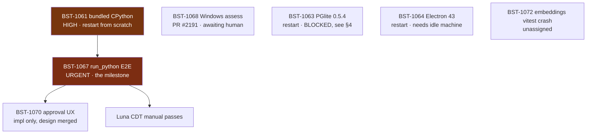

# Handoff — Agent Code Sandboxing (Two-Mode Path)

**Date:** 2026-08-01 · **Linear project:** [Agent Code Sandboxing — Two-Mode Path](https://linear.app/brainstrike/project/agent-code-sandboxing-two-mode-path-90a52846fbe8)

Read this file end to end before picking up a ticket. It carries findings that
are **not** in the tickets and not recoverable from the code — including three
real sandbox escapes that were found and fixed, and three lanes whose work was
lost with their worktrees.

---

## 1. Where the project stands

**Brainstrike can now execute code inside a real OS-level sandbox.** The seam,
the fence, and the adversarial test suite are all on `main`.

### Merged (9 tickets)

| Ticket | What landed | Commit |
| --- | --- | --- |
| BST-1060 | `CodeExecutor` seam + review hardening | `d809f0d`, `8448ffd` |
| BST-1062 | **FenceExecutor** — srt 0.0.67, Seatbelt/bubblewrap | `5277afc` |
| BST-1065 | transformers.js v4 vector-parity guard | `57756e1` |
| BST-1066 | quickjs-ng JS sandbox spike | `0f92dc0` |
| BST-1069 | Mode-two VM ADR (**Accepted**) | `29aab71` |
| BST-1070 | Approval UX **design spec only** | `9364140` |
| BST-1071 | **Escape-resistance suite + 3 real escape fixes** | `9b419c4` |
| BST-1073 | Plan-mode suspend bypass (security) | `fafd325` |
| BST-1074 | Windows guard footguns (security) | `ae67943` |

Three of those (1071's fixes, 1073, 1074) were **defects discovered during the
work**, not planned tickets. All three were the kind that fail silently.

### Authoritative docs — read before touching these areas

- `docs/agents/code-execution.md` — the seam contract. **Start here.**
- `docs/adr/0003-mode-two-full-isolation-vm.md` — mode two, Accepted.
- `docs/run-python-approval-ux-design-2026-08-01.md` — BST-1070's spec.
- `packages/agent/src/__tests__/fence-escape-resistance.README.md` — what the
  fence does and does **not** guarantee. Honest non-guarantees live here.

---

## 2. The remaining graph

**Critical path is exactly one chain:** BST-1061 → BST-1067 → BST-1070. Everything
else is parallel and independent.

---

## 3. In-flight work that was LOST — restart these

BST-1061, BST-1063 and BST-1064 were being worked in agent worktrees that were
**never pushed**. `git ls-remote` confirms no remote branches exist. Their code
is gone; their **findings are below and are the valuable part**. Restart the
implementation, do not restart the investigation.

---

## 4. Per-ticket context

### BST-1061 — Bundle a pinned CPython · **HIGH · start here**

Blocks the milestone. Restart from scratch, but with these constraints already
established (they are in the ticket, repeated here because they are easy to miss):

- `resolvePythonBinary()` **must return an absolute path**. `ExecPolicy` paths are
  absolute-only and a literal `~` is *rejected*, not expanded.
- **Verify the unpack location is readable inside the fence.** `ALWAYS_DENY_READ_PATHS`
  covers `~/.ssh`, `~/.aws`, `~/.config/gh`, `~/.npmrc` and friends. A per-user
  app-data dir should be fine — but an interpreter the sandbox can't read fails
  as an opaque spawn error, which is miserable to debug.
- **The interpreter is INJECTED**, not imported. `FenceExecutor` takes
  `FenceInterpreter { command, args?, env?, scriptExtension }`. Expose the
  resolver in a form desktop wiring can hand over.
- The typed "python unavailable" error must be **distinguishable** from
  `NoSandboxConfiguredError` / `ExecCapabilityMismatchError`, so `run_python` can
  tell the user which half is missing — no interpreter vs no sandbox.
- Build-time checksum-pinned fetch. **Not** `postinstall` (Electron 42 removed
  its own for supply-chain reasons; match that posture).
- Wire the unpacked dir into **factory reset**.

**Salvaged before the lane was lost — PR #2205 (draft), branch
`seandearnaley/bst-1061-bundle-a-pinned-cpython-...`.** It contains only
`apps/desktop/resources/python-runtime/manifest.json` plus a `.gitignore` rule,
but it carries the expensive part: the pinned release, **independently verified
by downloading both tarballs and hashing them**.

| Field | Value |
| --- | --- |
| Release tag | `20260728` |
| CPython | `3.13.14`, `install_only` |
| `aarch64-apple-darwin` | `a48399e6ddbb9ccf215eb5afea8f40eca289c808f99faa5d38f35f575a6f1784` |
| `x86_64-apple-darwin` | `1cae8109be20b827cf39abe76f0ef6fdb5cfc621ab1791beda77abf8ea7bb75e` |

Re-verify if you want, but these were hashed from the real downloads, not copied.

Two further notes from that lane: `app.getPath('userData')` is a **sibling of, not
a descendant of**, the fence's always-deny credential paths — reasoned-safe, but
verify it against the now-merged `ALWAYS_DENY_READ_PATHS` rather than trusting the
reasoning. And the planned error family (`python_unsupported_platform`,
`python_checksum_mismatch`, `python_unpack_failed`) was chosen to stay clear of
the seam's four typed errors; keep that separation.

The remaining checklist — fetch script, `resolvePythonBinary()`, call-site wiring,
factory-reset, `code-execution.md` note, third-party notices — is itemised in
#2205's body.

### BST-1067 — Ship `run_python` · **URGENT · the milestone**

The ticket carries a ⚠️ **Contract corrections** block. Read it: the original
wiring snippet in the ticket body *would throw* against the shipped schema.

Additional scope from BST-1070's design review that is **not** in the ticket:

1. **The pre-run approval card cannot show the writable path at all** without an
   additive typed `executionContext` field. It must be forwarded in **three**
   places — the approval chunk, `DataStreamMapper.handleToolApprovalRequired`
   (which rebuilds the request field-by-field), and rediscovery. Miss the mapper
   and every *live* approval degrades while only rediscovered ones work.
2. **Register it as the factory-returned Mastra Tool object directly**, not via
   the `{description, execute, id, inputSchema}` literal every other native tool
   uses (`assistant-tools.ts:558-568`). Re-wrapping **drops `suspendSchema`**, and
   the failure is silent: `hasSuspendSchema` goes false, the network gate never
   fires, and the run executes with a non-empty `allowedDomains` and no prompt.
3. **Exclude it for the built-in local provider**, alongside `askUser`/`submitPlan`.
4. `suspend()` returns `Promise<void>` — it does **not** resolve to the decision.
   Branch on `context.agent.resumeData` before calling it. Mirror `ask-user-tool.ts`.
5. Do not reclassify `submitPlan`/`askUser` risk. They survive plan mode *only*
   because they are `read`; BST-1073's guard test pins this.

### BST-1070 — Approval UX · implementation only

Design is merged and detailed. Settled rulings: **two gates on two channels**
(approval channel = "may this run", suspension channel = "may it reach these
domains" — the latter per-call, argument-aware, structurally ungrantable);
**no carve-out** from the blanket session grant (the honest comparison is
`run_python` vs `executeCommand`, already covered and strictly more dangerous);
six seam gaps listed in the spec.

### BST-1068 — Windows fence · **awaiting a human, do not merge**

PR #2191 is open and complete on the agent side. A human Windows reviewer is
executing the test plan. **Three results could change the recommendation**:
§6.3 raw TCP (must be exactly `WinError 10013`), §6.4/d1 the Python/OpenSSL
revocation leg, §6.6 the median that decides per-exec vs per-workspace policy.

Current recommendation: **absent factory on win32**, no elevated-install prompt.
The blocker is *expressibility*, not maturity — Windows srt fixes filesystem
scope at `initialize()`, so a per-execution `ExecPolicy` cannot be honoured.

### BST-1063 — PGlite 0.5.4 · **likely BLOCKED, needs a decision**

Two findings from the lost lane:

1. **The bump drags pg_textsearch to 1.3.1** — the exact version
   `docs/agents/database.md` records as producing invalid BM25 page chains, which
   is why migration 066 hard-checks `extversion = '1.2.0'`. The extension family
   is peer-locked, so it may not be splittable.
2. **A vitest worker crash on 0.5.4 solo that did not occur on 0.5.3 solo.**
   Contention timeouts were discarded as noise; the solo crash is the real signal
   and was not yet reproduced enough times to be conclusive.

**Do not move migration 066's guard off its exact-version check without ≥5
consecutive clean runs of `pg-textsearch-durability-gate.integration.test.ts` on
an idle machine.** A well-evidenced "blocked, here's why" is the correct outcome
if that evidence can't be obtained.

### BST-1064 — Electron 43 · needs an idle machine

The before/after boot median is the entire accept/reject signal. **Do not measure
on a contended host.** BST-1065's benchmark had to be retracted after swinging
from "+42% faster" to "2.5× slower" across four runs of identical code at load
average 30+. Report median *and* spread; if the distributions overlap, say
inconclusive rather than reporting a delta.

### BST-1072 — embeddings vitest worker crash · unassigned

Latent, not fixed. Any PR touching root `biome.json`/`tsconfig.json` marks all 43
packages affected and hits a reproducible `[vitest-pool]: Worker exited
unexpectedly` in the `packages/embeddings` integration lane (3/3 on PR #2187).
Ticket carries the repro recipe.

**Methodology gotcha preserved there:** turbo's `--filter="...[ref]"` diffs
**committed** refs and silently ignores working-tree changes. An earlier attempt
to test this by swapping config contents without committing produced a false
negative. Commit each scenario.

---

## 5. How to work — non-negotiable

### Model routing

| Role | Model |
| --- | --- |
| Planning, architecture, review, rulings | **Fable** |
| Implementation | **opus-5** or **gpt-5.6 sol** (via `codex exec`) |
| CDT / manual app testing | **gpt-5.6 luna** |

Escalate rather than ship mediocre output. Never Haiku.

### The merge gate — all four, every time

1. **Wait 10+ minutes after pushing.** Review bots take that long.
2. **Fetch inline comments**: `gh api repos/seandearnaley/brainstrike/pulls/<n>/comments --paginate`.
   `gh pr view --json reviews` shows **empty bodies** for these bots — the
   substance is inline only. This is how a PR was merged with 15 unaddressed
   comments earlier in this project.
3. **Address or explicitly justify declining every comment**, then reply per
   thread: `gh api repos/seandearnaley/brainstrike/pulls/<n>/comments/<id>/replies -f body='...'`
   (the PR number in the path is required; the shorter form 404s). End each reply
   with `_🤖 Addressed by [Claude Code](https://claude.com/claude-code)_`.
4. **Verify the checks are real.** Two traps, both hit this session:
   - A force-push may not re-trigger CI, leaving a **stale-green** PR on an old
     SHA. Check `gh api .../actions/runs?head_sha=<head>`; close/reopen to fire.
   - "Zero pending, zero failing" is **not green** if the matrix hasn't
     registered. Assert `Unit (rest)`, `Unit (db)`, `Static`, `Build` exist **by
     name** — otherwise Vercel resolving first looks identical to success.

Merge only after several green rounds. Commit and push freely; let the bots review.

### Testing

**RED/GREEN TDD, and mutation-prove every security assertion.** Break the guard,
watch the specific test fail, restore. This caught real gaps in three separate
PRs this session — including two of mine — and caught two tests that were passing
for the wrong reason in the escape suite itself.

**Do not relax a test to make it pass.** If a test is wrong, prove it is wrong and
say so; if it is flaky, diagnose the flake. "Passed on re-run" is not a diagnosis.

**Lane placement:** real OS primitives, PGlite, native binaries, or wall-clock
timing ⇒ `*.integration.spec.ts` and the integration lane. Everything else stays
in the cacheable unit lane. **Do not move tests between lanes to make CI green** —
that is relaxing a test with extra steps. If a lane is genuinely misassigned, say
so and fix the assignment deliberately, with the reasoning recorded. Note PR
#2203 (native Vitest DB shards) is in flight from another session and touches
shard/coverage reconciliation — coordinate rather than collide.

### House rules

TypeScript strict, never `any`. NO SILENT FALLBACKS — malformed or unsupported
states throw visibly. Capability-based gating, never `isElectron()`. New
persistent state wires into factory reset. Fresh branch per ticket, never work on
`main`. Update the paired `docs/agents/*.md` contract **in the same change** —
AGENTS.md requires it and reviewers enforce it.

### Operational gotchas

- **`codex exec` cannot commit inside a git worktree** under `-s workspace-write`.
  A worktree's git metadata (`.git/worktrees/<name>/index.lock`) lives *outside*
  the `--cd` tree, so the sandbox denies it with `Operation not permitted`. This
  is structural, not a fluke, and it silently shaped several lanes today. Either
  **have the orchestrating session run the commits**, or don't put codex in a
  worktree. A codex agent that "can't commit" will otherwise sit on uncommitted
  work until its worktree is pruned — combining both traps in this list.
- **Commit within your first few tool calls.** An unchanged agent worktree gets
  auto-pruned mid-run; this destroyed one lane's work today, and nearly took the
  bundled-CPython checksums with it.
- **Never end a turn idle waiting on background work.** Attach a Monitor or an
  until-loop, or the lane stalls silently.
- **This machine is heavily contended.** Do not write wall-clock-tight
  assertions, and treat any timing measurement taken here as suspect.

---

## 6. The pattern to watch for

Nearly every defect found in this project shares one property: **it fails
silently.**

A suspend schema quietly bypassing plan mode. A fence quietly inheriting provider
API keys. A descendant quietly surviving into the next run's network policy. A
registration shape that quietly drops `suspendSchema` so the network prompt never
fires. A `realpath` that quietly doesn't canonicalise case under a comment
claiming it does. And the three escapes: `allowRead: ['/']` quietly defeating
every credential deny on macOS — sandboxed code read real `~/.ssh` private-key
filenames and the contents of `~/.config/gh/hosts.yml` — while **Linux was
unaffected, so CI alone would never have caught it**.

None of these threw. Several would have shipped green, because the tests restated
the implementation instead of challenging it.

So: when you add a guard, ask **"if this mechanism were entirely absent, would
this test still pass?"** If yes, the test is decoration. And when a security test
involves the network, it needs a paired positive control — otherwise "blocked" is
indistinguishable from "unreachable".

One standing operational consequence: the root-`allowRead` escape test is
non-vacuous on macOS but **vacuously true on Linux**, so any srt version bump must
be re-greened on **both** platforms. That procedure is in the escape-suite README.
