# Mermaid Diagram Guide for BrainStrike

This guide documents best practices, common pitfalls, and testing procedures for Mermaid diagrams in this project.

## Table of Contents
- [Prerequisites](#prerequisites)
- [Validation Script](#validation-script)
- [Common Syntax Errors](#common-syntax-errors)
- [Node Shapes & Syntax](#node-shapes--syntax)
- [Diagram Types](#diagram-types)
- [Best Practices](#best-practices)
- [Troubleshooting](#troubleshooting)

## Prerequisites

### Required Dependencies
```bash
# Already installed in this project
pnpm add -D mermaid glob
```

### Validation Script Location
- **Script**: `scripts/validate-mermaid.mjs`
- **Purpose**: Validates Mermaid syntax in all markdown files
- **Usage**: `node scripts/validate-mermaid.mjs`

## Validation Script

### How It Works
The validation script:
1. Scans all `.md` files in `docs/architecture/`
2. Extracts Mermaid code blocks
3. Validates syntax for common errors:
   - Unquoted parentheses in labels
   - Invalid comments in ER diagrams
   - Other syntax violations

### Running Validation
```bash
# From project root
node scripts/validate-mermaid.mjs

# Expected output on success:
✅ All Mermaid diagrams pass syntax validation

# Expected output on errors:
✗ Diagram 1: SYNTAX ERRORS
  Line 5: Parentheses in unquoted label: Node[Label (error)]
```

### When to Run
**ALWAYS run after**:
- Creating a new Mermaid diagram
- Editing any existing diagram
- Before committing changes
- During code review

## Common Syntax Errors

### 1. Parentheses in Unquoted Labels ⚠️

**Problem**: Parentheses have special meaning in Mermaid and break unquoted labels.

**WRONG**:
```mermaid
flowchart LR
  A[Web App (Vite/React)]
  B[Lambda: Auth (verify)]
```

**CORRECT**:
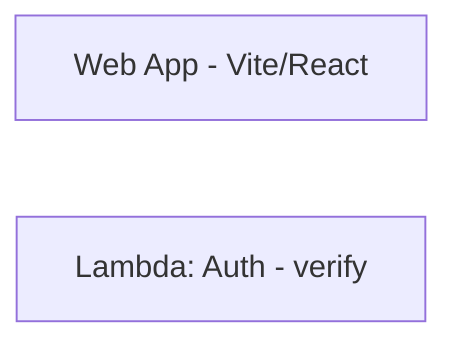

**Alternative (if parentheses needed)**:
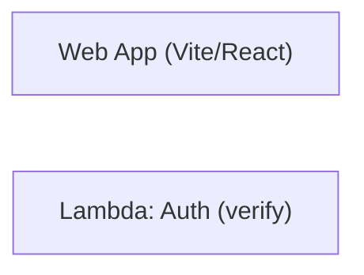

### 2. Comments in ER Diagrams ❌

**Problem**: ER diagrams don't support `//` comments in field definitions.

**WRONG**:
```mermaid
erDiagram
  USER {
    uuid id PK
    vector vec  // pgvector type
  }
```

**CORRECT**:
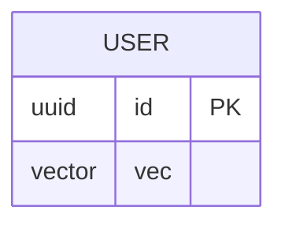

*Add comments outside the diagram or in the markdown text.*

### 3. Line Breaks in Labels

**Recommended**: Use `<br/>` for HTML-style line breaks (works everywhere).

**Also Valid**: `\\n` but ONLY when label is quoted.

**WRONG**:
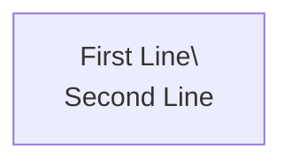

**CORRECT**:
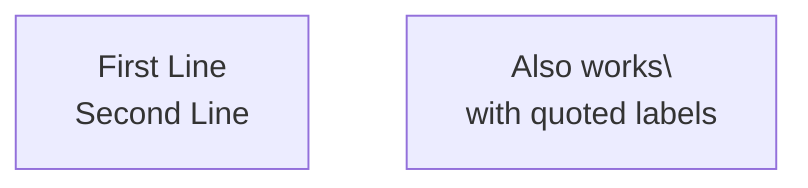

### 4. Special Characters in Labels

**Characters that require quoting**: `()`, `:`, `,`, `/`, `*`, `&`, etc.

**WRONG**:
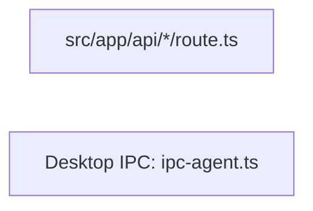

**CORRECT**:


## Node Shapes & Syntax

### Basic Shapes

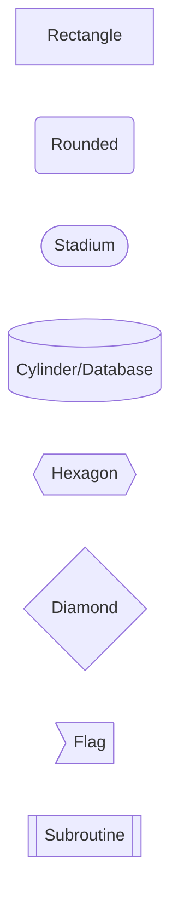

### Important Notes on Cylinder Nodes

**Cylinder/Database nodes use `[(` and `)]` - this IS valid syntax:**

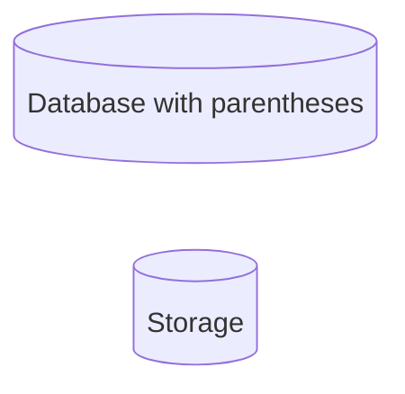

The validation script correctly handles this special case.

### Link/Edge Syntax

```mermaid
flowchart LR
  A --> B  %% Solid arrow
  C -.-> D  %% Dotted arrow
  E ==> F  %% Thick arrow
  G -->|label| H  %% Labeled arrow
  I <--> J  %% Bidirectional
  K --x L  %% Cross
  M --o N  %% Circle
```

## Diagram Types

### 1. Flowcharts

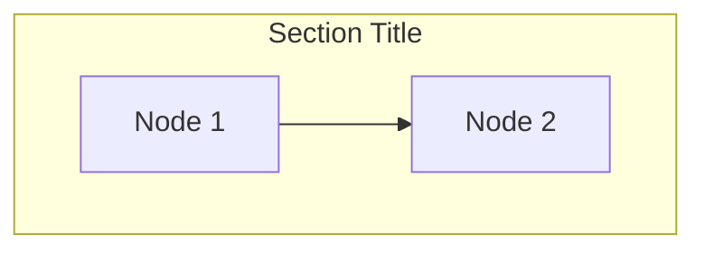

**Directions**: `TB` (top-bottom), `LR` (left-right), `BT`, `RL`

### 2. Sequence Diagrams

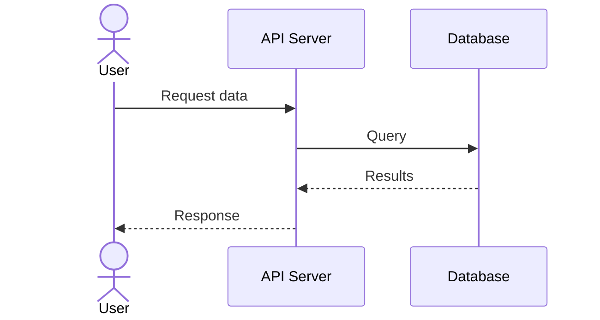

**Key Points**:
- No parentheses in participant names without quotes
- Use `as` for aliases
- `actor` for user-type participants

### 3. ER Diagrams

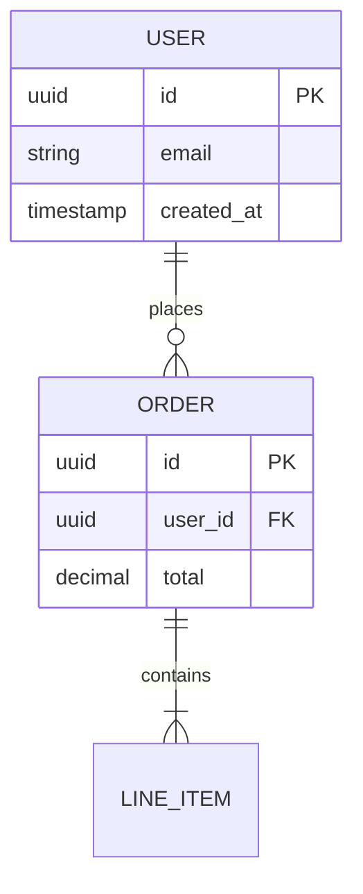

**Key Points**:
- NO comments allowed in field definitions
- Relationship syntax: `||--o{` (one-to-many), `||--||` (one-to-one), etc.

### 4. State Diagrams

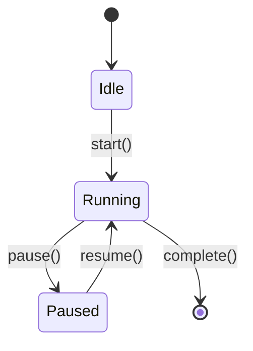

## Best Practices

### 1. Consistency
- Use same quote style throughout (prefer double quotes `"`)
- Be consistent with line break style (`<br/>` recommended)
- Use descriptive node IDs (e.g., `API` not `A`)

### 2. Readability
- Add subgraphs to organize complex diagrams
- Use meaningful labels
- Keep diagrams focused (split complex ones into multiple diagrams)

### 3. Maintainability
- **Test after every edit** with validation script
- Add comments in markdown, NOT in diagrams
- Document diagram purpose in surrounding text

### 4. Architecture Diagrams
- Follow C4 model conventions (see `docs/architecture/`)
- Use proper numbering (01, 02, 03... not 10, 20, 30)
- Include verification notes where assumptions exist

## Troubleshooting

### Problem: Validation Script Fails

**Check**:
1. Script runs from project root
2. Dependencies installed: `pnpm install`
3. Files are in `docs/architecture/` directory

### Problem: "DOMPurify" Errors

**Cause**: Old version of validation script using browser-based renderer.

**Solution**: Current script uses syntax-only validation, no browser needed.

### Problem: Diagram Looks Wrong on GitHub

**Cause**: GitHub's Mermaid renderer is strict about syntax.

**Solution**:
1. Run validation script
2. Test in Mermaid Live Editor: https://mermaid.live/
3. Fix any errors found

### Problem: Parentheses Needed in Label

**Solutions**:
1. Quote the entire label: `["Label (with parens)"]`
2. Replace with dashes: `["Label - with dashes"]`
3. For cylinder nodes, `[(...)` is valid: `DB[("Database (PG)")]`

## Example: Fixing a Broken Diagram

**Before (BROKEN)**:
```mermaid
flowchart LR
  A[Web (Vite)] --> B[API (Lambda)]
  B --> C[(DB (Postgres))]
  C --> D{Cache?}
  D -->|yes| E[Redis (verify)]
```

**After (FIXED)**:
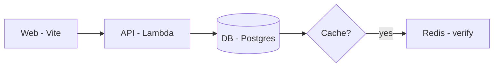

**Changes made**:
1. Quoted labels with parentheses
2. Replaced `(` with `-` where parentheses weren't essential
3. Used proper cylinder syntax for database: `[("...")]`

## Quick Reference Card

| Issue | Wrong | Right |
|-------|-------|-------|
| Parentheses | `[Label (text)]` | `["Label - text"]` or `["Label (text)"]` |
| Colons | `[Label: text]` | `["Label: text"]` |
| Line breaks | `[Line 1\\nLine 2]` | `["Line 1<br/>Line 2"]` |
| Comments (ER) | `field // comment` | Remove or add outside diagram |
| Database node | `[(DB (name))]` | `[("DB - name")]` or `[(DB name)]` |

## Resources

- **Mermaid Documentation**: https://mermaid.js.org/
- **Live Editor**: https://mermaid.live/
- **Syntax Reference**: https://mermaid.js.org/syntax/
- **Validation Script**: `scripts/validate-mermaid.mjs`
- **Architecture Docs**: `docs/architecture/`

## Version History

- **2025-01-26**: Initial guide created after fixing all architecture diagrams
  - Fixed 5 files with parentheses errors
  - Fixed 1 ER diagram with illegal comments
  - Created validation script
  - Renamed files from 10-80 to 01-09
