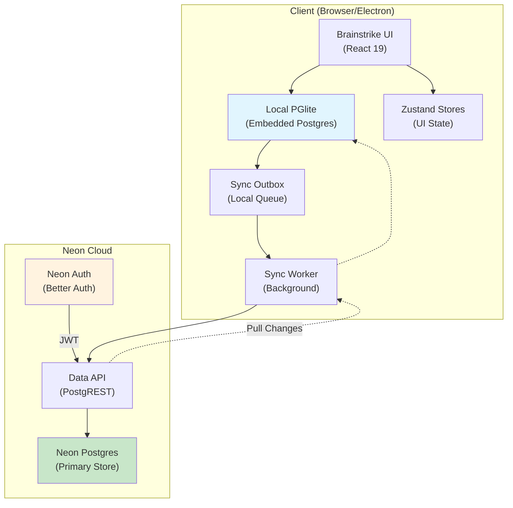
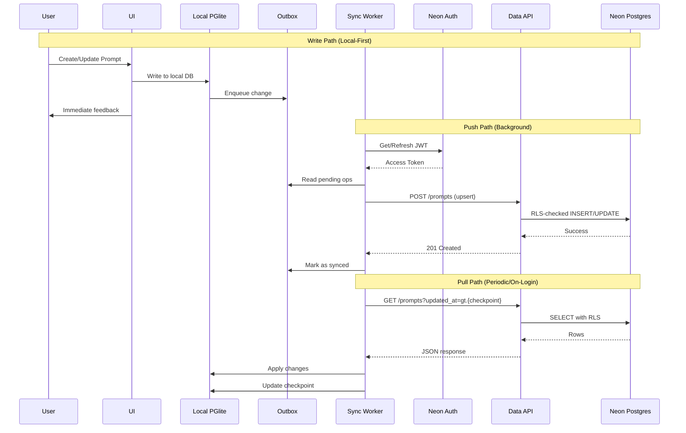
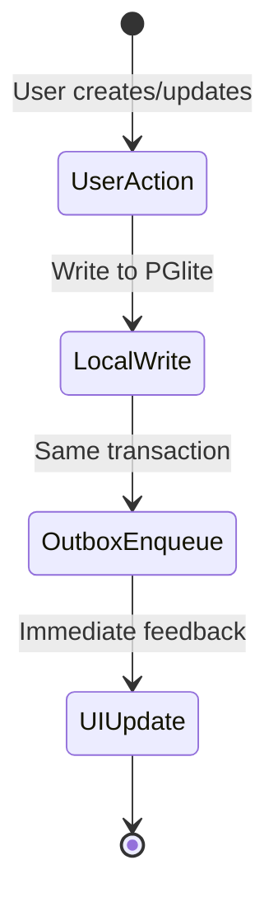

# Brainstrike Local-First Sync Plan (Neon Auth + Neon Data API)

**Date:** 2026-01-08
**Last Updated:** 2026-01-08
**Owner:** Brainstrike team
**Status:** Enhanced draft ready for implementation
**Target Release:** Q1 2026

---

## Executive Summary

Brainstrike is a local-first application using PGlite for embedded storage. User-created content like prompts is currently stored in localStorage via Zustand, making it vulnerable to data loss from PGlite corruption, browser storage limits, or device changes.

This plan implements serverless sync using **Neon Auth** (Better Auth-based authentication) and **Neon Data API** (PostgREST-compatible REST interface) as the cloud backing store. The architecture preserves local-first UX while enabling cross-device sync and data recovery.

### Key Goals
- **Local-first UX**: Reads and writes always go to local storage first
- **Offline support**: Full offline editing with eventual sync
- **Data recovery**: Recover user data if local DB is corrupted or cleared
- **Serverless**: No custom backend required (Neon Auth + Data API)
- **Type-safe**: Drizzle ORM with RLS policies defined in code

### Non-Goals (Phase 1)
- Real-time collaborative editing
- Syncing file paths, embeddings, or job queues
- Replacing all localStorage-based UI state simultaneously

---

## Table of Contents

1. [External Facts and Constraints](#external-facts-and-constraints)
2. [Architecture Overview](#architecture-overview)
3. [Data Classification](#data-classification)
4. [Server Schema (Neon)](#server-schema-neon)
5. [Local Schema Additions (PGlite)](#local-schema-additions-pglite)
6. [Authentication and Security](#authentication-and-security)
7. [Drizzle ORM RLS Integration](#drizzle-orm-rls-integration)
8. [Client Integration](#client-integration)
9. [Sync Strategy](#sync-strategy)
10. [Write Patterns Analysis](#write-patterns-analysis)
11. [Conflict Resolution](#conflict-resolution)
12. [Failure and Recovery](#failure-and-recovery)
13. [Observability](#observability)
14. [Implementation Phases](#implementation-phases)
15. [Testing Strategy](#testing-strategy)
16. [Security Hardening](#security-hardening)
17. [Risks and Mitigations](#risks-and-mitigations)
18. [Future Considerations](#future-considerations)
19. [Open Questions](#open-questions)
20. [References](#references)

---

## External Facts and Constraints

### Neon Auth (Beta)
- Managed authentication system built on **Better Auth**
- Stores data in `neon_auth` schema in your Neon database
- **Branchable** with Neon database branches (excellent for preview environments)
- Issues JWTs with `sub` claim containing unique user ID
- Exposes predefined roles: `authenticated`, `anonymous`
- Provides `auth.user_id()` SQL function for RLS policies

**Sources:**
- https://neon.com/docs/neon-auth/get-started
- https://neon.com/docs/neon-auth/api
- https://neon.com/blog/neon-auth

### Neon Data API (Beta)
- PostgREST-compatible REST interface for Postgres
- Requires JWT authentication
- Secured via Postgres RLS policies
- **Cannot be enabled when IP Allow is configured** for the project
- Supports `authenticated` and `anonymous` roles
- Custom roles via `role` claim in JWT

**API Roles:**
| Role | Usage |
|------|-------|
| `authenticated` | Requests with valid JWT (primary role for app users) |
| `anonymous` | Requests without Authorization header (no permissions by default) |
| Custom roles | Via `role` claim in JWT (e.g., `"role": "admin"`) |

**Sources:**
- https://neon.com/docs/data-api/get-started

### PGlite Sync Limitations
- Current sync plugin is **pull-only** (alpha)
- Does **not** push local writes or perform conflict resolution
- Requires Electric shape stream endpoint
- Multi-table sync supported with transactional consistency
- In-memory aggregation during initial sync may cause high memory usage

**Implication:** This plan uses a custom outbox-based push strategy rather than PGlite sync for writes. Electric sync may be adopted later for streaming read updates.

**Sources:**
- https://pglite.dev/docs/sync
- https://electric-sql.com/docs/guides/writes

### Drizzle ORM RLS Support
- Native RLS policy definitions in TypeScript
- `pgPolicy()` for raw policies, `crudPolicy()` for Neon-specific patterns
- Predefined Neon roles: `authenticatedRole`, `anonymousRole`
- `authUid()` helper for user ID comparisons
- Policy migrations managed by drizzle-kit

**Sources:**
- https://orm.drizzle.team/docs/rls

---

## Architecture Overview



### Data Flow Sequence



---

## Data Classification

### Sync Candidates (Cross-Device Recovery)

| Entity | Sync Strategy | Notes |
|--------|--------------|-------|
| Prompts | Full sync with revisions | Core user content |
| Prompt Categories | Full sync | User organization |
| Prompt Revisions | Full sync | Version history |
| User Settings (synced) | Key-value sync | Model preferences, provider config |
| UI Layout (optional) | Per-user, device-agnostic | Panel positions, theme |

### Local-Only Data (Device-Specific)

| Entity | Reason |
|--------|--------|
| File Records | Device-specific paths, large content |
| File Chunks | Heavy embeddings, derived data |
| Embeddings | Model-specific, regenerable |
| Embedding Sets | Device-specific configurations |
| Job Queue | Device-scoped processing |
| Token Cache | Performance optimization, regenerable |
| File System Handles | Browser API handles, non-serializable |

---

## Server Schema (Neon)

All tables use UUIDs, soft deletes, and include `user_id` and `updated_at` for sync.

### prompt_categories

```sql
CREATE TABLE prompt_categories (
  id UUID PRIMARY KEY DEFAULT gen_random_uuid(),
  user_id UUID NOT NULL,
  name TEXT NOT NULL,
  color TEXT NOT NULL DEFAULT '#64748b',
  icon TEXT NOT NULL DEFAULT 'Box',
  description TEXT,
  sort_order INTEGER NOT NULL DEFAULT 0,
  created_at TIMESTAMPTZ NOT NULL DEFAULT now(),
  updated_at TIMESTAMPTZ NOT NULL DEFAULT now(),
  deleted_at TIMESTAMPTZ,

  CONSTRAINT unique_category_name_per_user UNIQUE (user_id, name)
);

CREATE INDEX idx_prompt_categories_user_id ON prompt_categories(user_id);
CREATE INDEX idx_prompt_categories_updated_at ON prompt_categories(updated_at);
CREATE INDEX idx_prompt_categories_not_deleted ON prompt_categories(user_id)
  WHERE deleted_at IS NULL;
```

### prompts

```sql
CREATE TABLE prompts (
  id UUID PRIMARY KEY DEFAULT gen_random_uuid(),
  user_id UUID NOT NULL,
  category_id UUID REFERENCES prompt_categories(id) ON DELETE SET NULL,
  title TEXT NOT NULL,
  content TEXT NOT NULL,
  tags TEXT[] DEFAULT '{}',
  model_settings JSONB DEFAULT '{}',
  rating INTEGER CHECK (rating >= 0 AND rating <= 5),
  is_favorite BOOLEAN NOT NULL DEFAULT false,
  site_url TEXT,
  created_at TIMESTAMPTZ NOT NULL DEFAULT now(),
  updated_at TIMESTAMPTZ NOT NULL DEFAULT now(),
  deleted_at TIMESTAMPTZ,

  -- Conflict detection
  version INTEGER NOT NULL DEFAULT 1,
  last_modified_device TEXT
);

CREATE INDEX idx_prompts_user_id ON prompts(user_id);
CREATE INDEX idx_prompts_category_id ON prompts(category_id);
CREATE INDEX idx_prompts_updated_at ON prompts(updated_at);
CREATE INDEX idx_prompts_not_deleted ON prompts(user_id) WHERE deleted_at IS NULL;
CREATE INDEX idx_prompts_favorites ON prompts(user_id, is_favorite) WHERE deleted_at IS NULL;
```

### prompt_revisions

```sql
CREATE TABLE prompt_revisions (
  id UUID PRIMARY KEY DEFAULT gen_random_uuid(),
  prompt_id UUID NOT NULL REFERENCES prompts(id) ON DELETE CASCADE,
  user_id UUID NOT NULL,
  content TEXT NOT NULL,
  note TEXT,
  model_settings JSONB,
  created_at TIMESTAMPTZ NOT NULL DEFAULT now(),

  -- Track which device created this revision
  source_device TEXT
);

CREATE INDEX idx_prompt_revisions_prompt_id ON prompt_revisions(prompt_id);
CREATE INDEX idx_prompt_revisions_user_id ON prompt_revisions(user_id);
CREATE INDEX idx_prompt_revisions_created_at ON prompt_revisions(created_at DESC);
```

### user_settings

```sql
CREATE TABLE user_settings (
  user_id UUID NOT NULL,
  key TEXT NOT NULL,
  value JSONB NOT NULL,
  updated_at TIMESTAMPTZ NOT NULL DEFAULT now(),
  device_id TEXT, -- NULL for cross-device settings
  version INTEGER NOT NULL DEFAULT 1,

  PRIMARY KEY (user_id, key, COALESCE(device_id, ''))
);

CREATE INDEX idx_user_settings_user_id ON user_settings(user_id);
CREATE INDEX idx_user_settings_updated_at ON user_settings(updated_at);
```

### Trigger for updated_at

```sql
CREATE OR REPLACE FUNCTION trigger_set_updated_at()
RETURNS TRIGGER AS $$
BEGIN
  NEW.updated_at = now();
  RETURN NEW;
END;
$$ LANGUAGE plpgsql;

-- Apply to all synced tables
CREATE TRIGGER set_updated_at BEFORE UPDATE ON prompt_categories
  FOR EACH ROW EXECUTE FUNCTION trigger_set_updated_at();
CREATE TRIGGER set_updated_at BEFORE UPDATE ON prompts
  FOR EACH ROW EXECUTE FUNCTION trigger_set_updated_at();
CREATE TRIGGER set_updated_at BEFORE UPDATE ON user_settings
  FOR EACH ROW EXECUTE FUNCTION trigger_set_updated_at();
```

---

## Local Schema Additions (PGlite)

### Drizzle Schema (packages/db/src/schema/sync.ts)

```typescript
import { boolean, integer, pgTable, text, timestamp, uuid, jsonb } from 'drizzle-orm/pg-core';

// ============================================================================
// PROMPT CATEGORIES (LOCAL MIRROR)
// ============================================================================

export const promptCategories = pgTable('prompt_categories', {
  id: uuid('id').defaultRandom().primaryKey(),
  userId: uuid('user_id'), // NULL until authenticated
  name: text('name').notNull(),
  color: text('color').notNull().default('#64748b'),
  icon: text('icon').notNull().default('Box'),
  description: text('description'),
  sortOrder: integer('sort_order').notNull().default(0),
  createdAt: timestamp('created_at', { withTimezone: true }).defaultNow().notNull(),
  updatedAt: timestamp('updated_at', { withTimezone: true }).defaultNow().notNull(),
  deletedAt: timestamp('deleted_at', { withTimezone: true }),

  // Sync metadata
  dirty: boolean('dirty').notNull().default(true),
  localUpdatedAt: timestamp('local_updated_at', { withTimezone: true }).defaultNow().notNull(),
  remoteUpdatedAt: timestamp('remote_updated_at', { withTimezone: true }),
});

// ============================================================================
// PROMPTS (LOCAL MIRROR)
// ============================================================================

export const prompts = pgTable('prompts', {
  id: uuid('id').defaultRandom().primaryKey(),
  userId: uuid('user_id'),
  categoryId: uuid('category_id').references(() => promptCategories.id, { onDelete: 'set null' }),
  title: text('title').notNull(),
  content: text('content').notNull(),
  tags: text('tags').array().default([]),
  modelSettings: jsonb('model_settings').default({}),
  rating: integer('rating'),
  isFavorite: boolean('is_favorite').notNull().default(false),
  siteUrl: text('site_url'),
  createdAt: timestamp('created_at', { withTimezone: true }).defaultNow().notNull(),
  updatedAt: timestamp('updated_at', { withTimezone: true }).defaultNow().notNull(),
  deletedAt: timestamp('deleted_at', { withTimezone: true }),
  version: integer('version').notNull().default(1),
  lastModifiedDevice: text('last_modified_device'),

  // Sync metadata
  dirty: boolean('dirty').notNull().default(true),
  localUpdatedAt: timestamp('local_updated_at', { withTimezone: true }).defaultNow().notNull(),
  remoteUpdatedAt: timestamp('remote_updated_at', { withTimezone: true }),
  conflictState: text('conflict_state').$type<'none' | 'local_wins' | 'remote_wins' | 'unresolved'>().default('none'),
});

// ============================================================================
// PROMPT REVISIONS (LOCAL MIRROR)
// ============================================================================

export const promptRevisions = pgTable('prompt_revisions', {
  id: uuid('id').defaultRandom().primaryKey(),
  promptId: uuid('prompt_id').notNull().references(() => prompts.id, { onDelete: 'cascade' }),
  userId: uuid('user_id'),
  content: text('content').notNull(),
  note: text('note'),
  modelSettings: jsonb('model_settings'),
  createdAt: timestamp('created_at', { withTimezone: true }).defaultNow().notNull(),
  sourceDevice: text('source_device'),

  // Sync metadata
  dirty: boolean('dirty').notNull().default(true),
});

// ============================================================================
// USER SETTINGS (LOCAL MIRROR)
// ============================================================================

export const userSettings = pgTable('user_settings', {
  userId: uuid('user_id').notNull(),
  key: text('key').notNull(),
  value: jsonb('value').notNull(),
  updatedAt: timestamp('updated_at', { withTimezone: true }).defaultNow().notNull(),
  deviceId: text('device_id'),
  version: integer('version').notNull().default(1),

  // Sync metadata
  dirty: boolean('dirty').notNull().default(true),
  localUpdatedAt: timestamp('local_updated_at', { withTimezone: true }).defaultNow().notNull(),
  remoteUpdatedAt: timestamp('remote_updated_at', { withTimezone: true }),
});

// ============================================================================
// SYNC OUTBOX
// ============================================================================

export const syncOutbox = pgTable('sync_outbox', {
  id: uuid('id').defaultRandom().primaryKey(),
  entityType: text('entity_type').$type<'prompts' | 'categories' | 'revisions' | 'settings'>().notNull(),
  entityId: uuid('entity_id').notNull(),
  operation: text('operation').$type<'insert' | 'update' | 'delete'>().notNull(),
  payload: jsonb('payload').notNull(),
  createdAt: timestamp('created_at', { withTimezone: true }).defaultNow().notNull(),
  attempts: integer('attempts').notNull().default(0),
  lastError: text('last_error'),
  status: text('status').$type<'pending' | 'processing' | 'failed' | 'completed'>().notNull().default('pending'),
  nextRetryAt: timestamp('next_retry_at', { withTimezone: true }),
});

// ============================================================================
// SYNC CHECKPOINT
// ============================================================================

export const syncCheckpoint = pgTable('sync_checkpoint', {
  tableName: text('table_name').primaryKey(),
  lastSyncedAt: timestamp('last_synced_at', { withTimezone: true }).notNull(),
  lastSyncedVersion: integer('last_synced_version'),
});

// ============================================================================
// SYNC STATE
// ============================================================================

export const syncState = pgTable('sync_state', {
  key: text('key').primaryKey(),
  value: jsonb('value').notNull(),
  updatedAt: timestamp('updated_at', { withTimezone: true }).defaultNow().notNull(),
});
```

---

## Authentication and Security

### Neon Auth Configuration

```typescript
// packages/sync/src/auth/neon-auth-client.ts
import { createAuthClient } from '@neon/auth-client';

export const authClient = createAuthClient({
  projectId: process.env.NEON_PROJECT_ID!,
  // OAuth providers configured in Neon Console
});

export async function getAccessToken(): Promise<string | null> {
  const session = await authClient.getSession();
  return session?.accessToken ?? null;
}

export function getCurrentUserId(): string | null {
  const session = authClient.session;
  return session?.user?.id ?? null;
}
```

### Data API Client

```typescript
// packages/sync/src/api/data-api-client.ts
import { getAccessToken } from '../auth/neon-auth-client';

const DATA_API_BASE = `https://${process.env.NEON_PROJECT_ID}.api.neon.tech/v1`;

export async function dataApiRequest<T>(
  path: string,
  options: RequestInit = {}
): Promise<T> {
  const token = await getAccessToken();

  if (!token) {
    throw new Error('Not authenticated');
  }

  const response = await fetch(`${DATA_API_BASE}${path}`, {
    ...options,
    headers: {
      'Authorization': `Bearer ${token}`,
      'Content-Type': 'application/json',
      'Accept': 'application/json',
      'Prefer': 'return=representation', // Return inserted/updated rows
      ...options.headers,
    },
  });

  if (!response.ok) {
    const error = await response.json().catch(() => ({}));
    throw new DataApiError(response.status, error);
  }

  return response.json();
}

export class DataApiError extends Error {
  constructor(
    public readonly status: number,
    public readonly body: unknown
  ) {
    super(`Data API error: ${status}`);
    this.name = 'DataApiError';
  }
}
```

### RLS Policies (Server-Side SQL)

```sql
-- ============================================================================
-- ENABLE RLS ON ALL TABLES
-- ============================================================================

ALTER TABLE prompt_categories ENABLE ROW LEVEL SECURITY;
ALTER TABLE prompts ENABLE ROW LEVEL SECURITY;
ALTER TABLE prompt_revisions ENABLE ROW LEVEL SECURITY;
ALTER TABLE user_settings ENABLE ROW LEVEL SECURITY;

-- ============================================================================
-- GRANT PERMISSIONS TO AUTHENTICATED ROLE
-- ============================================================================

GRANT USAGE ON SCHEMA public TO authenticated;
GRANT SELECT, INSERT, UPDATE, DELETE ON ALL TABLES IN SCHEMA public TO authenticated;
ALTER DEFAULT PRIVILEGES IN SCHEMA public
  GRANT SELECT, INSERT, UPDATE, DELETE ON TABLES TO authenticated;

-- ============================================================================
-- PROMPT CATEGORIES POLICIES
-- ============================================================================

CREATE POLICY "categories_select_own" ON prompt_categories
  FOR SELECT TO authenticated
  USING (user_id = auth.user_id());

CREATE POLICY "categories_insert_own" ON prompt_categories
  FOR INSERT TO authenticated
  WITH CHECK (user_id = auth.user_id());

CREATE POLICY "categories_update_own" ON prompt_categories
  FOR UPDATE TO authenticated
  USING (user_id = auth.user_id())
  WITH CHECK (user_id = auth.user_id());

CREATE POLICY "categories_delete_own" ON prompt_categories
  FOR DELETE TO authenticated
  USING (user_id = auth.user_id());

-- ============================================================================
-- PROMPTS POLICIES
-- ============================================================================

CREATE POLICY "prompts_select_own" ON prompts
  FOR SELECT TO authenticated
  USING (user_id = auth.user_id());

CREATE POLICY "prompts_insert_own" ON prompts
  FOR INSERT TO authenticated
  WITH CHECK (user_id = auth.user_id());

CREATE POLICY "prompts_update_own" ON prompts
  FOR UPDATE TO authenticated
  USING (user_id = auth.user_id())
  WITH CHECK (user_id = auth.user_id());

CREATE POLICY "prompts_delete_own" ON prompts
  FOR DELETE TO authenticated
  USING (user_id = auth.user_id());

-- ============================================================================
-- PROMPT REVISIONS POLICIES (via parent prompt ownership)
-- ============================================================================

CREATE POLICY "revisions_select_own" ON prompt_revisions
  FOR SELECT TO authenticated
  USING (
    EXISTS (
      SELECT 1 FROM prompts
      WHERE prompts.id = prompt_revisions.prompt_id
      AND prompts.user_id = auth.user_id()
    )
  );

CREATE POLICY "revisions_insert_own" ON prompt_revisions
  FOR INSERT TO authenticated
  WITH CHECK (
    user_id = auth.user_id() AND
    EXISTS (
      SELECT 1 FROM prompts
      WHERE prompts.id = prompt_revisions.prompt_id
      AND prompts.user_id = auth.user_id()
    )
  );

-- ============================================================================
-- USER SETTINGS POLICIES
-- ============================================================================

CREATE POLICY "settings_select_own" ON user_settings
  FOR SELECT TO authenticated
  USING (user_id = auth.user_id());

CREATE POLICY "settings_insert_own" ON user_settings
  FOR INSERT TO authenticated
  WITH CHECK (user_id = auth.user_id());

CREATE POLICY "settings_update_own" ON user_settings
  FOR UPDATE TO authenticated
  USING (user_id = auth.user_id())
  WITH CHECK (user_id = auth.user_id());

CREATE POLICY "settings_delete_own" ON user_settings
  FOR DELETE TO authenticated
  USING (user_id = auth.user_id());
```

---

## Drizzle ORM RLS Integration

### Server Schema with RLS Policies

```typescript
// packages/sync/src/schema/server-schema.ts
import { sql } from 'drizzle-orm';
import {
  pgTable, uuid, text, integer, boolean, timestamp, jsonb,
  pgPolicy, index, uniqueIndex
} from 'drizzle-orm/pg-core';
import { authenticatedRole, authUid } from 'drizzle-orm/neon';

export const promptCategories = pgTable('prompt_categories', {
  id: uuid('id').defaultRandom().primaryKey(),
  userId: uuid('user_id').notNull().default(sql`auth.user_id()`),
  name: text('name').notNull(),
  color: text('color').notNull().default('#64748b'),
  icon: text('icon').notNull().default('Box'),
  description: text('description'),
  sortOrder: integer('sort_order').notNull().default(0),
  createdAt: timestamp('created_at', { withTimezone: true }).defaultNow().notNull(),
  updatedAt: timestamp('updated_at', { withTimezone: true }).defaultNow().notNull(),
  deletedAt: timestamp('deleted_at', { withTimezone: true }),
}, (table) => [
  index('idx_prompt_categories_user_id').on(table.userId),
  index('idx_prompt_categories_updated_at').on(table.updatedAt),
  uniqueIndex('idx_prompt_categories_unique_name').on(table.userId, table.name),

  // RLS policies using Drizzle's Neon integration
  pgPolicy('categories_select_own', {
    for: 'select',
    to: authenticatedRole,
    using: authUid(table.userId),
  }),
  pgPolicy('categories_insert_own', {
    for: 'insert',
    to: authenticatedRole,
    withCheck: authUid(table.userId),
  }),
  pgPolicy('categories_update_own', {
    for: 'update',
    to: authenticatedRole,
    using: authUid(table.userId),
    withCheck: authUid(table.userId),
  }),
  pgPolicy('categories_delete_own', {
    for: 'delete',
    to: authenticatedRole,
    using: authUid(table.userId),
  }),
]);

export const prompts = pgTable('prompts', {
  id: uuid('id').defaultRandom().primaryKey(),
  userId: uuid('user_id').notNull().default(sql`auth.user_id()`),
  categoryId: uuid('category_id').references(() => promptCategories.id, { onDelete: 'set null' }),
  title: text('title').notNull(),
  content: text('content').notNull(),
  tags: text('tags').array().default([]),
  modelSettings: jsonb('model_settings').default({}),
  rating: integer('rating'),
  isFavorite: boolean('is_favorite').notNull().default(false),
  siteUrl: text('site_url'),
  createdAt: timestamp('created_at', { withTimezone: true }).defaultNow().notNull(),
  updatedAt: timestamp('updated_at', { withTimezone: true }).defaultNow().notNull(),
  deletedAt: timestamp('deleted_at', { withTimezone: true }),
  version: integer('version').notNull().default(1),
  lastModifiedDevice: text('last_modified_device'),
}, (table) => [
  index('idx_prompts_user_id').on(table.userId),
  index('idx_prompts_category_id').on(table.categoryId),
  index('idx_prompts_updated_at').on(table.updatedAt),

  pgPolicy('prompts_select_own', {
    for: 'select',
    to: authenticatedRole,
    using: authUid(table.userId),
  }),
  pgPolicy('prompts_insert_own', {
    for: 'insert',
    to: authenticatedRole,
    withCheck: authUid(table.userId),
  }),
  pgPolicy('prompts_update_own', {
    for: 'update',
    to: authenticatedRole,
    using: authUid(table.userId),
    withCheck: authUid(table.userId),
  }),
  pgPolicy('prompts_delete_own', {
    for: 'delete',
    to: authenticatedRole,
    using: authUid(table.userId),
  }),
]);
```

### Drizzle Config for Neon

```typescript
// drizzle.config.ts (for server schema)
import { defineConfig } from 'drizzle-kit';

export default defineConfig({
  dialect: 'postgresql',
  schema: './packages/sync/src/schema/server-schema.ts',
  out: './packages/sync/drizzle',
  dbCredentials: {
    url: process.env.NEON_DATABASE_URL!,
  },
  verbose: true,
  strict: true,
  entities: {
    roles: {
      provider: 'neon', // Exclude Neon system roles from migrations
    },
  },
});
```

---

## Client Integration

### Current State Analysis

| Component | Location | Storage | Sync Status |
|-----------|----------|---------|-------------|
| Prompts | `packages/ui/src/prompt-management/store.ts` | localStorage (Zustand persist) | **Needs migration** |
| Categories | Same store | localStorage | **Needs migration** |
| Revisions | Same store (embedded in prompts) | localStorage | **Needs migration** |
| Settings | `packages/preferences/src/stores/*` | localStorage | Partial (sync key settings) |
| UI State | `packages/app-shell/src/stores/*` | localStorage | Keep local-only |

### Migration Path

```typescript
// packages/ui/src/prompt-management/store.ts (updated)
import { create } from 'zustand';
import { useSyncedPromptRepository } from '@brainstrike/sync';

// UI-only state (not synced)
type PromptUIState = {
  filter: PromptFilter;
  selectedPromptId: string | null;
  isSidebarOpen: boolean;
  setFilter: (filter: Partial<PromptFilter>) => void;
  setSelectedPromptId: (id: string | null) => void;
  toggleSidebar: () => void;
};

export const usePromptUIStore = create<PromptUIState>((set) => ({
  filter: { search: '', tags: [], favoritesOnly: false },
  selectedPromptId: null,
  isSidebarOpen: true,
  setFilter: (filterUpdates) => set((state) => ({
    filter: { ...state.filter, ...filterUpdates }
  })),
  setSelectedPromptId: (id) => set({ selectedPromptId: id }),
  toggleSidebar: () => set((state) => ({ isSidebarOpen: !state.isSidebarOpen })),
}));

// Data operations use repository (DB-backed)
export function usePrompts() {
  const repo = useSyncedPromptRepository();
  return {
    prompts: repo.prompts,
    categories: repo.categories,
    isLoading: repo.isLoading,
    isSyncing: repo.isSyncing,
    addPrompt: repo.addPrompt,
    updatePrompt: repo.updatePrompt,
    deletePrompt: repo.deletePrompt,
    // ... other methods
  };
}
```

### Repository Pattern

```typescript
// packages/sync/src/repositories/prompt-repository.ts
import { useLiveQuery } from '@electric-sql/pglite-react';
import { usePGlite } from '@brainstrike/db';
import { prompts, promptCategories, syncOutbox } from '../schema/local-schema';
import { eq, isNull, and, desc } from 'drizzle-orm';

export function useSyncedPromptRepository() {
  const db = usePGlite();

  // Live query for prompts (reactive to local changes)
  const promptsQuery = useLiveQuery(async () => {
    return db.select()
      .from(prompts)
      .where(isNull(prompts.deletedAt))
      .orderBy(desc(prompts.updatedAt));
  }, []);

  const categoriesQuery = useLiveQuery(async () => {
    return db.select()
      .from(promptCategories)
      .where(isNull(promptCategories.deletedAt))
      .orderBy(promptCategories.sortOrder);
  }, []);

  async function addPrompt(data: NewPromptInput): Promise<Prompt> {
    const deviceId = getDeviceId();
    const id = crypto.randomUUID();

    await db.transaction(async (tx) => {
      // 1. Insert into local prompts table
      await tx.insert(prompts).values({
        id,
        ...data,
        lastModifiedDevice: deviceId,
        dirty: true,
      });

      // 2. Add to sync outbox
      await tx.insert(syncOutbox).values({
        entityType: 'prompts',
        entityId: id,
        operation: 'insert',
        payload: { id, ...data, lastModifiedDevice: deviceId },
        status: 'pending',
      });
    });

    return { id, ...data } as Prompt;
  }

  async function updatePrompt(id: string, updates: Partial<Prompt>): Promise<void> {
    const deviceId = getDeviceId();

    await db.transaction(async (tx) => {
      // 1. Get current prompt for version increment
      const [current] = await tx.select()
        .from(prompts)
        .where(eq(prompts.id, id));

      if (!current) throw new Error('Prompt not found');

      // 2. Update local prompt
      await tx.update(prompts)
        .set({
          ...updates,
          version: current.version + 1,
          lastModifiedDevice: deviceId,
          dirty: true,
          localUpdatedAt: new Date(),
        })
        .where(eq(prompts.id, id));

      // 3. Add to sync outbox
      await tx.insert(syncOutbox).values({
        entityType: 'prompts',
        entityId: id,
        operation: 'update',
        payload: { ...updates, version: current.version + 1 },
        status: 'pending',
      });
    });
  }

  async function deletePrompt(id: string): Promise<void> {
    await db.transaction(async (tx) => {
      // Soft delete locally
      await tx.update(prompts)
        .set({ deletedAt: new Date(), dirty: true })
        .where(eq(prompts.id, id));

      // Add to sync outbox
      await tx.insert(syncOutbox).values({
        entityType: 'prompts',
        entityId: id,
        operation: 'delete',
        payload: { id },
        status: 'pending',
      });
    });
  }

  return {
    prompts: promptsQuery.rows ?? [],
    categories: categoriesQuery.rows ?? [],
    isLoading: promptsQuery.loading || categoriesQuery.loading,
    addPrompt,
    updatePrompt,
    deletePrompt,
    // ... other methods
  };
}
```

---

## Sync Strategy

### Write Path (Local-First)



1. **UI writes to local PGlite** (immediate)
2. **Same transaction writes outbox entry** (atomic)
3. **UI updates from local state** (reactive via live query)

### Push Path (Background Sync Worker)

```typescript
// packages/sync/src/workers/sync-worker.ts
import { dataApiRequest, DataApiError } from '../api/data-api-client';
import { syncOutbox } from '../schema/local-schema';
import { eq, and, lt, or } from 'drizzle-orm';

const BATCH_SIZE = 50;
const MAX_RETRIES = 5;
const BASE_BACKOFF_MS = 1000;

export class SyncPushWorker {
  private isRunning = false;
  private intervalId: number | null = null;

  start(intervalMs = 5000) {
    if (this.intervalId) return;
    this.intervalId = window.setInterval(() => this.process(), intervalMs);
    this.process(); // Initial run
  }

  stop() {
    if (this.intervalId) {
      window.clearInterval(this.intervalId);
      this.intervalId = null;
    }
  }

  async process() {
    if (this.isRunning) return;
    this.isRunning = true;

    try {
      const db = getPGliteInstance();

      // Get pending items ready for retry
      const pending = await db.select()
        .from(syncOutbox)
        .where(
          and(
            eq(syncOutbox.status, 'pending'),
            or(
              isNull(syncOutbox.nextRetryAt),
              lt(syncOutbox.nextRetryAt, new Date())
            )
          )
        )
        .limit(BATCH_SIZE);

      for (const item of pending) {
        await this.processItem(db, item);
      }
    } finally {
      this.isRunning = false;
    }
  }

  private async processItem(db: PGlite, item: SyncOutboxItem) {
    try {
      // Mark as processing
      await db.update(syncOutbox)
        .set({ status: 'processing' })
        .where(eq(syncOutbox.id, item.id));

      // Send to Data API
      const endpoint = this.getEndpoint(item.entityType);
      const method = this.getMethod(item.operation);

      await dataApiRequest(endpoint, {
        method,
        body: JSON.stringify(item.payload),
      });

      // Mark as completed and clear dirty flag
      await db.transaction(async (tx) => {
        await tx.delete(syncOutbox).where(eq(syncOutbox.id, item.id));

        // Clear dirty flag on source entity
        const table = this.getTable(item.entityType);
        await tx.update(table)
          .set({ dirty: false, remoteUpdatedAt: new Date() })
          .where(eq(table.id, item.entityId));
      });

    } catch (error) {
      const attempts = item.attempts + 1;
      const shouldRetry = attempts < MAX_RETRIES && this.isRetryable(error);

      await db.update(syncOutbox)
        .set({
          status: shouldRetry ? 'pending' : 'failed',
          attempts,
          lastError: error instanceof Error ? error.message : String(error),
          nextRetryAt: shouldRetry
            ? new Date(Date.now() + BASE_BACKOFF_MS * Math.pow(2, attempts))
            : null,
        })
        .where(eq(syncOutbox.id, item.id));
    }
  }

  private isRetryable(error: unknown): boolean {
    if (error instanceof DataApiError) {
      // Retry on network errors and server errors, not client errors
      return error.status >= 500 || error.status === 0;
    }
    return true; // Retry network errors
  }

  private getEndpoint(entityType: string): string {
    const endpoints: Record<string, string> = {
      prompts: '/prompts',
      categories: '/prompt_categories',
      revisions: '/prompt_revisions',
      settings: '/user_settings',
    };
    return endpoints[entityType] ?? `/${entityType}`;
  }

  private getMethod(operation: string): string {
    return operation === 'delete' ? 'DELETE' :
           operation === 'insert' ? 'POST' : 'PATCH';
  }
}
```

### Pull Path (Fetch Remote Changes)

```typescript
// packages/sync/src/workers/sync-pull-worker.ts
export class SyncPullWorker {
  async pullChanges() {
    const db = getPGliteInstance();

    for (const table of ['prompts', 'prompt_categories', 'prompt_revisions', 'user_settings']) {
      await this.pullTable(db, table);
    }
  }

  private async pullTable(db: PGlite, tableName: string) {
    // Get last sync checkpoint
    const [checkpoint] = await db.select()
      .from(syncCheckpoint)
      .where(eq(syncCheckpoint.tableName, tableName));

    const lastSyncedAt = checkpoint?.lastSyncedAt?.toISOString() ?? '1970-01-01T00:00:00Z';

    // Fetch changes from Data API with pagination
    let hasMore = true;
    let offset = 0;
    const limit = 100;

    while (hasMore) {
      const params = new URLSearchParams({
        'updated_at': `gte.${lastSyncedAt}`,
        'order': 'updated_at.asc',
        'limit': String(limit),
        'offset': String(offset),
      });

      const rows = await dataApiRequest<any[]>(`/${tableName}?${params}`);

      if (rows.length > 0) {
        await this.applyChanges(db, tableName, rows);
        offset += rows.length;
      }

      hasMore = rows.length === limit;
    }
  }

  private async applyChanges(db: PGlite, tableName: string, rows: any[]) {
    await db.transaction(async (tx) => {
      for (const row of rows) {
        const table = this.getLocalTable(tableName);

        // Check for local dirty state (conflict detection)
        const [local] = await tx.select()
          .from(table)
          .where(eq(table.id, row.id));

        if (local?.dirty && local.localUpdatedAt > new Date(row.updated_at)) {
          // Local is newer and dirty - conflict
          await this.handleConflict(tx, table, local, row);
        } else {
          // Remote wins or no conflict - upsert
          await tx.insert(table)
            .values({
              ...this.transformRow(row),
              dirty: false,
              remoteUpdatedAt: new Date(row.updated_at),
            })
            .onConflictDoUpdate({
              target: table.id,
              set: {
                ...this.transformRow(row),
                dirty: false,
                remoteUpdatedAt: new Date(row.updated_at),
              },
            });
        }
      }

      // Update checkpoint
      const latestUpdatedAt = rows[rows.length - 1]?.updated_at;
      if (latestUpdatedAt) {
        await tx.insert(syncCheckpoint)
          .values({ tableName, lastSyncedAt: new Date(latestUpdatedAt) })
          .onConflictDoUpdate({
            target: syncCheckpoint.tableName,
            set: { lastSyncedAt: new Date(latestUpdatedAt) },
          });
      }
    });
  }
}
```

---

## Write Patterns Analysis

Based on Electric SQL's write patterns documentation, we're implementing **Pattern 3: Shared Persistent Optimistic State**.

### Why This Pattern

| Pattern | Pros | Cons | Fit for Brainstrike |
|---------|------|------|---------------------|
| 1. Online Writes | Simple | No offline, laggy | ❌ Need offline |
| 2. Optimistic State | Offline works | Component-scoped, ephemeral | ❌ Need persistence |
| **3. Shared Persistent** | Offline, shared, persistent | Slight complexity | ✅ **Best fit** |
| 4. Through-the-DB | Pure local-first | Complex schema, rollback complexity | ⚠️ Future consideration |

### Implementation Alignment

Our approach aligns with Pattern 3:
- **Persistent optimistic state** via PGlite tables (not just localStorage)
- **Shared across components** via live queries
- **Background sync** via outbox pattern
- **Resilient to page reloads** due to persistence
- **Clear rollback path** by clearing local dirty state

---

## Conflict Resolution

### Strategy: Last-Write-Wins with Revision Preservation

```typescript
// packages/sync/src/conflict/resolution.ts

export type ConflictResolution = 'local_wins' | 'remote_wins' | 'merge' | 'create_revision';

export interface ConflictContext {
  entityType: 'prompts' | 'categories' | 'settings';
  localVersion: number;
  remoteVersion: number;
  localUpdatedAt: Date;
  remoteUpdatedAt: Date;
  localContent?: string;
  remoteContent?: string;
}

export function resolveConflict(ctx: ConflictContext): ConflictResolution {
  // Settings: Always LWW based on timestamp
  if (ctx.entityType === 'settings' || ctx.entityType === 'categories') {
    return ctx.localUpdatedAt > ctx.remoteUpdatedAt ? 'local_wins' : 'remote_wins';
  }

  // Prompts: Create revision for content conflicts
  if (ctx.entityType === 'prompts') {
    if (ctx.localContent !== ctx.remoteContent) {
      // Both changed content differently - preserve both
      return 'create_revision';
    }
    // Same content or only metadata changed - LWW
    return ctx.localUpdatedAt > ctx.remoteUpdatedAt ? 'local_wins' : 'remote_wins';
  }

  return 'remote_wins'; // Default fallback
}

export async function applyConflictResolution(
  db: PGlite,
  resolution: ConflictResolution,
  local: Prompt,
  remote: Prompt
): Promise<void> {
  switch (resolution) {
    case 'local_wins':
      // Keep local, re-queue for push
      await db.update(syncOutbox)
        .set({ status: 'pending', attempts: 0 })
        .where(
          and(
            eq(syncOutbox.entityId, local.id),
            eq(syncOutbox.status, 'failed')
          )
        );
      break;

    case 'remote_wins':
      // Accept remote, clear dirty flag
      await db.update(prompts)
        .set({
          ...remote,
          dirty: false,
          conflictState: 'remote_wins',
          remoteUpdatedAt: remote.updatedAt,
        })
        .where(eq(prompts.id, local.id));
      break;

    case 'create_revision':
      // Keep remote as current, save local as revision
      await db.transaction(async (tx) => {
        // Save local version as revision
        await tx.insert(promptRevisions).values({
          promptId: local.id,
          content: local.content,
          note: 'Auto-saved during sync conflict',
          modelSettings: local.modelSettings,
          sourceDevice: local.lastModifiedDevice,
        });

        // Update to remote version
        await tx.update(prompts)
          .set({
            ...remote,
            dirty: false,
            conflictState: 'none',
            remoteUpdatedAt: remote.updatedAt,
          })
          .where(eq(prompts.id, local.id));
      });
      break;
  }
}
```

### Conflict UI Indicator

```tsx
// packages/ui/src/prompt-management/components/conflict-indicator.tsx
export function ConflictIndicator({ prompt }: { prompt: Prompt }) {
  if (prompt.conflictState === 'none') return null;

  return (
    <TooltipProvider>
      <Tooltip>
        <TooltipTrigger>
          <AlertTriangle className="h-4 w-4 text-amber-500" />
        </TooltipTrigger>
        <TooltipContent>
          {prompt.conflictState === 'remote_wins' &&
            'Updated from another device. Your previous version saved as revision.'}
          {prompt.conflictState === 'local_wins' &&
            'Pending sync to cloud.'}
          {prompt.conflictState === 'unresolved' &&
            'Sync conflict - please review.'}
        </TooltipContent>
      </Tooltip>
    </TooltipProvider>
  );
}
```

---

## Failure and Recovery

### PGlite Corruption Recovery

```typescript
// packages/sync/src/recovery/local-recovery.ts

export async function recoverFromCorruption(): Promise<void> {
  const userId = getCurrentUserId();
  if (!userId) {
    throw new Error('Must be authenticated to recover data');
  }

  // 1. Clear all local synced tables
  const db = await initializeFreshPGlite();

  await db.transaction(async (tx) => {
    await tx.delete(prompts);
    await tx.delete(promptCategories);
    await tx.delete(promptRevisions);
    await tx.delete(userSettings);
    await tx.delete(syncOutbox);
    await tx.delete(syncCheckpoint);
  });

  // 2. Pull all data from remote
  const pullWorker = new SyncPullWorker();
  await pullWorker.fullSync();

  // 3. Notify user
  showToast({
    title: 'Data Recovered',
    description: 'Your data has been restored from the cloud.',
    variant: 'success',
  });
}
```

### Outbox Failure Handling

```typescript
// packages/sync/src/components/sync-status-indicator.tsx
export function SyncStatusIndicator() {
  const { failedCount, pendingCount, lastError, lastSyncAt } = useSyncStatus();

  if (failedCount > 0) {
    return (
      <div className="flex items-center gap-2 text-destructive">
        <AlertCircle className="h-4 w-4" />
        <span>{failedCount} sync failures</span>
        <Button size="sm" variant="outline" onClick={retrySyncFailures}>
          Retry
        </Button>
      </div>
    );
  }

  if (pendingCount > 0) {
    return (
      <div className="flex items-center gap-2 text-muted-foreground">
        <RefreshCw className="h-4 w-4 animate-spin" />
        <span>Syncing {pendingCount} changes...</span>
      </div>
    );
  }

  return (
    <div className="flex items-center gap-2 text-muted-foreground">
      <CheckCircle className="h-4 w-4 text-green-500" />
      <span>Synced {formatRelativeTime(lastSyncAt)}</span>
    </div>
  );
}
```

### Factory Reset

```typescript
// packages/sync/src/recovery/factory-reset.ts

export async function factoryReset(): Promise<void> {
  // 1. Stop sync workers
  syncPushWorker.stop();
  syncPullWorker.stop();

  // 2. Clear all local storage
  localStorage.clear();
  sessionStorage.clear();

  // 3. Clear IndexedDB (PGlite storage)
  const databases = await indexedDB.databases();
  for (const db of databases) {
    if (db.name?.startsWith('brainstrike')) {
      indexedDB.deleteDatabase(db.name);
    }
  }

  // 4. Sign out
  await authClient.signOut();

  // 5. Reload app
  window.location.reload();
}
```

---

## Observability

### Sync Metrics Store

```typescript
// packages/sync/src/stores/sync-metrics-store.ts
import { create } from 'zustand';

interface SyncMetrics {
  lastSyncAt: Date | null;
  lastPushAt: Date | null;
  lastPullAt: Date | null;
  pendingCount: number;
  failedCount: number;
  lastError: string | null;
  totalPushed: number;
  totalPulled: number;
  conflicts: number;
}

interface SyncMetricsStore extends SyncMetrics {
  recordPush: (count: number) => void;
  recordPull: (count: number) => void;
  recordError: (error: string) => void;
  recordConflict: () => void;
  updateCounts: (pending: number, failed: number) => void;
}

export const useSyncMetricsStore = create<SyncMetricsStore>((set) => ({
  lastSyncAt: null,
  lastPushAt: null,
  lastPullAt: null,
  pendingCount: 0,
  failedCount: 0,
  lastError: null,
  totalPushed: 0,
  totalPulled: 0,
  conflicts: 0,

  recordPush: (count) => set((state) => ({
    lastPushAt: new Date(),
    lastSyncAt: new Date(),
    totalPushed: state.totalPushed + count,
  })),

  recordPull: (count) => set((state) => ({
    lastPullAt: new Date(),
    lastSyncAt: new Date(),
    totalPulled: state.totalPulled + count,
  })),

  recordError: (error) => set({ lastError: error }),

  recordConflict: () => set((state) => ({ conflicts: state.conflicts + 1 })),

  updateCounts: (pending, failed) => set({ pendingCount: pending, failedCount: failed }),
}));
```

### Logging

```typescript
// packages/sync/src/logging/sync-logger.ts
import { getLogger } from '@logtape/logtape';

const logger = getLogger(['brainstrike', 'sync']);

export const syncLogger = {
  pushStart: (count: number) =>
    logger.info`Push sync started: ${count} items`,

  pushComplete: (count: number, durationMs: number) =>
    logger.info`Push sync complete: ${count} items in ${durationMs}ms`,

  pushError: (error: Error, itemId: string) =>
    logger.error`Push failed for ${itemId}: ${error.message}`,

  pullStart: (table: string) =>
    logger.info`Pull sync started for ${table}`,

  pullComplete: (table: string, count: number) =>
    logger.info`Pull sync complete for ${table}: ${count} rows`,

  conflict: (entityId: string, resolution: string) =>
    logger.warn`Conflict resolved for ${entityId}: ${resolution}`,

  recovery: (reason: string) =>
    logger.warn`Data recovery triggered: ${reason}`,
};
```

---

## Implementation Phases

### Phase 0: Design Confirmation (1 week)
- [ ] Confirm data entities to sync: prompts, categories, revisions, settings
- [ ] Confirm conflict policy: LWW + revision preservation for content conflicts
- [ ] Confirm serverless requirement: Neon Auth + Data API only
- [ ] Review and approve this plan document
- [ ] Create Jira epic and child tickets

### Phase 1: Server Schema and RLS (1-2 weeks)
- [ ] Create Neon project with Data API enabled
- [ ] Configure Neon Auth with OAuth providers (Google, GitHub)
- [ ] Write Drizzle schema for server tables (`packages/sync/src/schema/server-schema.ts`)
- [ ] Implement RLS policies using Drizzle `pgPolicy`
- [ ] Run migrations via drizzle-kit
- [ ] Test RLS policies with sample data
- [ ] Seed default categories per user

**Acceptance Criteria:**
- [ ] Users can only query their own data via Data API
- [ ] RLS blocks cross-user access
- [ ] Schema supports soft deletes and versioning

### Phase 2: Local Schema and Repositories (2 weeks)
- [ ] Add PGlite migrations for prompt/settings tables (`packages/db/src/migrations`)
- [ ] Create sync schema tables: `sync_outbox`, `sync_checkpoint`, `sync_state`
- [ ] Implement `PromptRepository` with CRUD + outbox writes
- [ ] Implement `CategoryRepository`
- [ ] Implement `SettingsRepository`
- [ ] Add device ID generation and persistence
- [ ] Write unit tests for repositories

**Acceptance Criteria:**
- [ ] All writes create outbox entries atomically
- [ ] Live queries update UI reactively
- [ ] Offline writes persist across page reloads

### Phase 3: Sync Workers (2 weeks)
- [ ] Implement `SyncPushWorker` with batching and retries
- [ ] Implement `SyncPullWorker` with pagination and checkpointing
- [ ] Implement conflict detection and resolution logic
- [ ] Add exponential backoff for failed syncs
- [ ] Implement sync state management (online/offline detection)
- [ ] Add authentication token refresh handling
- [ ] Write integration tests for sync flows

**Acceptance Criteria:**
- [ ] Push worker processes outbox entries reliably
- [ ] Pull worker fetches incremental changes efficiently
- [ ] Conflicts are detected and resolved per policy
- [ ] Sync resumes after network restoration

### Phase 4: UI Migration (2 weeks)
- [ ] Migrate `usePromptStore` to use DB-backed repository
- [ ] Keep UI-only state in Zustand (filter, selection, sidebar)
- [ ] Add sync status indicator component
- [ ] Add conflict resolution UI
- [ ] Add "Sync now" manual trigger
- [ ] Migrate one-time from localStorage to PGlite on first load
- [ ] Update tests for new data layer

**Acceptance Criteria:**
- [ ] Existing prompt management works identically
- [ ] Sync status visible to users
- [ ] Smooth migration from localStorage

### Phase 5: Recovery Flows (1 week)
- [ ] Implement "Reset local data" feature
- [ ] Implement full rehydration from remote
- [ ] Implement factory reset (clear all, sign out)
- [ ] Add recovery UI in settings
- [ ] Handle edge cases (partial corruption, migration failures)

**Acceptance Criteria:**
- [ ] Users can recover from local corruption
- [ ] Factory reset clears all data cleanly
- [ ] Recovery doesn't cause data loss

### Phase 6: QA and Hardening (2 weeks)
- [ ] Offline testing: create prompts offline, reconnect, verify sync
- [ ] Conflict testing: edit same prompt on two devices
- [ ] Corruption testing: wipe local DB, rehydrate from Neon
- [ ] Load testing: 1000+ prompts, verify performance
- [ ] Security audit: RLS policy verification, token handling
- [ ] Cross-browser testing: Chrome, Firefox, Safari
- [ ] Electron testing: verify sync works in desktop app

**Acceptance Criteria:**
- [ ] All test scenarios pass
- [ ] Performance acceptable with large datasets
- [ ] Security audit completed

---

## Testing Strategy

### Unit Tests

```typescript
// packages/sync/src/repositories/__tests__/prompt-repository.test.ts
describe('PromptRepository', () => {
  let db: PGlite;
  let repo: PromptRepository;

  beforeEach(async () => {
    db = await createTestPGlite();
    repo = new PromptRepository(db);
  });

  it('should create prompt with outbox entry atomically', async () => {
    await repo.addPrompt({ title: 'Test', content: 'Content' });

    const prompts = await db.select().from(promptsTable);
    const outbox = await db.select().from(syncOutboxTable);

    expect(prompts).toHaveLength(1);
    expect(outbox).toHaveLength(1);
    expect(outbox[0].entityId).toBe(prompts[0].id);
    expect(outbox[0].operation).toBe('insert');
  });

  it('should mark prompt as dirty on update', async () => {
    const prompt = await repo.addPrompt({ title: 'Test', content: 'Content' });
    await repo.clearDirtyFlag(prompt.id); // Simulate sync complete

    await repo.updatePrompt(prompt.id, { title: 'Updated' });

    const [updated] = await db.select().from(promptsTable).where(eq(promptsTable.id, prompt.id));
    expect(updated.dirty).toBe(true);
  });
});
```

### Integration Tests

```typescript
// packages/sync/src/__tests__/sync-flow.integration.test.ts
describe('Sync Flow Integration', () => {
  it('should push local changes to remote', async () => {
    const { db, pushWorker } = await setupTestEnvironment();

    // Create prompt locally
    const repo = new PromptRepository(db);
    await repo.addPrompt({ title: 'Test', content: 'Content' });

    // Run push worker
    await pushWorker.process();

    // Verify remote has the prompt
    const remote = await fetchFromDataApi('/prompts');
    expect(remote).toHaveLength(1);
    expect(remote[0].title).toBe('Test');

    // Verify outbox is cleared
    const outbox = await db.select().from(syncOutboxTable);
    expect(outbox).toHaveLength(0);
  });

  it('should pull remote changes to local', async () => {
    const { db, pullWorker } = await setupTestEnvironment();

    // Create prompt on remote
    await postToDataApi('/prompts', { title: 'Remote', content: 'From cloud' });

    // Run pull worker
    await pullWorker.pullChanges();

    // Verify local has the prompt
    const local = await db.select().from(promptsTable);
    expect(local).toHaveLength(1);
    expect(local[0].title).toBe('Remote');
    expect(local[0].dirty).toBe(false);
  });

  it('should handle conflict with revision creation', async () => {
    const { db, pushWorker, pullWorker } = await setupTestEnvironment();

    // Create same prompt locally and remotely with different content
    const promptId = crypto.randomUUID();
    await db.insert(promptsTable).values({
      id: promptId,
      title: 'Test',
      content: 'Local content',
      dirty: true,
      localUpdatedAt: new Date(),
    });

    await postToDataApi('/prompts', {
      id: promptId,
      title: 'Test',
      content: 'Remote content',
      updated_at: new Date(Date.now() + 1000).toISOString(),
    });

    // Pull should detect conflict and create revision
    await pullWorker.pullChanges();

    const [prompt] = await db.select().from(promptsTable).where(eq(promptsTable.id, promptId));
    const revisions = await db.select().from(promptRevisionsTable).where(eq(promptRevisionsTable.promptId, promptId));

    expect(prompt.content).toBe('Remote content'); // Remote wins
    expect(revisions).toHaveLength(1);
    expect(revisions[0].content).toBe('Local content'); // Local preserved as revision
  });
});
```

### E2E Tests

```typescript
// apps/web/e2e/sync.spec.ts
import { test, expect } from '@playwright/test';

test.describe('Sync E2E', () => {
  test('should create prompt offline and sync when online', async ({ page, context }) => {
    // Sign in
    await page.goto('/');
    await signIn(page);

    // Go offline
    await context.setOffline(true);

    // Create prompt
    await page.click('[data-testid="new-prompt-button"]');
    await page.fill('[data-testid="prompt-title"]', 'Offline Prompt');
    await page.fill('[data-testid="prompt-content"]', 'Created while offline');
    await page.click('[data-testid="save-prompt"]');

    // Verify local indicator
    await expect(page.locator('[data-testid="sync-pending"]')).toBeVisible();

    // Go online
    await context.setOffline(false);

    // Wait for sync
    await expect(page.locator('[data-testid="sync-complete"]')).toBeVisible({ timeout: 10000 });

    // Verify in another browser context
    const context2 = await browser.newContext();
    const page2 = await context2.newPage();
    await page2.goto('/');
    await signIn(page2);

    await expect(page2.locator('text=Offline Prompt')).toBeVisible();
  });
});
```

### RLS Policy Tests

```sql
-- Run as part of CI to verify RLS policies

-- Test: User A cannot see User B's data
SET ROLE authenticated;
SET request.jwt.claims = '{"sub": "user-a-id"}';

INSERT INTO prompts (user_id, title, content) VALUES ('user-a-id', 'A Prompt', 'Content');
INSERT INTO prompts (user_id, title, content) VALUES ('user-b-id', 'B Prompt', 'Content');

-- This should only return A's prompt
SELECT * FROM prompts;
-- Expected: 1 row

-- Reset
RESET ROLE;
DELETE FROM prompts;
```

---

## Security Hardening

### JWT Token Handling

```typescript
// packages/sync/src/auth/token-manager.ts

const TOKEN_REFRESH_THRESHOLD_MS = 5 * 60 * 1000; // 5 minutes before expiry

export class TokenManager {
  private refreshPromise: Promise<string> | null = null;

  async getValidToken(): Promise<string> {
    const session = await authClient.getSession();

    if (!session?.accessToken) {
      throw new AuthRequiredError();
    }

    // Check if token needs refresh
    const payload = this.decodeToken(session.accessToken);
    const expiresAt = payload.exp * 1000;
    const now = Date.now();

    if (expiresAt - now < TOKEN_REFRESH_THRESHOLD_MS) {
      return this.refreshToken();
    }

    return session.accessToken;
  }

  private async refreshToken(): Promise<string> {
    // Deduplicate concurrent refresh requests
    if (this.refreshPromise) {
      return this.refreshPromise;
    }

    this.refreshPromise = authClient.refreshSession()
      .then((session) => {
        if (!session?.accessToken) {
          throw new AuthRequiredError();
        }
        return session.accessToken;
      })
      .finally(() => {
        this.refreshPromise = null;
      });

    return this.refreshPromise;
  }

  private decodeToken(token: string): { exp: number; sub: string } {
    const [, payload] = token.split('.');
    return JSON.parse(atob(payload));
  }
}
```

### Input Validation

```typescript
// packages/sync/src/validation/prompt-validation.ts
import { z } from 'zod';

export const promptSchema = z.object({
  title: z.string().min(1).max(500),
  content: z.string().min(1).max(100000),
  tags: z.array(z.string().max(50)).max(20).default([]),
  categoryId: z.string().uuid().nullable().optional(),
  rating: z.number().int().min(0).max(5).nullable().optional(),
  isFavorite: z.boolean().default(false),
  siteUrl: z.string().url().nullable().optional(),
  modelSettings: z.record(z.unknown()).default({}),
});

export const categorySchema = z.object({
  name: z.string().min(1).max(100),
  color: z.string().regex(/^#[0-9a-fA-F]{6}$/),
  icon: z.string().max(50),
  description: z.string().max(500).nullable().optional(),
  sortOrder: z.number().int().min(0).default(0),
});

export function validatePrompt(data: unknown): z.infer<typeof promptSchema> {
  return promptSchema.parse(data);
}

export function validateCategory(data: unknown): z.infer<typeof categorySchema> {
  return categorySchema.parse(data);
}
```

### Audit Logging

```typescript
// packages/sync/src/audit/audit-log.ts

export interface AuditEvent {
  timestamp: Date;
  userId: string;
  deviceId: string;
  action: 'create' | 'update' | 'delete' | 'sync_push' | 'sync_pull' | 'conflict';
  entityType: string;
  entityId: string;
  metadata?: Record<string, unknown>;
}

export async function logAuditEvent(event: Omit<AuditEvent, 'timestamp'>): Promise<void> {
  const fullEvent: AuditEvent = {
    ...event,
    timestamp: new Date(),
  };

  // Store locally for debugging
  const db = getPGliteInstance();
  await db.insert(auditLog).values(fullEvent);

  // Optional: Send to telemetry service
  if (isTelemetryEnabled()) {
    await sendToTelemetry(fullEvent);
  }
}
```

---

## Risks and Mitigations

| Risk | Likelihood | Impact | Mitigation |
|------|------------|--------|------------|
| Neon Auth/Data API breaking changes (beta) | Medium | High | Pin API versions, implement adapter pattern for easy swap |
| RLS policy mistakes leak data | Low | Critical | Comprehensive RLS tests in CI, security audit before launch |
| Outbox growth during extended offline | Medium | Medium | Implement compaction (merge sequential updates), size limits with warning |
| Local corruption with unsynced data | Low | High | Encourage frequent sync, warn users of pending changes |
| Conflict resolution loses user edits | Medium | Medium | Always preserve local as revision, never delete without backup |
| Token expiry during long offline | Medium | Low | Handle auth errors gracefully, prompt re-login on sync |
| Performance with large prompt libraries | Low | Medium | Pagination, virtual lists, index optimization |
| Browser storage quota exceeded | Low | Medium | Monitor usage, implement cleanup for old revisions |

---

## Future Considerations

### Electric SQL Integration

Once Electric SQL supports bidirectional sync with conflict resolution:
- Replace polling-based pull with shape streams
- Maintain outbox pattern for writes (Electric is read-path focused)
- Consider through-the-database sync pattern (Pattern 4)

### Real-Time Collaboration (Phase 2+)

If real-time collaboration is needed:
- Add presence indicators (who's editing)
- Consider CRDT for rich text (Yjs, Automerge)
- Implement operational transformation or CRDT-based merging

### Multi-Tenant / Team Workspaces

If teams need shared prompts:
- Add `workspace_id` to schema
- Implement workspace-level RLS policies
- Add sharing/permission model

### Offline Indicator

```tsx
// packages/ui/src/components/network-status.tsx
export function NetworkStatus() {
  const [isOnline, setIsOnline] = useState(navigator.onLine);

  useEffect(() => {
    const handleOnline = () => setIsOnline(true);
    const handleOffline = () => setIsOnline(false);

    window.addEventListener('online', handleOnline);
    window.addEventListener('offline', handleOffline);

    return () => {
      window.removeEventListener('online', handleOnline);
      window.removeEventListener('offline', handleOffline);
    };
  }, []);

  if (isOnline) return null;

  return (
    <div className="fixed bottom-4 right-4 bg-amber-500 text-white px-4 py-2 rounded-lg shadow-lg">
      <WifiOff className="inline mr-2 h-4 w-4" />
      You're offline. Changes will sync when connected.
    </div>
  );
}
```

---

## Open Questions

### Product Questions
1. **Which settings must be synced vs device-local?**
   - Suggestion: Model preferences = synced; window positions = device-local

2. **Do prompts need shared team workspaces?**
   - Current plan: Per-user only (Phase 1)
   - Team workspaces can be added later

3. **Is per-device UI state (panel layout) needed across devices?**
   - Suggestion: Optionally sync if user enables "sync layout"

4. **How long to keep revisions?**
   - Suggestion: Unlimited, but add cleanup option in settings

### Technical Questions
1. **Should we support Electron-specific sync optimizations?**
   - e.g., Background sync service, native notifications

2. **What's the maximum prompt size we should support?**
   - Suggestion: 100KB per prompt, with warning at 50KB

3. **Should we implement sync for web app only first, then Electron?**
   - Suggestion: Yes, web first for faster iteration

---

## References

### Neon Documentation
- [Neon Auth Overview](https://neon.com/blog/neon-auth)
- [Neon Auth API](https://neon.com/docs/neon-auth/api)
- [Neon Auth Getting Started](https://neon.com/docs/neon-auth/get-started)
- [Neon Data API](https://neon.com/docs/data-api/get-started)
- [Neon Data API Access Control](https://neon.com/docs/data-api/access-control)
- [RLS Tutorial with Neon](https://neon.com/docs/guides/rls-tutorial)

### Drizzle ORM
- [Drizzle RLS Documentation](https://orm.drizzle.team/docs/rls)
- [Drizzle Neon Integration](https://orm.drizzle.team/docs/get-started/neon-existing)

### Local-First / Sync Patterns
- [PGlite Sync Documentation](https://pglite.dev/docs/sync)
- [Electric SQL Write Patterns](https://electric-sql.com/docs/guides/writes)
- [Electric SQL Shapes Guide](https://electric-sql.com/docs/guides/shapes)

### Best Practices
- [Local-First Apps in 2025](https://debugg.ai/resources/local-first-apps-2025-crdts-replication-edge-storage-offline-sync)
- [CRDT Implementation Guide](https://velt.dev/blog/crdt-implementation-guide-conflict-free-apps)

### Sample Repositories
- [Neon Data API + Neon Auth Example](https://github.com/neondatabase-labs/neon-data-api-neon-auth)

---

## Appendix: Device ID Generation

```typescript
// packages/sync/src/utils/device-id.ts

const DEVICE_ID_KEY = 'brainstrike-device-id';

export function getDeviceId(): string {
  let deviceId = localStorage.getItem(DEVICE_ID_KEY);

  if (!deviceId) {
    deviceId = generateDeviceId();
    localStorage.setItem(DEVICE_ID_KEY, deviceId);
  }

  return deviceId;
}

function generateDeviceId(): string {
  // Format: platform-random
  const platform = detectPlatform();
  const random = crypto.randomUUID().slice(0, 8);
  return `${platform}-${random}`;
}

function detectPlatform(): string {
  if (typeof window !== 'undefined') {
    // @ts-expect-error - Electron detection
    if (window.electronAPI) return 'electron';
    if (/iPhone|iPad|iPod/.test(navigator.userAgent)) return 'ios';
    if (/Android/.test(navigator.userAgent)) return 'android';
    return 'web';
  }
  return 'unknown';
}
```

---

## Appendix: Migration from localStorage

```typescript
// packages/sync/src/migration/localstorage-migration.ts

const MIGRATION_KEY = 'brainstrike-sync-migration-v1';

export async function migrateFromLocalStorage(db: PGlite): Promise<void> {
  // Check if already migrated
  if (localStorage.getItem(MIGRATION_KEY)) {
    return;
  }

  // Read old data
  const oldStore = localStorage.getItem('brainstrike-prompt-store');
  if (!oldStore) {
    localStorage.setItem(MIGRATION_KEY, 'complete');
    return;
  }

  const { state } = JSON.parse(oldStore);
  const { prompts, categories } = state;

  await db.transaction(async (tx) => {
    // Migrate categories
    for (const cat of categories) {
      await tx.insert(promptCategoriesTable).values({
        id: cat.id,
        name: cat.name,
        color: cat.color,
        icon: cat.icon,
        dirty: true, // Mark for sync
      });
    }

    // Migrate prompts
    for (const prompt of prompts) {
      await tx.insert(promptsTable).values({
        id: prompt.id,
        categoryId: prompt.categoryId,
        title: prompt.title,
        content: prompt.content,
        tags: prompt.tags,
        modelSettings: prompt.modelSettings,
        rating: prompt.rating,
        isFavorite: prompt.isFavorite,
        siteUrl: prompt.siteUrl,
        createdAt: new Date(prompt.createdAt),
        updatedAt: new Date(prompt.updatedAt),
        dirty: true,
      });

      // Migrate revisions
      for (const rev of prompt.revisions ?? []) {
        await tx.insert(promptRevisionsTable).values({
          id: rev.id,
          promptId: prompt.id,
          content: rev.content,
          note: rev.note,
          createdAt: new Date(rev.timestamp),
          dirty: true,
        });
      }
    }
  });

  localStorage.setItem(MIGRATION_KEY, 'complete');

  // Optionally clear old data after successful migration
  // localStorage.removeItem('brainstrike-prompt-store');
}
```

---

**Document Version:** 2.0
**Last Updated:** 2026-01-08
**Status:** Ready for implementation review
