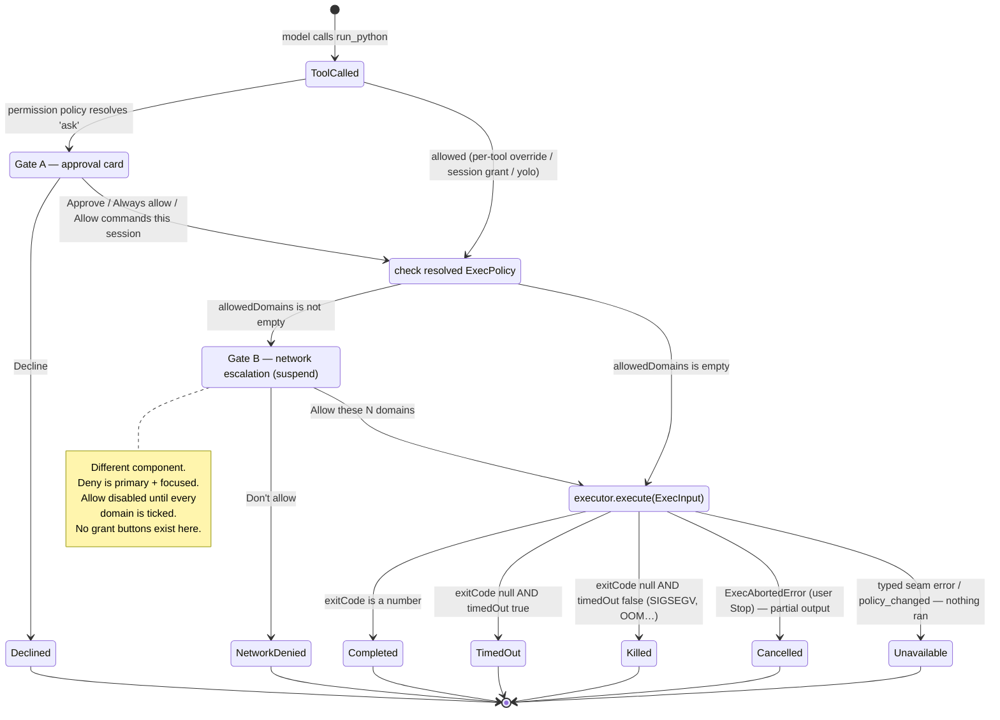

# `run_python` approval UX + network escalation — design spec (BST-1070)

> **Status: DESIGN ONLY, 2026-08-01.** Nothing here is implemented. The tool
> `brainstrike.runPython` does not exist yet (BST-1067); the executor backend
> does not exist yet (BST-1062). This document is written against the MERGED
> seam `packages/agent/src/code-execution.ts` (BST-1060) and the MERGED
> permission engine, so that implementation is wiring rather than invention.
>
> Read with: `docs/agents/code-execution.md` (the seam contract),
> `docs/agents/assistant-runtime.md` § PERMISSION ENGINE and § PLAN MODE & TOOL
> SUSPENSION, `docs/agents/ui-conventions.md` § FLOATING LAYER STACKING.

---

## 0. The one-paragraph version

`run_python` gets **two gates, on two different existing channels**, because
they answer two different questions and only one of them may ever be
pre-granted.

- **Gate A — "may this code run at all?"** rides the existing **approval**
  channel (`tool-approval-required` → `AssistantToolApprovalNotice`) as a
  normal `riskCategory: 'execute'` tool, exactly like
  `brainstrike.executeCommand`. It is grantable by the existing grant actions.
- **Gate B — "may it reach these specific domains?"** rides the existing
  **suspension** channel (`tool-suspend-required` →
  `AssistantToolSuspendNotice`), raised from inside the tool's `execute()`
  **before** the executor is touched, and **only** when the resolved policy has
  a non-empty `allowedDomains`. It is per-call, argument-aware, and — because
  the suspension channel has no grant surface at all — **structurally
  ungrantable**.

Everything below is the detail of those two surfaces, the result surface, the
copy, and the twelve places the existing code has to change (§10).

---

## 1. Why two channels and not one card (the load-bearing constraint)

The obvious design — one approval card that looks scarier when the script wants
network — **cannot be built correctly**, and the reason is mechanical:

Mastra's `requireApproval` is a **per-tool** flag, set on the tool map
*before* the immutable `Agent` is built
(`filterToolsByPermissionWithMetadata`, assistant-runtime.md § PERMISSION
ENGINE step 2). At that moment nobody knows whether *this particular call* will
ask for `pypi.org`. So an approval-channel design can only offer "run_python
always prompts" or "run_python never prompts". Once the user clicks **Allow
commands this session**, `run_python` stops prompting — including for the call
three turns later that quietly adds `allowedDomains: ['exfil.example.com']`.
Cosmetic escalation (red border, extra checkbox) inside the approval card does
not survive that grant, because the card never renders.

`suspend()`, by contrast, is called *from inside `execute()`* with the real
arguments in hand (assistant-runtime.md § PLAN MODE & TOOL SUSPENSION). It is
per-call, it is unaffected by the permission policy, and there is no
"always allow this suspension" anywhere in the product. Three consequences fall
straight out, and all three are properties the ticket asks for:

| Requirement | How the suspension channel satisfies it |
| --- | --- |
| Network can't be approved by muscle memory | It is a **different React component** with a different button set, not a restyled one |
| No global "always allow" for network | There is no grant surface for suspensions. Not "we chose not to add one" — there isn't one |
| Survives the user opting out of permissions | `enforce: false` sends no policy snapshot and gates nothing. `suspend()` still fires |
| Survives "Allow all tools this session" | That grants four risk **categories**. A suspension is not a category |

**Rejected alternative — a third approval action (`approve_with_network`).**
`AssistantToolApprovalAction` is a strict exact-own-key wire object validated at
four boundaries (Desktop, Vercel Preview, Vite dev, Vite preview), each
returning `invalid_tool_approval_action`/400 on anything else. Adding a third
verb is a four-boundary wire change to express something the suspension channel
already expresses for free.

**Rejected alternative — carve `execute` out of `grantAllSessionCategories`.**
See §5. Short version: it makes a button labelled "Allow all tools this
session" not allow all tools, which is a lie in a security control.

---

## 2. Gate A — the pre-run approval card

### 2.1 Where it mounts

No new chain. The existing one, unchanged:

```
makeApprovalRequiredChunks (agent)
  → tool-approval-required chunk
  → DataStreamMapper.handleToolApprovalRequired
  → TOOL_APPROVAL_DATA_NAME data part
  → assistant-tool-approval-notice.tsx
      └─ ApprovalPreview  ← ONE new branch here
```

`ApprovalPreview` (`packages/ui/src/assistant-ui-panel/assistant-tool-approval-notice.tsx`,
~line 417) already dispatches on `toolName` for four tools. `run_python` adds a
fifth branch and a sibling component in the same file, following
`RunSkillScriptPreview` (semantic, purpose-built) rather than the raw-JSON
default:

**Two structural changes at that call site, easy to miss.**

`ApprovalPreview` today is `({ toolName, args }: { toolName: string; args:
unknown })` — it never receives the `AssistantToolApprovalRequest`, only two
destructured fields, so `executionContext` needs threading through. And the
grant-suppression rules (§2.2 when the context is absent, §6.5 when narrowing
fails) have to reach the **button row**, which the parent renders — today
`PreviewParseError` just returns JSX and the parent cannot tell it fired.

Rather than have the preview return a `{ node, suppressGrants }` pair (a
component that returns a tuple is awkward and easy to ignore), **the parent
decides suppression before rendering either half**, from the same two inputs
the preview narrows:

```ts
/** null → this tool has no structured preview; the raw-args view handles it. */
function resolveApprovalPreviewPolicy(
  approval: AssistantToolApprovalRequest
): { readonly suppressGrants: boolean } | null;
```

For `run_python` it returns `{ suppressGrants: true }` when
`narrowRunPythonArgs(approval.args)` is `null` **or**
`approval.executionContext` is absent, and `{ suppressGrants: false }`
otherwise. The parent passes `grantCategory={suppressGrants ? null :
grantCategory}` to the existing `ApprovalGrantButtons`, which already renders
nothing for a `null` category — so suppression reuses the existing
capability-gating path instead of adding a second one. Every other tool returns
`null` and is completely unaffected.

```ts
const RUN_PYTHON_TOOL_ID = NATIVE_TOOL_ID.runPython;

if (toolName === RUN_PYTHON_TOOL_ID) {
  return <RunPythonPreview args={args} context={executionContext} />;
}
```

Restart-safe rediscovery needs **no** extra work in the renderer: the
rediscovered approval carries the same `TOOL_APPROVAL_DATA_NAME` part, so the
same preview renders (assistant-runtime.md § restart-safe rediscovery).

### 2.2 The wire gap this design needs closed

**The approval card can only see `approval.args` — the model's tool-call
arguments.** The facts a user actually needs (which folder is writable, what
the script can read, which executor kind, the effective timeout) are
**host-derived**, and there is no channel for them today. Putting them in the
tool's input schema would mean the model chooses its own sandbox, which is
absurd.

The precedent for a server-computed, display-only field on this chunk already
exists: `riskCategory` and `policyDecision` are exactly that. This design adds
one more, typed narrowly (never `unknown`), in
`packages/assistant-contract/src/tool-approval.ts`:

```ts
/**
 * Server-computed, display-only execution context for a code-execution
 * approval. NEVER model-supplied: the agent runtime stamps it from the
 * resolved ExecPolicy + executor kind when it builds the approval chunk, the
 * same way riskCategory is stamped from buildNativeToolRiskMap.
 */
export interface CodeExecutionApprovalContext {
  /** Effective ExecPolicy.allowedDomains. Empty = no network. */
  readonly allowedDomains: readonly string[];
  /** Effective ExecPolicy.allowRead (absent in the policy ⇒ empty here). */
  readonly allowRead: readonly string[];
  /** Effective ExecPolicy.allowWrite. Always contains scratchDir. */
  readonly allowWrite: readonly string[];
  readonly executorKind: ExecutorKind; // 'fence' | 'vm'
  readonly language: ExecLanguage;     // 'python' for run_python
  /**
   * Stable hash over every field above. The tool recomputes it at execute
   * time and refuses to run if it differs — see "Display can drift" below.
   */
  readonly policyFingerprint: string;
  readonly scratchDir: string;
  readonly timeoutMs: number;
}

export interface AssistantToolApprovalRequest {
  // …existing fields…
  /** Present only for code-execution tools; absent everywhere else. */
  executionContext?: CodeExecutionApprovalContext;
}
```

**It must be forwarded in THREE places, not one.** Stamping it in
`makeApprovalRequiredChunks` alone delivers it to nothing:
`DataStreamMapper.handleToolApprovalRequired`
(`packages/agent/src/stream/data-stream-mapper.ts`) rebuilds
`AssistantToolApprovalRequest` field by field and today copies only
`riskCategory`, `policyDecision`, `args` and `resumeSchema` — anything not
explicitly spread is dropped. Miss it and **every live approval takes the
missing-context path** (no fact rows, grants suppressed), while only
rediscovered ones work, which is precisely backwards.

| Path | Where | Note |
| --- | --- | --- |
| live — chunk | `mastra/tool-approval-chunks.ts` | stamp from the resolved policy |
| live — data part | `stream/data-stream-mapper.ts` | **add the spread**; needs a live-stream transport test |
| rediscovered | `apps/desktop/src/assistant-server/status-endpoints.ts` | recompute, exactly where `riskCategory` is recomputed today |

**Display can drift; execution must not.** Recomputing this context does not by
itself bind what the user approved to what runs: approval resume rebuilds a
fresh runtime around the durable arguments, so a workspace-config change while
a card is pending — especially across a reload — could show one scratch dir or
read scope and execute under another. That is why
`policyFingerprint` is part of the payload rather than decoration: the tool
recomputes it at execute time from the policy it is about to use, and a
mismatch returns `{ kind: 'unavailable', reason: 'policy_changed' }` **without
running anything**, so the user re-approves against the real terms. The
fingerprint is display-context-derived and carries no secrets; it exists only
to make the two sides comparable.

(Gate B does not need this: its `suspendPayload` is built inside `execute()`
from the live policy, so the domains shown are the domains used, by
construction.)

**Fail-safe when it is absent** (old snapshot, unmapped route, recompute
failure): the card does **not** guess a scratch path, does **not** claim "no
internet", and **suppresses the grant buttons**. This mirrors, exactly, the
existing rule that an approval with no `riskCategory` shows no reason line and
no grant buttons rather than fabricating one.

### 2.3 What the user sees — no-network case

The outer card is unchanged (amber, "Tool approval required", status pill, tool
name line, reason line, expander, Approve/Decline/grant row). Only the preview
region is new.

```
┌─ ⚠  Tool approval required                            [Pending] ─┐
│    brainstrike.runPython                                          │
│    Requires approval: execute (runs commands or code)             │
│                                                                   │
│    Run this Python code on your computer, in a sandbox.           │
│   ┌─────────────────────────────────────────────────────────┐    │
│   │ import json, pathlib                                    │    │
│   │                                                         │    │
│   │ rows = json.loads(pathlib.Path("data.json").read_text())│    │
│   │ print(len(rows))                                        │    │
│   └─────────────────────────────────────────────────────────┘    │
│                                                                   │
│    Internet        No internet access                             │
│    Can write to    /Users/you/.brainstrike/py-scratch/01J8…       │
│                    and nowhere else.                              │
│    Can read        /Users/you/code/brainstrike                    │
│    Time limit      Stops after 30 seconds                         │
│    Sandbox         Isolated sandbox on this machine               │
│                                                                   │
│   [✓ Approve] [✗ Decline] [🛡 Always allow] [⏱ Allow commands …] [⌄]│
└───────────────────────────────────────────────────────────────────┘
```

Field order is deliberate: **code first** (what will happen), then **reach**
(internet → write → read, most-dangerous-first), then **limits**. "Internet"
leads the fact list precisely so its absence is never inferred from a missing
row — see the copy rule in §6.2.

### 2.4 Component composition — reuse, no forks

| Element | Component | Source | Notes |
| --- | --- | --- | --- |
| Code block | `CodeSurface` | `packages/ui/src/code-surface/code-surface.tsx` | `editable` omitted (read-only), **`language="python"`** — `resolveCodeSurfaceLanguage` accepts it explicitly (`EXPLICIT_LANGUAGE_LABELS`), and passing a synthetic `path="script.py"` instead would put a filename that does not exist on a security surface. `lineWrapping`, `ariaLabel="Python code to run"`, `testId="approval-run-python-code"`, `truncated` from the truncation helper. Wrapped in the same `h-64 overflow-hidden rounded-md border border-border` box the `write` preview already uses. CodeMirror keeps it selectable and whitespace-exact. |
| Truncation | `truncatePreviewText` + `PreviewTruncatedNote` | same file (already exported/local) | **Load-bearing here**: the seam allows `MAX_EXEC_CODE_LENGTH = 1_000_000` chars, the preview cap is `APPROVAL_PREVIEW_CHAR_CAP = 100_000`. A 1 MB script must never render as a silently-clipped 100 KB script. The raw-args expander still holds the full text. |
| Fact rows | `<dl>/<dt>/<dd>` | inline, same markup as `ExecuteCommandPreview` | Not a component — the established pattern in this file. Values keep `font-mono … [overflow-wrap:anywhere]` so a long path wraps instead of truncating. **Never truncate a path or a domain with an ellipsis**: `pypi.org.evil.com` clipped to `pypi.org…` is a lie. |
| "No internet access" pill | `Badge` (`variant="secondary"`) | `packages/ui/src/badge.tsx` | Already exported from the UI barrel. |
| Buttons / grants | `Button`, `DropdownMenu*`, `ApprovalGrantButtons` | unchanged | No change for the no-network case. |
| Parse-error line | `PreviewParseError` | same file | Reused verbatim, plus one extra line for `run_python` (§6.5). |

**No new floating layers**, so §FLOATING LAYER STACKING imposes nothing new:
this card is inline in the thread, and the only popup it opens (the grant
overflow `DropdownMenu`) already carries `POPUP_LAYER_CLASS`. Do not add a
dialog. Do not hardcode a `z-` utility anywhere in this work; if a later
revision needs a popover, import the token from `packages/ui/src/layers.ts`.

### 2.5 Argument narrowing (strict, mirrors the agent schema)

Same discipline as `narrowExecuteCommandArgs`/`narrowRunSkillScriptArgs`:
unknown keys rejected, every field validated, `null` on failure → visible parse
error + raw JSON, never a guessed preview.

```ts
const RUN_PYTHON_ARG_KEYS = new Set(['allowedDomains', 'code', 'timeoutMs']);

interface RunPythonApprovalArgs {
  readonly allowedDomains?: readonly string[];
  readonly code: string;
  readonly timeoutMs?: number;
}

function narrowRunPythonArgs(value: unknown): RunPythonApprovalArgs | null;
```

Bounds mirror the seam constants: `code.length <= MAX_EXEC_CODE_LENGTH`,
`timeoutMs` a positive integer `<= MAX_EXEC_TIMEOUT_MS`, `allowedDomains` an
array of non-blank strings `<= MAX_POLICY_ENTRIES`. The UI package does not
depend on `@brainstrike/agent`, so these are local literals with a comment
naming the seam constant they mirror — the same trade the existing narrowers
make.

**Domain shape is NOT re-validated in the UI.** The seam's `policyDomainSchema`
is authoritative and already rejects a bare `*` and single-label wildcards; a
second, drifting copy of that regex in the renderer would be a way to disagree
with the thing that actually enforces it. The UI only checks "non-blank string,
bounded length" and renders the value verbatim.

### 2.6 Forewarning when the call does want network

When `executionContext.allowedDomains.length > 0`, the **Internet** row changes
and one advisory line appears below the fact list. The buttons do **not**
change — Gate A is still just "may this code run".

```
    Internet        Wants to reach 2 domains
    …
    You'll be asked about internet access separately, right before it runs.
```

Styled as the existing amber advisory
(`text-amber-700 text-xs dark:text-amber-400`), the same treatment the stale
rediscovery line uses.

---

## 3. Gate B — the network escalation

### 3.1 Mechanism

`run_python` becomes a **suspending tool**. Inside `execute()`, before
`resolveCodeExecutor` and before any spawn:

**`suspend()` returns `Promise<void>` — it does not resolve to the decision.**
Mastra re-runs `execute` from the top on resume with the answer in
`context.agent.resumeData`, which is exactly how `createAskUserTool` is written
(`packages/agent/src/tools/ask-user-tool.ts`: `const resume =
context?.agent?.resumeData; if (resume !== undefined) { … } … await
suspend(payload); return;`). A design that awaited a return value from
`suspend()` would suspend forever instead of ever deciding. The control flow is
therefore resume-first:

```ts
execute: async (input, context) => {
  const resolved = resolveExecPolicy(input, runtimeData); // policy + executorKind

  // 1. Resume leg — the user has answered Gate B.
  const resume = readNetworkDecision(context?.agent?.resumeData);
  if (resume !== undefined) {
    if (resume.action !== 'allow') {
      return { deniedDomains: resolved.policy.allowedDomains, kind: 'network_denied' };
    }
    return await runInExecutor(resolved, input);
  }

  // 2. First leg — no network wanted, nothing to escalate.
  if (resolved.policy.allowedDomains.length === 0) {
    return await runInExecutor(resolved, input);
  }

  // 3. First leg, network wanted — escalate.
  const suspend = context?.agent?.suspend;
  if (!suspend) {
    // Direct invocation outside an agent run. askUser degrades to a readable
    // answer here; run_python MUST NOT — degrading would run the script with
    // network and no prompt, the exact bypass Gate B exists to prevent.
    return {
      detail: 'No suspension channel is available, so network access could not be confirmed.',
      kind: 'unavailable',
      reason: 'network_confirmation_unavailable',
    };
  }
  await suspend({
    allowedDomains: resolved.policy.allowedDomains,
    kind: 'network',
  } satisfies RunPythonNetworkSuspendPayload);
  return;
}
```

`readNetworkDecision` validates `resumeData` against `RunPythonNetworkDecision`
and treats anything unrecognised as **deny**, not as allow: Mastra validates
resume data against `resumeSchema`, but a fail-open narrowing here would turn a
schema drift into a silent network grant.

**The resumed leg re-derives the policy** (step 1 calls `resolveExecPolicy`
again). That is why the fingerprint check in §2.2 matters: the domains the user
ticked must be the domains that get used, and the resumed leg must prove it
rather than assume it.

Registration has **three** halves, all in the same change. The third is the one
that fails silently in the direction that matters:

1. add `NATIVE_TOOL_ID.runPython` to `REGISTERED_SUSPEND_RESUME_TOOL_IDS`;
2. add its typed branch to `AssistantToolSuspendNotice`;
3. register the tool in `apps/desktop/src/assistant-server/assistant-tools.ts`
   as the **factory-returned Mastra `Tool` object directly** —
   `[NATIVE_TOOL_ID.runPython]: createRunPythonTool(runtimeData)` — never
   re-wrapped in that file's usual
   `{ description, execute, id, inputSchema }` registry literal.

Half 1 alone recreates the silent dead end that list exists to prevent. Half 2
alone produces a `tool.resume.unsupported` run event. **Half 3 alone is worse
than either**, and it is the natural mistake: every other native tool in that
file uses the literal shape, and the literal shape drops `suspendSchema` /
`resumeSchema`. `hasSuspendSchema(tool)` then returns `false`, `suspend()` is
never reachable, and **Gate B silently never fires** — the script runs with a
non-empty `allowedDomains` and no prompt at all. No error, no log, no run
event. The site already carries a comment saying exactly this
(`assistant-tools.ts:557-566`), but a comment in another package is not a
guard: §10 requires a test asserting `hasSuspendSchema` is true for the
registered `run_python` entry.

**Built-in local provider: excluded, alongside `askUser`/`submitPlan`.** The
same registration site gates both suspending tools behind
`isLocalProvider ? {} : { … }` (the WebGPU-prefill reasoning shared with the
plan-mode gate). `run_python` goes **inside** the non-local branch. The
alternative — registering it outside so the local model can run Python — puts
it in the map without a suspend schema, i.e. with Gate B structurally absent
while Gate A still shows the §2.6 line promising "You'll be asked about
internet access separately". A prompt that makes a promise the build cannot
keep is worse than an absent capability. This is also consistent with
`runSkillScript` already being excluded from `LocalDesktopNativeToolId`.

New contract types alongside `SubmitPlanPayload`/`AskUserPayload`:

```ts
export interface RunPythonNetworkSuspendPayload {
  /** The exact ExecPolicy.allowedDomains the script will get. Never empty. */
  readonly allowedDomains: readonly string[];
  readonly kind: 'network';
}

/** Resumed into the suspended call. Deny is expressible; "run offline" is not. */
export interface RunPythonNetworkDecision {
  readonly action: 'allow' | 'deny';
}
```

### 3.2 Three changes this forces elsewhere (do not skip)

**(a) The plan-mode gate was a real hole — FIXED in BST-1073 (PR #2194), no
longer this ticket's work.** Recorded here because it is the reason Gate B is
safe to build on the suspension channel at all, and because anyone reading this
design against an older tree needs to know the fix is a prerequisite.

`filterToolsForPlanMode` (`packages/agent/src/mastra/plan-mode-tool-gate.ts`)
used to short-circuit on `hasSuspendSchema(tool)` **before** it looked at risk:

```ts
for (const [sanitizedId, tool] of Object.entries(tools)) {
  if (hasSuspendSchema(tool)) {   // ← keeps ANY suspending tool in plan mode
    kept[sanitizedId] = tool;
    continue;
  }
  // …risk check never reached…
}
```

Giving `run_python` a `suspendSchema` would therefore make an **execute-risk,
arbitrary-code tool available in plan mode**, whose entire purpose is that the
model can investigate but cannot act. The escape hatch is only safe today
because both registered suspending tools (`submitPlan`, `askUser`) are
classified `riskCategory: 'read'`.

**The fix (shipped in #2194):** the short-circuit is gone; a suspending tool is
kept only if its risk would have kept it anyway.

```ts
const risk = riskForTool(riskByTool, originalName, sanitizedId);
if (PLAN_MODE_KEPT_RISK.has(risk)) {
  kept[sanitizedId] = tool;
  continue;
}
// hasSuspendSchema no longer widens the plan-mode set
```

Behaviour for `submitPlan`/`askUser` is unchanged (both are `read`), and
`plan-mode-tool-gate.spec.ts` now pins *"omits an execute-risk suspending
tool"* using `brainstrike.runPython` itself as the fixture — so the guard is
armed before the tool exists.

**One coupling this introduces, which BST-1067 must not break.**
`submitPlan`/`askUser` now survive plan mode *only* because the catalog
classifies them `read`. Reclassifying either would silently remove plan mode's
only exit path. #2194 adds a guard test for that direction too; do not
reclassify a suspending tool without reading it.

**(b) No workflow storage ⇒ `run_python` disappears entirely.** With storage
absent, `resolveAskToolsForRun` fail-safe-omits ask tools *and*
`resolveSuspendToolsForRun` fail-safe-omits suspending tools. `run_python` is
both. That is the correct outcome (a pause that can never resume must never be
armed) and needs no new code — but it means **Hosted Web never gets
`run_python`**, which is consistent with the desktop-first posture and with
`WebNativeToolId` already excluding `runSkillScript`. Add `runPython` to that
`Exclude<…>` union.

**(c) Cross-reload rediscovery does not yet cover suspensions.**
`listSuspendedMastraRuns` returns approval-gated calls only; non-approval
`suspend()` pauses are "tolerated + skipped (debug-logged)", and unified
suspend rediscovery is already a documented follow-up. So a renderer reload
while a network escalation is on screen strands the run: the transient
`brainstrike.tool-suspend` part is gone and nothing re-surfaces it.

The **direction** is safe — the run stays suspended, the executor is never
reached, no code runs, no packet leaves. But it is silent, which this project
does not accept. **BST-1070 implementation is blocked on unified suspend
rediscovery** (or on a scoped version of it that covers
`REGISTERED_SUSPEND_RESUME_TOOL_IDS`). File it as a dependency; do not ship the
escalation with a silent stranding path.

### 3.3 What the user sees

A **different component**, deliberately: destructive chrome instead of amber,
a different headline, an inverted button order, no grant buttons, and a primary
action that is **Deny**.

```
┌─ 🌐  This script wants to reach the internet ─────────────────────┐
│                                                                   │
│  You said the code could run. Before it does, it needs your OK    │
│  to connect out.                                                  │
│                                                                   │
│  It will be able to connect to:                                   │
│    ☐  pypi.org                                                    │
│    ☐  *.githubusercontent.com   — any host ending in that         │
│                                                                   │
│  Nothing else. Every other address is blocked.                    │
│                                                                   │
│  Once it can connect, it can also send data out — including       │
│  anything it read from your files.                                │
│                                                                   │
│   [ Don't allow ]   [ Allow these 2 domains ]                     │
│                     Tick each domain above to enable this.        │
│                                                                   │
│  You'll be asked this every time. There is no "always allow"      │
│  for internet access.                                             │
└───────────────────────────────────────────────────────────────────┘
```

**How it defeats muscle memory — four mechanisms, not one:**

1. **Different component, different chrome.** `border-destructive/50
   bg-destructive/5` and a `Globe` icon, against the approval card's amber
   `border-amber-500/40 bg-amber-50/50` and `AlertTriangle`. Nothing about it
   reads as "the usual prompt".
2. **Inverted button order, and the inversion is the safe direction.** The
   approval card's left/primary slot is **Approve**. Here the left/primary slot
   is **Don't allow** (`variant="default"`, first in DOM and tab order,
   `autoFocus`). A user clicking where Approve *was* denies. A user hitting
   Enter denies. Deny is one step, always, and is the outcome of every
   non-action (stop the run, close the app, never answer).
3. **The affirmative action is disabled until every domain is ticked**, one
   `Checkbox` (`packages/ui/src/checkbox.tsx`) per domain, label = the domain
   itself, all required. This is intentionally proportional to how much you're
   being asked to trust: one domain is one extra click; a script asking for
   twenty is tedious, and *that tedium is correct signal* — a Python script
   needing twenty hosts is unusual and should feel unusual. The list scrolls at
   `max-h-48 overflow-auto`; no domain is ever truncated. Ticking state is
   local component state, never persisted, and resets if the card re-renders.
4. **The affirmative button names what it does**: "Allow these 2 domains", or
   "Allow pypi.org" when there is exactly one. Never a bare "Allow".

**No grant buttons here at all.** Not suppressed conditionally — the component
never renders `ApprovalGrantButtons` and never reads
`useToolApprovalGrants()`. A grant would let one answer authorize a *future,
unnamed* domain list, which is the exact escalation this card exists to
prevent.

**Rejected third action — "Run without internet".** It looks helpful and is
not. The seam's own rationale
(`assertExecRequestSatisfiable` → `network_unsupported`) is that running a
network-requesting script with networking off is a *stronger* sandbox but a
*wrong* result: exit code 0 and missing data. Offering it as a button would let
a user cause that outcome with one click and then trust the output. Deny, let
the model see `network_denied`, and let it rewrite the script offline
deliberately.

### 3.4 Wildcard rendering

`*.example.com` is rendered verbatim in mono, followed by a muted plain-English
gloss so nobody has to know the syntax:

- `*.githubusercontent.com` → "— any host ending in `.githubusercontent.com`"
- `pypi.org` → no gloss (an exact host needs none)

A bare `*` and single-label wildcards (`*.com`) are rejected by
`policyDomainSchema` and can never arrive here. The card therefore has **no
"allow all network" affordance and no way to render one** — that is a property
of the seam, not a UI choice, and the copy leans on it ("Every other address is
blocked").

---

## 4. The result surface

### 4.1 Four terminal states plus one orthogonal modifier

The ticket names four states; the seam actually gives **four terminal states
and one orthogonal modifier**, and conflating them would produce a card that
cannot describe "timed out *and* truncated":

| | Discriminator on `ExecResult` | Can be truncated? |
| --- | --- | --- |
| **Completed** | `exitCode !== null` | yes |
| **Timed out** | `exitCode === null` **and** `timedOut === true` | yes |
| **Killed** | `exitCode === null` **and** `timedOut === false` | yes |
| **Cancelled** | `ExecAbortedError` thrown (BST-1062), carries `partialStdout`/`partialStderr` | n/a — partial by definition |
| **Didn't run** | one of the typed seam errors | no output at all |
| *truncated* | `stdoutOmittedBytes > 0 \|\| stderrOmittedBytes > 0` — **per stream** | *is the modifier* |

**Killed is a real, reachable state, not a defensive branch.** The seam says
`exitCode` is null "exactly when the process was terminated by a signal —
**including** a timeout kill". *Including* means a timeout is one case, not the
only one: a segfaulting native extension, the OOM killer, or the fence tearing
the process down all produce `exitCode: null, timedOut: false, signal:
'SIGSEGV'`. Without its own branch an implementer must invent one of the two
things this document exists to prevent — coerce it into **completed** (a green
check for a crashed script) or into **didn't run** (destructive "Nothing ran"
for a script that ran and printed output).

**`signal` is nullable in the type but always named in a well-behaved
backend.** The seam's contract says the signal names the termination, so
`{ exitCode: null, signal: null }` is a **backend contract violation**, not a
state to design copy around. The discriminators above therefore key on
`exitCode`/`timedOut` only and never on `signal`; the copy in §6.4 has a
signal-less variant marked **defensive-only** so a misbehaving backend still
renders something true rather than printing "ended by null".

Rendering truncation as a peer state would force a choice between "timed out"
and "truncated" for a run that was both. It is a per-stream note under the
affected pane.

### 4.2 Tool result shape (for BST-1067)

Discriminated union, TypeScript strict, no `any`. This is what the UI narrows
and what the model reads:

```ts
export type RunPythonResult =
  | {
      readonly kind: 'completed';
      readonly exitCode: number;
      readonly stderr: string;
      readonly stderrOmittedBytes: number;
      readonly stdout: string;
      readonly stdoutOmittedBytes: number;
    }
  | {
      readonly kind: 'timed_out';
      readonly signal: string | null;
      readonly stderr: string;
      readonly stderrOmittedBytes: number;
      readonly stdout: string;
      readonly stdoutOmittedBytes: number;
      readonly timeoutMs: number;
    }
  | {
      readonly kind: 'killed';
      readonly signal: string | null;
      readonly stderr: string;
      readonly stderrOmittedBytes: number;
      readonly stdout: string;
      readonly stdoutOmittedBytes: number;
    }
  | {
      readonly kind: 'cancelled';
      readonly partialStderr: string;
      readonly partialStdout: string;
    }
  | { readonly deniedDomains: readonly string[]; readonly kind: 'network_denied' }
  | { readonly detail: string; readonly kind: 'unavailable'; readonly reason: RunPythonUnavailableReason };

export type RunPythonUnavailableReason =
  | 'executor_kind_unavailable'
  | 'executor_tier_mismatch'
  | 'language_unsupported'
  | 'network_confirmation_unavailable'
  | 'network_unsupported'
  | 'no_sandbox_configured'
  | 'policy_changed';
```

`exitCode` is `number` in `completed` and **absent** in `timed_out`/`killed` —
the union makes it impossible to render `0` for a signal-terminated run, which
is the failure mode the seam's `exitCode: number | null` convention exists to
prevent. `signal` stays nullable in both because the *type* permits it, while
§4.1 rules a null signal a backend contract violation: the UI renders the
defensive copy rather than trusting a value the contract says cannot occur.

**Mapping seam errors → `RunPythonUnavailableReason`.** The union deliberately
flattens two different seam fields, because §6.4 needs distinct copy for the
two capability-mismatch reasons that share one error class. That flattening is
a UI decision, so the mapping is stated rather than left to be re-derived:

| Thrown | Reason value | Source field |
| --- | --- | --- |
| `ExecCapabilityMismatchError` | `language_unsupported` / `network_unsupported` | `err.reason` (`ExecCapabilityMismatchReason`) — `err.code` (`exec_capability_mismatch`) is **not** surfaced |
| `ExecutorKindUnavailableError` | `executor_kind_unavailable` | `err.code` |
| `ExecutorTierMismatchError` | `executor_tier_mismatch` | `err.code` |
| `NoSandboxConfiguredError` | `no_sandbox_configured` | `err.code` |
| *(not a seam error)* | `policy_changed` | §2.2 fingerprint mismatch, before any executor call |
| *(not a seam error)* | `network_confirmation_unavailable` | §3.1, no suspension channel |

Anything else must rethrow rather than map to a reason — an unrecognised
failure rendered as one of these would claim a diagnosis the tool does not have.

### 4.3 Where it renders

`tool-fallback.tsx` already special-cases a tool's output (it consumes
`useShellOutput()` and renders `LiveShellOutputPane` for shell tools). Add the
same kind of branch on `toolName === NATIVE_TOOL_ID.runPython` → a new
`run-python-result.tsx` in
`packages/ui/src/assistant-ui-panel/`.

**`LiveShellOutputPane` is deliberately not reused.** Not a fork-by-laziness
call: it is `flex-col-reverse`, i.e. bottom-pinned, which is the correct
affordance for a *streaming* terminal and the wrong one for a finished result —
a completed script's output would open scrolled to its end with the traceback's
first line hidden above the fold. The new `RunPythonStreamPane` keeps the exact
same class vocabulary (`rounded bg-muted/50`, `whitespace-pre-wrap break-words
p-2 font-mono text-[11px]`, `role="log"` → `role="group"` since it is no longer
live) and adds a stream label and a per-stream omitted-bytes note.

### 4.4 State-by-state rendering

Header icon/label reuse `tool-fallback.tsx`'s existing `STATUS_ICONS`
vocabulary where the meaning matches, and deliberately break from it where it
does not.

| State | Icon | Header | Body |
| --- | --- | --- | --- |
| completed, exit 0, output | `CheckCircle` green | **Finished** | stdout pane; stderr pane only if non-empty |
| completed, exit 0, no output | `CheckCircle` green | **Finished — the script didn't print anything** | no panes |
| completed, exit ≠ 0 | `AlertCircle` amber (**not** destructive) | **Finished with an error (exit code 1)** | stderr pane first, then stdout |
| timed out | `Timer` amber | **Stopped after 30 seconds — the script was still running** | both panes, headed "Output before it was stopped" |
| killed | `AlertCircle` amber | **The script was stopped by the system before it finished** | both panes, headed "Output before it was stopped" |
| cancelled | `CircleSlash` muted (**never** a green check) | **You stopped this** | both panes, headed "Partial output" |
| cancelled, nothing printed | `CircleSlash` muted | **You stopped this before the script printed anything** | no panes |
| network denied | `Globe` muted | **You didn't allow internet access, so the script didn't run** | no panes |
| unavailable | `AlertCircle` destructive | see §6.4 | no panes |

Two rules that are easy to get wrong and must be pinned by tests:

- **A non-zero exit code is not a tool failure.** The tool did its job; the
  script returned 1. Amber "Finished with an error", not the destructive
  "Failed" chrome. Destructive is reserved for *didn't run*.
- **Cancelled never renders as success and never renders as empty.** Both are
  lies in opposite directions: a green check implies the work completed, a
  blank card implies nothing happened. `ExecAbortedError` carries partial
  streams precisely so neither is necessary.

### 4.5 Truncation notes

Per stream, under that stream's pane, in the existing amber advisory style:

```
Output was too long — 4.2 MB wasn't captured.
```

`formatOmittedBytes(n)` renders `bytes` / `KB` / `MB` at one decimal
(`812 bytes`, `41.0 KB`, `4.2 MB`).

**The copy must not claim *where* the drop happened.** `ExecResult` gives a
count, not a position; "the last 4.2 MB" would be an invention. (Minor seam
gap — see §8.)

Both streams truncated ⇒ two notes, one per pane. Never one merged note: the
whole reason the seam has per-stream counters instead of a `truncated` boolean
is that one flag cannot say which stream was cut.

---

## 5. Remember-choice scope — the recommendation

### 5.1 Should execute-risk code execution be exempt from "Allow all tools this session"?

**Recommendation: NO for the base run gate, and the question is moot for the
network gate.**

**Why the base gate stays covered.** The intuition "arbitrary code is worse
than a file edit" is right, but the comparison that matters is not
`run_python` vs `writeWorkspaceFile` — it is `run_python` vs
`brainstrike.executeCommand`, which is *already* in the `execute` category,
*already* covered by every grant action, and is **strictly more dangerous**:

| | `brainstrike.executeCommand` | `run_python` |
| --- | --- | --- |
| Isolation | none — the real shell | OS fence (`REQUIRED_ISOLATION_TIER.fence = 'os-fence'`) or VM, enforced at resolve time |
| Writable | the workspace (and whatever the command reaches) | `ExecPolicy.allowWrite`, with `scratchDir ⊆ allowWrite` enforced by the schema |
| Network | unrestricted | `allowedDomains`, where `[]` means none and unrestricted egress is **not expressible** |
| Escalation prompt | none | Gate B, ungrantable |

Exempting the *sandboxed* tool from a grant while the *unsandboxed* one stays
covered is security theatre: it adds friction where the risk is bounded and
leaves it absent where the risk is not. If someone wants execute-risk tools out
of the blanket grant, the honest version of that argument targets
`executeCommand` first, and it belongs in a separate ticket about the grant
model — not smuggled in as a `run_python` special case.

**Why a carve-out would also be actively harmful.** "Allow all tools this
session" is documented as **four category grants in one atomic `set()`** — a
settled ruling, with the resume-gate posture logic
(`permissionEnforced === true` and an empty `askTools` ⇒ all-allowed) built on
top of it. A silent carve-out makes a button labelled *allow all tools* not
allow all tools. A user who clicks it and then gets prompted anyway learns that
the security controls do not mean what they say, and that lesson generalises to
every other prompt in the product. The mechanism can technically express it
(`askTools = {runPython}` is non-empty and gates exactly that set) — the
objection is not mechanical, it is that a security control which lies about its
own scope is worse than a slightly-too-broad one.

**Why the question is moot for the network gate.** The genuinely
categorically-different thing about `run_python` is not "it runs code" — it is
"it can open sockets to hosts named at call time". That escalation lives on the
suspension channel (§3), which no grant can reach, under any posture, including
`yolo: true` and `enforce: false`. The dangerous half is exempt from *every*
blanket grant by construction, without any carve-out and without any lie.

### 5.2 What the user can therefore remember

| Choice | Scope | Storage | Exists today? |
| --- | --- | --- | --- |
| "Always allow `brainstrike.runPython`" | workspace install, persisted | `permission-policy-store` → `perToolOverrides['brainstrike.runPython']` | yes, no change |
| "Allow commands this session" | session, lost on reload | `permission-policy-store` → `sessionGrants` (excluded from `partialize`) | yes, no change |
| "Allow all tools this session" | session, lost on reload | `grantAllSessionCategories()` | yes, no change |
| **Any memory of an allowed domain** | — | — | **must never exist** |

There is **no global "always allow code execution"** and this design adds none:
`perToolOverrides` is keyed by tool id, `sessionGrants` by risk category, and
both are already listed and individually revocable in
Settings > Permissions.

**Explicitly rejected: remembering acknowledged domains.** "Don't ask me again
for `pypi.org`" is a standing network grant with a friendly name. It would need
new persistence, new factory-reset wiring, a new revocation surface, and it
would defeat the one property Gate B exists to provide (that the domain list is
re-read every time, because *the list changes every call*). Do not add it in a
follow-up either.

The sanctioned way to stop being asked is a **workspace-level exec config** —
domains the user wrote down deliberately, in a file, under version control. That
config is owned by BST-1067/ADR-0003 and is out of scope here. Even with it,
Gate B still fires and still names the domains: config decides what is
*permissible*, the prompt confirms what is *about to happen*.

---

## 6. Copy — verbatim

Written from the user's side of the screen. No "subprocess", no "fence", no
"policy", no "egress". Sentence case, no terminal periods on labels, periods on
sentences.

### 6.1 Shared reason line (one small change to existing copy)

`RISK_CATEGORY_REASON.execute` currently reads `execute (runs a command)`.
`run_python` does not run a command. Change the shared string — it reads better
for `executeCommand` too:

```ts
execute: 'execute (runs commands or code on your computer)',
```

### 6.2 Gate A — pre-run card

| Slot | Copy |
| --- | --- |
| Lead line | **Run this Python code on your computer, in a sandbox.** |
| Code block label | Code |
| `Internet`, no network | **No internet access** |
| `Internet`, network wanted | **Wants to reach 2 domains** *(singular: `Wants to reach 1 domain`)* |
| Forewarning line | You'll be asked about internet access separately, right before it runs. |
| `Can write to` | *(the paths)* + second line: and nowhere else. |
| `Can read` value when the list is empty | Nothing — it can't read your files. |
| `Time limit` | Stops after 30 seconds *(`Stops after 5 minutes` above 60 s; never raw `30000 ms`)* |
| `Sandbox`, fence | Isolated sandbox on this machine |
| `Sandbox`, vm | Virtual machine |

Every one of those rows is always rendered, including `No internet access`. A
missing row is ambiguous; an explicit negative is not. This is the single most
important copy rule on this card: **the safe state is stated, never implied.**

### 6.3 Gate B — network escalation card

| Slot | Copy |
| --- | --- |
| Headline | **This script wants to reach the internet** |
| Sub-line | You said the code could run. Before it does, it needs your OK to connect out. |
| List heading | It will be able to connect to: |
| Wildcard gloss | — any host ending in `.githubusercontent.com` |
| After the list | Nothing else. Every other address is blocked. |
| Consequence line | Once it can connect, it can also send data out — including anything it read from your files. |
| Deny button | **Don't allow** |
| Allow button, n > 1 | **Allow these 2 domains** |
| Allow button, n = 1 | **Allow pypi.org** |
| Allow button hint while disabled | Tick each domain above to enable this. |
| Footer | You'll be asked this every time. There is no "always allow" for internet access. |
| Answered — denied | You didn't allow internet access. |
| Answered — allowed | You allowed 2 domains. |

### 6.4 Result card

| State | Copy |
| --- | --- |
| Finished, output | **Finished** |
| Finished, silent | **Finished — the script didn't print anything.** |
| Finished, exit ≠ 0 | **Finished with an error (exit code 1).** |
| Timed out | **Stopped after 30 seconds — the script was still running.**<br>*muted:* It was ended by SIGKILL, so there's no exit code. |
| Killed | **The script was stopped by the system before it finished.**<br>*muted:* It was ended by SIGSEGV, so there's no exit code. Out of memory or a crash inside a Python package are the usual causes. |
| Timed out / killed, **no signal reported** *(defensive only — §4.1 rules this a backend contract violation)* | *muted:* It was ended before it finished, so there's no exit code. |
| Cancelled, some output | **You stopped this.** Here's what it printed before it stopped. |
| Cancelled, no output | **You stopped this before the script printed anything.** |
| Network denied | **You didn't allow internet access, so the script didn't run.** |
| Truncated (per stream) | Output was too long — 4.2 MB wasn't captured. |
| Pane labels | Output · Errors · Output before it was stopped · Partial output |

Didn't-run states, one per typed error:

| Error | Copy |
| --- | --- |
| `NoSandboxConfiguredError` | **Nothing ran — there's no sandbox to run Python in.**<br>Python runs here once a sandbox is installed. |
| `ExecutorKindUnavailableError` | **Nothing ran — this workspace is set to run Python in a virtual machine, and this computer can't do that yet.**<br>Available here: isolated sandbox. |
| `ExecutorTierMismatchError` | **Nothing ran — the sandbox couldn't confirm it was actually isolating this script.**<br>That's a setup problem on this machine, not something the script did. |
| `ExecCapabilityMismatchError` / `network_unsupported` | **Nothing ran — this sandbox can't give the script internet access, and the script needed it.**<br>Running it offline would have finished "successfully" with missing data, so it wasn't run at all. |
| `ExecCapabilityMismatchError` / `language_unsupported` | **Nothing ran — this sandbox can't run Python.** |
| `policy_changed` (§2.2) | **Nothing ran — what this script is allowed to touch changed after you approved it.**<br>Ask again and you'll get a fresh prompt showing the current terms. |
| `network_confirmation_unavailable` (§3.1) | **Nothing ran — this script wanted internet access and there was no way to ask you about it.** |

The `network_unsupported` second line is the seam's own no-silent-degradation
rationale, in plain words. It is the sentence that teaches the user why the
product refused instead of quietly doing something adjacent — worth the extra
line.

### 6.5 Empty and degraded states

| Condition | Copy | Behaviour |
| --- | --- | --- |
| Args fail strict narrowing | *(existing)* Could not render a preview for these arguments — see the raw arguments below.<br>**+ new:** Because this tool runs code, we won't offer "always allow" for a call we can't read. | Approve/Decline stay enabled (the raw JSON is right there); **grant buttons suppressed** |
| `executionContext` absent | We couldn't confirm what this script is allowed to touch. Check the raw arguments below before approving. | **grant buttons suppressed**; no fact rows invented |
| `code` is an empty string | This script is empty — it won't do anything. | Approve stays enabled (declining is also fine); no `CodeSurface` mounted |
| Rediscovered after a restart | *(existing, unchanged)* Pending since 2 hours ago / This approval has been pending a while — re-running the request may be safer. | both buttons enabled, no auto-decline |

---

## 7. Flow



Note that **`Running` is re-entered from the top on the Gate B resume leg** —
Mastra re-runs `execute` with `resumeData` rather than resolving `suspend()`
(§3.1), so the "Allow these N domains" edge is a fresh `execute` call, not a
continuation.

The three horizontal bars a user can be at are: **may it run** (Gate A, once,
grantable), **may it connect** (Gate B, every call, never grantable), **what
happened** (result, always honest about which of six endings it was).

---

## 8. Places the seam or the wire can't express what the UX needs

Reported as gaps, not worked around silently.

1. **No server-computed display context on the approval chunk.**
   `AssistantToolApprovalRequest` carries only model-supplied `args` plus
   permission metadata. The scratch path, readable roots, executor kind and
   effective timeout are host-derived and have nowhere to travel. §2.2 proposes
   an additive, typed `executionContext` following the `riskCategory`
   precedent. **Without it, the pre-run affordance cannot honestly show the
   writable path at all** — it would have to guess one.

2. **`CodeExecutor.execute()` has no incremental output channel.** It returns
   `Promise<ExecResult>`. `executeCommand` streams live output through
   `useShellOutput` → `LiveShellOutputPane`; `run_python` structurally cannot,
   so the UI shows a spinner and nothing else for up to
   `MAX_EXEC_TIMEOUT_MS` (10 minutes). A long-running script is indistinguishable
   from a hung one. Adding an optional `onOutput` callback to `ExecInput` is the
   obvious shape; it is a seam change and therefore out of scope for BST-1070,
   but it should be filed before someone ships a 10-minute blank spinner.

3. **`stdoutOmittedBytes` says how much, never where.** Head, tail, and middle
   truncation are indistinguishable, so the copy cannot say "the last 4.2 MB".
   Minor — the current copy is honest without it — but if the fence ends up
   dropping from the *middle*, users reading a stitched-together traceback will
   be misled by the absence of a marker. An in-band marker at the omission
   point would be worth more than a byte count.

4. **`ExecPolicy` has no read-list provenance.** `allowRead` is a flat path
   list, so the card can print paths but cannot say *why* each is readable
   ("your workspace", "the Python standard library"). A bare
   `/opt/brainstrike/python/lib` in a security prompt reads as alarming when it
   is mundane. A labelled shape (`{ path, purpose }`) would let the card group
   "your files" separately from "the interpreter's own files". Cosmetic today,
   but it is the kind of unexplained detail that trains users to stop reading
   the prompt.

5. **Suspension pauses are not rediscovered across a reload** (§3.2c). Not a
   seam gap — an assistant-runtime follow-up — but it is a hard blocker for
   Gate B, because the failure is silent.

6. **`ExecAbortedError` is assumed, not merged.** BST-1062. The cancelled state
   in §4.4 depends on it carrying `partialStdout`/`partialStderr`. If it lands
   without them, the cancelled card has no honest content and the design needs
   revisiting rather than falling back to a blank card.

---

## 9. Factory-reset wiring

**This design adds no new persisted preference, and therefore needs no new
factory-reset registration.** Everything it remembers already lives in
`permission-policy-store`, which is already registered:

- `perToolOverrides['brainstrike.runPython']` (from "Always allow") — persisted;
  cleared by `clearPersistentUiState`'s blanket `localStorage.clear()` **and**
  by the explicit `resetPermissionPolicyStoreToDefaults()` call at
  `packages/preferences/src/settings/system/factory-reset-helpers.ts:336`.
- `sessionGrants` — never persisted (excluded from `partialize`), and the same
  explicit reset drops the in-memory set so grants cannot survive a reset that
  does not reload.
- Gate B's per-domain checkbox state — React component state. Not stored
  anywhere, by design (§5.2).

**If implementation adds any persisted preference anyway** (it should not — see
§5.2), the AGENTS.md rule requires, in the same change:

1. a `resetXStoreToDefaults()` export from the store module;
2. an entry in `collectPersistentUiStateResetFailures` in
   `factory-reset-helpers.ts`, beside the existing
   `resetPermissionPolicyStoreToDefaults()` / `resetHookTrustStoreToDefaults()`
   calls;
3. a note in this document and in `docs/agents/platform-contracts.md`
   § FACTORY RESET CONTRACT naming the new key.

A remembered-domain allowlist is the one candidate that would plausibly want
persistence, and §5.2 rejects it outright. If a future ticket revives it, it is
a **security-sensitive per-root store** and must follow `hook-trust-store`'s
pattern exactly — keyed by the stable DB `roots.id`, factory-reset-registered,
and individually revocable in Settings.

---

## 10. Implementation checklist

Ordered by dependency. Item 2 is safe to land before BST-1067.

| # | Change | File |
| --- | --- | --- |
| ~~1~~ | ~~Risk-gate the plan-mode suspend short-circuit + spec case~~ — **DONE, BST-1073 / PR #2194** | `packages/agent/src/mastra/plan-mode-tool-gate.ts` |
| 2 | Reword `RISK_CATEGORY_REASON.execute` | `packages/ui/src/assistant-ui-panel/assistant-tool-approval-notice.tsx` |
| 3 | `NATIVE_TOOL_ID.runPython`; add to `WebNativeToolId`'s `Exclude<…>` | `packages/assistant-contract/src/native-tool-catalog.ts` |
| 4 | `CodeExecutionApprovalContext` (incl. `policyFingerprint`) + `executionContext?` field | `packages/assistant-contract/src/tool-approval.ts` |
| 5 | `RunPythonNetworkSuspendPayload` / `RunPythonNetworkDecision`; register the id | `packages/assistant-contract/src/tool-suspend.ts` |
| 6 | Stamp `executionContext` when building the approval chunk | `packages/agent/src/mastra/tool-approval-chunks.ts` |
| 6b | **Spread `executionContext` into the data part** — without this the live path gets nothing (§2.2) | `packages/agent/src/stream/data-stream-mapper.ts` |
| 7 | Recompute `executionContext` on rediscovery | `apps/desktop/src/assistant-server/status-endpoints.ts` |
| 7b | **Register as the factory-returned `Tool` object, inside the non-local branch** (§3.2) | `apps/desktop/src/assistant-server/assistant-tools.ts` |
| 8 | `narrowRunPythonArgs` + `RunPythonPreview` + `ApprovalPreview` branch + `resolveApprovalPreviewPolicy` grant suppression + prop threading | `assistant-tool-approval-notice.tsx` |
| 9 | `RunPythonNetworkNotice` branch | `assistant-tool-suspend-notice.tsx` |
| 10 | `RunPythonResult` + `RunPythonStreamPane`; branch in `tool-fallback.tsx` | `packages/ui/src/assistant-ui-panel/run-python-result.tsx` |
| 11 | Unified suspend rediscovery (blocking dependency, §3.2c) | `packages/agent/src/mastra/agent-streaming.ts` |

Tests that must exist before this is called done:

- ~~plan mode omits a suspending **execute**-risk tool~~ — already landed in
  #2194, using `brainstrike.runPython` as the fixture; BST-1067 inherits it;
- `hasSuspendSchema` is **true** for the registered `run_python` entry — the only
  guard against the silent Gate-B bypass in §3.2, since the existing warning is a
  comment in another package;
- `run_python` is **absent** from the tool map under the built-in local provider;
- a live-stream transport test asserting `executionContext` survives
  `DataStreamMapper` and reaches the data part (the §2.2 three-place forwarding);
- an execute-time `policyFingerprint` mismatch returns `policy_changed` and
  **never** reaches `resolveCodeExecutor`;
- unrecognised `resumeData` on the Gate B resume leg denies, never allows;
- the escalation card's allow action is disabled until every checkbox is ticked,
  and renders **no** grant buttons under a mounted `ToolApprovalGrantProvider`;
- a `run_python` approval with **no** `executionContext` renders no fact rows and
  no grant buttons;
- each of the six result states — including `exitCode: null, timedOut: false`
  rendering **killed**, not completed and not "nothing ran" — plus a run that is
  **both** timed out and truncated on **one** stream only;
- a cancelled run with empty partial streams renders the "before the script
  printed anything" copy and **not** a success icon.
