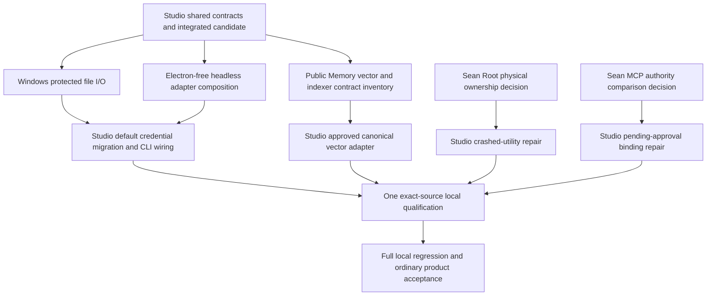

# M3 current bounded packet allocation — 7 October, 04:40 UTC

Studio remains the sole product/interface integrator under parent dot. This is
an allocation proposal for the parent's existing workers, not a dispatch or a
second orchestrator. One candidate and draft PR3543 target frozen M2 directly.
No main merge, hosted CI, signing, release, paid call or deletion clock starts.

Current unpublished integrated result: ordinary approval/native/MCP/context,
denial, reconnect, Stop with physical native-process exit, reload and reopen
passed. Public Memory's bounded-history second-turn defect is repaired and
qualified with three real SQLite cases. The parent-confirmed empty SDK error
defect is repaired; the isolated provider commit `e1ab722aa383115c980e435b5f64be600b5e9cf2`
is composed with `--no-commit` into this batch. Its canonical six offline
production-host/SQLite cases pass. This is not whole-milestone acceptance.

## Dependency graph



## Owned boundaries and finite deliverables

| Packet | Exclusive files | Deliverable and limit |
| --- | --- | --- |
| Studio integration | `core.ts`, `ports.ts`, `protocol.ts`, `production-platform.ts`, existing Memory storage/ownership adapters, `adapter-services.ts`, platform wire/Main/Node composition, renderer routing and build/CLI entry wiring | Own every shared interface and coherent final behavior. Preserve both active red regressions. No Root/MCP design patch before the stated owner decisions. |
| Existing Windows credential worker | New `apps/desktop/src/agent-host-platform/private-credential-file.ts`; new `apps/desktop/src/__tests__/private-credential-file.integration.test.ts` | Implement only `readPrivateCredentialFile(path): Promise<string \| undefined>` and `writePrivateCredentialFile(path, content): Promise<void>`. Preserve POSIX descriptor/0600 checks. Measure native Windows owner/DACL protection, protect the sibling temporary file before secret bytes, verify parent/file ACL and reparse semantics, retain atomic replacement/cleanup. No mode-check bypass. Studio wires the existing parser/backend. One 45-minute implementation packet, then exact Windows proof. |
| Existing Memory worker: implement OM provider parity now | New `apps/desktop/src/agent-host-platform/memory-model-configuration.ts`; new `apps/desktop/src/__tests__/memory-model-configuration.test.ts` | Export `createDesktopHostMemoryConfiguration(selection, resolveProviderAuth): Promise<ProductionHostRunConfiguration['memory']>`. Selection is `z.output<typeof PlatformSelectionSchema>`; resolver is `(provider: string) => Promise<ProviderAuthInput \| undefined>`. Use existing `resolveRuntimeConfiguration`/`createProvider` and public `materializeHostProviderModel` to supply a concrete observer/reflector, preserving the selected target, scope, thresholds, retrieval mode and working-memory options. Qualify actual vendor model/auth request shapes with synthetic intercepted fetch; no paid calls, environment credential resolution, fallback or silent vector disable. Missing hidden/local/subscription capabilities remain explicit. Studio retains `desktop-node-platform.ts` extraction/wiring and existing public Memory/SQLite integration tests. Two new files only; 45-minute packet, no vendor patches or shared interfaces. |
| Existing CLI/Node worker, when parent allocates it | New `apps/desktop/src/agent-host-platform/headless-node-platform.ts`; new `apps/desktop/src/__tests__/headless-node-platform.integration.test.ts` | Compose existing `createAgentHostAdapterServices` and `createProductionHostPlatform` with the existing `ProductionHostPlatformOptions` configuration/policy ports. Node owns the same SDK loop/public Memory/MCP authority, app UI is text, and startup retains every acquired service. Prove actual Node process/source purity and real owned local MCP/SQLite behavior. Do not import Electron, open a second PGlite writer, invent a configuration store/Root ID, reduce the native catalog, or claim the injected component closes standalone CLI acceptance. Studio owns canonical metadata/bootstrap/default CLI wiring. First 15-minute purity/dependency checkpoint; stop the packet at 45 minutes if its existing-owner seam cannot be composed. |
| Existing Memory worker, validation/inventory first | New `docs/superpowers/plans/2026-10-07-m3-memory-vector-owner-packet.md`; recorded vendor-call fixture only after review of its actual runtime shape | Inventory public Memory's vector/embedder/upsert/query/purge primitives against existing canonical message IDs and the actual indexer protocol. ADR0011 requires the existing indexer to be the only derived-store writer. Return a concrete complete adapter boundary, real runtime payloads and erasure/reopen acceptance; no shadow vector DB, alias/backfill or invented embedding values. This is a 25-minute contract packet; product edits wait for Studio's one interface and any required owner decision. Do not reduce MiniLM or present a recorded-call spike as product acceptance. |

Parent can launch Windows protected-file and Memory OM implementation immediately
on separate existing machines. Queue CLI composition/vector inventory in the
next existing slot, or explicitly reallocate the cap. Keep at most three
active implementation agents including Studio unless the parent explicitly
reallocates the cap. Mini/cloud can independently inspect or qualify an exact
published snapshot within the parent's total accounting. No agent is dispatched
by this document, and SEAN9 is not newly allocated.

The OM packet has no dependency on either pending Root or MCP decision.
`materializeHostProviderModel` is now exported by Studio from the existing
agent-host Node entry; its implementation and the root model loop are unchanged.
The new Memory leaf replaces the current private API-key-only observer resolver
and configuration helper after composition. It does not own vectors, erasure,
the SQLite writer, the SDK loop or credential persistence.

At 04:55 UTC the parent allocated both exact two-file packets to the existing
Windows and Memory workers, each with a 45-active-minute initial limit and a
20-minute checkpoint. They start from published `a07e08dc`. Studio will not edit
their four exclusive files before composition. The Memory selection's options,
settings and resource ID shapes are unchanged from that source. The required
function signature is:

```ts
createDesktopHostMemoryConfiguration(
  selection: z.output<typeof PlatformSelectionSchema>,
  resolveProviderAuth: (provider: string) => Promise<ProviderAuthInput | undefined>
): Promise<ProductionHostRunConfiguration['memory']>
```

Import `ProviderAuthInput`, `resolveRuntimeConfiguration` and `createProvider`
from `@brainstrike/agent/provider-runtime`, and the existing selection schema
from `./platform-wire`. Import the materialization bridge from
`@brainstrike/agent-host` after this shared publication; its implementation is
unchanged. The resolver returns the decoded provider-runtime auth union, not the
private wire DTO. Studio retains private auth encoding/decoding and selection
release ownership. Workers must not invent a replacement auth or Memory schema.
For Windows the two exports take `string` paths and content exactly as the table
states; Studio retains existing credential-map parsing and backend composition.

## Gates and acceptance frontier

The MCP A-to-B persisted-approval test is red; Sean's explicit approval of a
non-secret authority comparison is pending after automatic review rejected the
parent's proposed approval. Do not implement an alternate refusal to bypass it.
The crashed-utility test is also red: a real contender acquires Root while the
Main-owned native PID remains alive. Its one-page note requires an owner design
for physical lease retention and third-strike handling. Both gates apply only
to their product predicates; independent work continues.

Standalone production CLI additionally needs one canonical metadata/configuration
owner usable by both shells. A headless factory supplied with configuration
callbacks is only a component. Opening PGlite behind a live GUI writer, copying
settings into a second store, or starting hidden Electron cannot close this gap.
Default keyring migration must writer-fence old maps, verify copy before retire,
surface conflicts/partial failures, and join reset; fixture authorization does
not permit changing Sean's real credentials. Public Memory vectors must use the
existing derived writer and hidden inference placement. Subscription/local
providers, remaining questions/plans/elicitation, loaded foreground p95 and the
known full-regression reds remain part of the milestone frontier.

## Timing, ceiling and stop conditions

Measured local times inform the next packet: host unit **119/119, 2.52 s**;
host integration **79 pass / 7 Windows-only skips, 39.16 s**; build/types
**59/59, 33.258 s**; ordinary lifecycle **1/1, 8.952 s body / 10.08 s lane**;
crashed-utility causal failure **6.710 s / 7.84 s**; offline provider regression
**6/6, 1.732 s / 2.60 s**. Windows host/process/CLI took **147.47 s** for 12 cases.
Package/native/loaded benchmark costs remain separate; ordinary component
timings are not estimates for them.

Proposed next total packet window: **90 minutes, 04:40–06:10 UTC**, capped at
**4.5 active agent-hours** with three implementation agents. Checkpoint at
**05:25 UTC**: integrated source, causal verdicts, physical cleanup and remaining
frontier. At **06:10 UTC**, stop incomplete packets, preserve their concrete
results and ask the parent to reallocate; continue already authorized independent
work. Parent's **06:54:27 UTC** is an accounting/replan checkpoint, not automatic
shutdown. Retain the original 16 active agent-hour cap until the parent updates
it from actual accounting; Studio has no reliable aggregate measurement.

There is no defensible whole-milestone completion ETA until the Root/MCP decisions
and canonical standalone metadata-owner seam are resolved. Do not substitute this
90-minute packet ceiling for a promise that M3 will be complete then. Third same-
class repair, new durable identity/writer/backfill, unexplained causal red, or a
packet crossing its seam stops only that packet for an owner decision. Preserve
original deadlines; no retries, timeout increases, fixture weakening or fallback.

Batch publication once the integrated source is reviewable: normal local hooks,
one unsigned commit/push to the same candidate, then exact-source Mini/Windows
qualification and one parent-coordinated review/remediation pass. Red specs need
fixes or owner-held quarantine before a merge; main stays frozen regardless.
OpenAI live qualification remains valid and ledger-owned elsewhere; Anthropic is
owner-deferred/unrun until identity verification. Studio has made no paid calls.
CI is disabled due to cost; validation must run locally.
